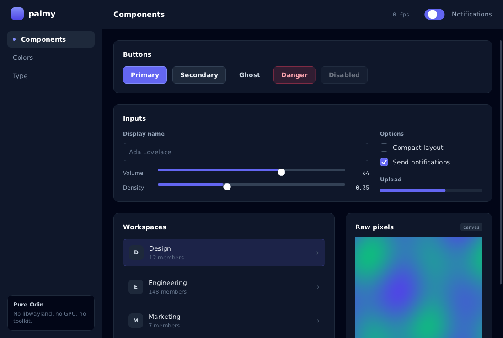

# Palmframe

An experiment in rethinking a Linux distribution for a machine where AI is
part of the system rather than a website you visit.

**palmy** is its UI toolkit, and what most of this README describes: written
from scratch in Odin, speaking Wayland and X11, both hand-rolled. Components
are procedures, styling is Tailwind class strings, and the result is pixels
written straight into the display server's shared memory.

The toolkit came first because the rest is not worth attempting on a stack you
cannot see the bottom of. What exists today is that toolkit and the
applications built on it — a window manager, a login manager, a file browser,
a mail client, an office suite, media players, a torrent client, a local-model
chat client, and others. The distribution and everything under *Where this is
going* below is a plan, not a shipped thing, and is written here so the
direction is on the record rather than implied.

```odin
for ui in palmy.frames(app) {
	palmy.div(ui, "flex-col items-center justify-center w-full h-full gap-4 bg-slate-950")
	defer palmy.end(ui)

	palmy.textf(ui, "text-5xl font-bold text-white", "%d", count)

	if palmy.button(ui, "Add one", "bg-indigo-500 hover:bg-indigo-400 border-indigo-400") {
		count += 1
	}
}
```



## What it is

`ldd` on a palmy binary:

```
linux-vdso.so.1
libm.so.6
libc.so.6
```

That is the whole dependency list. There is no libwayland, no GTK or Qt, no
GPU driver, no font library:

- **Both display protocols are implemented directly** — Wayland messages are
  encoded onto a unix socket by hand, with file descriptors passed in
  `SCM_RIGHTS` control messages; the X11 core protocol is framed on the same
  socket machinery, authenticated with a cookie read out of `~/.Xauthority`,
  and presents through MIT-SHM. There is no libwayland, no libX11 and no
  libxcb: `palmy/wire.odin`, `palmy/wayland.odin` and `palmy/x11.odin` are the
  entire client library.
- **Rendering is a software rasterizer** — antialiased rounded rectangles,
  borders, shadows, gradients and lines, computed from signed distance fields
  and written into the shared-memory buffer the compositor is about to show.
- **Layout is flexbox** — the subset that real interfaces use, following CSS
  closely enough that a browser is a reliable mental model.
- **Styling is Tailwind** — the class names you already know, resolving against
  the real Tailwind palette, generated from `tailwindcss@3.4.17`, so
  `bg-slate-900` is `#0f172a` here too.
- **Text is real TrueType** — glyphs are rasterized through stb_truetype from
  whatever font is installed, with kerning, word wrap, a slant axis, tabular
  figures, glyph outlines, colour-bitmap emoji and a glyph cache.

On Wayland it talks xdg-shell, follows HiDPI output scale, uses
`cursor-shape-v1` for pointer shapes, loads libxkbcommon at runtime for correct
keyboard layouts, and asks for server-side decorations when the compositor
offers them. On X11 it talks the core protocol: MIT-SHM for presentation with a
chunked `PutImage` fallback, `WM_PROTOCOLS`/`WM_DELETE_WINDOW` so a window
manager asks instead of killing the process, `WM_CLASS` carrying the same app
id, the cursor font for pointer shapes, and `GetKeyboardMapping` for layouts.

### Which backend

The same binary runs on either, and an application cannot tell which it is on:
the public API is identical and the rasterizer is shared, so a window and an
offscreen render of the same tree are the same pixels.

```
WAYLAND_DISPLAY set    ->  Wayland
otherwise DISPLAY set  ->  X11
PALMY_BACKEND=x11      ->  X11, whatever the environment says
PALMY_BACKEND=wayland  ->  Wayland, likewise
```

The override matters because a Wayland session with XWayland exports `DISPLAY`
too, so the environment alone cannot say "use X11". The one thing that does not
cross over is a layer surface: `Config.layer` needs `wlr-layer-shell`, which
X11 has no equivalent of, and `create` says so rather than opening an ordinary
window in the wrong place.

## Running it

```sh
make            # build every example into ./bin
make run-todo   # or run-counter, run-gallery, run-pixels
make test       # the headless test suite
```

Built and tested with Odin `dev-2026-09` on Hyprland; any compositor with
`xdg-shell` should work, as should any X server with a TrueColor screen.
`apps/tools/x11-selftest.sh` exercises the X11 backend end to end on a private
Xvfb — window, properties, pixels against the offscreen renderer, keyboard,
pointer, resize and the close handshake — without putting a window on your
screen.

| example | what it shows |
| --- | --- |
| `counter` | the smallest complete app |
| `todo`    | text entry, keyed lists, filtering, scrolling |
| `gallery` | every widget, the palette, the type scale |
| `pixels`  | the raw buffer, no UI layer at all |

## The idea

A frame is a procedure call. You describe what the interface *is* right now,
palmy works out what changed, and the loop blocks until something happens.

```odin
app, err := palmy.create({title = "Hello", width = 480, height = 320})
if err != "" { /* ... */ }
defer palmy.destroy(app)

for ui in palmy.frames(app) {
	// build the tree here
}
```

Elements nest with `div`/`end`, which pairs well with `defer`:

```odin
palmy.col(ui, "gap-4 p-6 bg-slate-900 rounded-xl border border-slate-800")
defer palmy.end(ui)

palmy.text(ui, "Settings", "text-sm font-semibold text-white")
palmy.text(ui, "These apply to every project.", "text-xs text-slate-500")
```

`div` is a plain box, `row` and `col` are the same thing with the direction
already set, and `text`/`textf` add runs of text.

### State

Odin has no closures, so palmy does not pretend otherwise: your state lives in
ordinary variables in the loop, or in a struct you pass down.

```odin
count := 0
for ui in palmy.frames(app) {
	if palmy.button(ui, "+") { count += 1 }
}
```

When a piece of state belongs to one element rather than to the program —
whether a disclosure is open, how far a panel has scrolled — `state` keeps it
alive between frames, keyed by position in the tree:

```odin
open := palmy.state(ui, "open", false)
if palmy.button(ui, "Details") { open^ = !open^ }
if open^ {
	palmy.text(ui, "...")
}
```

### Identity

Elements are identified by where they sit in the tree, so nothing needs naming
in the common case. Lists are the exception: `key` ties an element to the item
it is showing, so state follows the item when the list is reordered or filtered.

```odin
for task in tasks {
	palmy.key(ui, task.id_string)
	palmy.row(ui, "items-center gap-3 p-3 rounded-lg bg-slate-900")
	palmy.checkbox(ui, "", &task.done)
	palmy.text(ui, task.text, task.done ? "line-through text-slate-500" : "")
	palmy.end(ui)
}
```

### Interaction

Widgets return what happened. Any element becomes clickable with `clickable`:

```odin
palmy.div(ui, "p-4 rounded-xl bg-slate-900 hover:bg-slate-800 transition cursor-pointer")
if palmy.clickable(ui) {
	open(item)
}
palmy.text(ui, item.name)
palmy.end(ui)
```

Hit testing runs against the previous frame, which is what makes `hover:` and
`active:` work without a retained tree.

## Overlays, panels and launchers

A window is an `xdg-shell` toplevel by default. Set `layer` and palmy opens a
`wlr-layer-shell` surface instead — a surface the compositor places itself,
which is what a launcher, panel, bar or notification actually needs:

```odin
app, err := palmy.create({
	title = "launcher",
	width = 720, height = 520,
	layer          = true,
	layer_level    = .Overlay,    // .Background .Bottom .Top .Overlay
	layer_keyboard = .Exclusive,  // all key input comes here, like a launcher
})
```

Leave `width`/`height` at 0 to fill whatever the compositor gives you — that is
how a fullscreen greeter or a bar anchored to opposing edges asks for its size,
and the compositor answers with the real one in its configure.

Anchor it to edges to build a bar, and reserve space so other windows tile
around it:

```odin
layer_anchor   = {.Top, .Left, .Right},
exclusive_zone = 36,
layer_margin   = {8, 8, 0, 8},   // top, right, bottom, left
```

Requires a compositor implementing `zwlr_layer_shell_v1`, which the wlroots
family and Hyprland do. Everything else — layout, input, drawing — is identical
to an ordinary window.

## Drawing pixels

Two ways down to the buffer.

**A panel inside the layout.** `pixels` gives a procedure the element's
rectangle and the canvas, with your own data pointer threaded through:

```odin
palmy.pixels(ui, "flex-1 rounded-xl overflow-hidden", &scene,
	proc(c: ^palmy.Canvas, r: palmy.Rect, s: ^Scene) {
		for y in int(r.y) ..< int(r.y + r.h) {
			row := c.px[y * c.w:][:c.w]
			for x in int(r.x) ..< int(r.x + r.w) {
				row[x] = shade(x, y, s.t)
			}
		}
	})
```

**The whole window.** `direct_frames` skips the UI layer entirely and hands you
the buffer each vsync:

```odin
for c in palmy.direct_frames(app) {
	for y in 0 ..< c.h {
		for x in 0 ..< c.w {
			c.px[y * c.w + x] = plasma(x, y, palmy.app_elapsed(app))
		}
	}
}
```

Pixels are `0xffRRGGBB`. The rasterizer is available in both cases:
`fill_rect`, `fill_round_rect`, `stroke_round_rect`, `drop_shadow`,
`fill_circle`, `draw_line`, `draw_text`, `blit_mask`, plus `push_clip` and
`pop_clip`, and `blend` for a single antialiased pixel.

## Classes

Utilities are applied in order, so later ones win and your classes always beat
a widget's defaults. Variants `hover:`, `active:`, `focus:` and `disabled:`
apply when the element is in that state.

| group | supported |
| --- | --- |
| layout | `flex-row` `flex-col` `flex-wrap` `items-*` `justify-*` `self-*` `gap-*` `gap-x-*` `gap-y-*` `hidden` `relative` `absolute` `inset-0` `top/right/bottom/left-*` `z-*` |
| sizing | `w-*` `h-*` `size-*` `w-full` `h-full` `w-screen` `w-1/2` `min-w-*` `max-w-*` `min-h-*` `max-h-*` `basis-*` `flex-1` `flex-auto` `flex-none` `grow` `grow-0` `shrink` `shrink-0` |
| spacing | `p-*` `px-*` `py-*` `pt/pr/pb/pl-*`, the same for `m-*`, `mx-auto` |
| color | `bg-*` `text-*` `border-*`, `bg-gradient-to-b` with `from-*`/`to-*`, opacity suffixes like `bg-white/10`, arbitrary values like `bg-[#1e293b]` |
| border | `border` `border-2` `border-t-2` `rounded` `rounded-lg` `rounded-full` `rounded-t-xl` `rounded-[10]` |
| text | `text-xs` … `text-9xl` `font-bold` `font-mono` `italic` `not-italic` `tabular-nums` `text-center` `leading-*` `tracking-*` `uppercase` `truncate` `whitespace-nowrap` `line-through` `underline` `text-outline-2` `text-outline-black` |
| effects | `shadow` `shadow-sm` … `shadow-2xl` `opacity-*` `transition` `duration-*` |
| overflow | `overflow-hidden` `overflow-scroll` |
| cursor | `cursor-pointer` `cursor-text` `cursor-crosshair` `cursor-grab` … |

Spacing follows Tailwind's scale (`p-4` is 16px, `p-0.5` is 2px, `p-px` is 1px)
and anything in brackets is exact pixels (`w-[260]`).

`transition` eases background, text and border colors toward their target, so
`hover:` states fade rather than snap. Only the frames that are actually
animating get drawn.

### Type features

`italic` is a real axis, not a heavier weight: discovery looks for `*-Italic`
and `*-Oblique` files alongside the upright ones, and an italic request with no
italic file on the machine falls back to a real italic at a neighbouring weight
before it will settle for a sheared upright. `palmy.font_is_synthetic` says
which you got, and `palmy.use_synthetic_italic` forces the shear — which is
what you want after swapping the primaries for a family that ships no italic,
since a sheared Geist still reads as Geist.

`tabular-nums` gives every digit the same advance, so a clock, a byte counter
or a rate readout stops moving sideways as its digits change. There is no GSUB
here to select the font's own `tnum` feature, so the slot is measured instead:
the widest of the ten digits at that exact size, with each glyph centred in it.
`text_width`, `draw_text` and `text_index_at` all apply it, so carets and
centred labels stay where the glyphs are.

`text-outline-2 text-outline-black` strokes every glyph, which is what a
subtitle needs over a moving frame. The stroke is the glyph's own coverage mask
dilated by the radius and cached, not the run drawn again at offsets, so it
costs one rasterisation and the joins are round.

Colour emoji come from `NotoColorEmoji` and its kin, which have no outlines at
all — their glyphs are PNGs in the `CBDT`/`CBLC` tables. palmy reads those
tables directly, box-filters each strike down to the text size once and caches
it. A codepoint that defaults to the emoji presentation, or is followed by
U+FE0F, goes to the colour font ahead of the outline fallbacks; one that
defaults to text (`☀`, `❤`, `✔`) keeps its text glyph.

When a class cannot express something, reach for the style directly:

```odin
palmy.div(ui, "h-8 rounded-md")
palmy.style(ui).bg = palmy.flat(swatch)
palmy.end(ui)
```

## Widgets

`button`, `checkbox`, `toggle`, `slider`, `progress`, `text_field`, `spacer`,
`divider`, `pixels`. Each takes a class string that overrides its defaults, and
each is a few dozen lines built on the same primitives you have — they are a
starting point, not a framework.

```odin
changed, submitted := palmy.text_field(ui, &buf, "What needs doing?")
palmy.slider(ui, &volume, 0, 100)
palmy.toggle(ui, &enabled)
```

Keyboard handling comes with them: Tab cycles focus, Space and Enter activate,
text fields support arrows, Home/End, Backspace, Delete and Ctrl-A/E/U, with
key repeat at the compositor's configured rate.

## Testing and offscreen rendering

The whole UI runs without a compositor, which is how palmy tests itself:

```odin
off := palmy.offscreen_create(800, 600)
defer palmy.offscreen_destroy(off)

ui := palmy.offscreen_begin(off)
palmy.text(ui, "Hello", "text-2xl font-bold")
palmy.offscreen_end(off)

palmy.offscreen_write_png(off, "shot.png")
```

Input can be driven synthetically — `move_pointer`, `press`, `release`,
`scroll_by`, `type_text`, `press_key` — and `node_rect` reports where anything
landed, so layout and interaction are both assertable:

```odin
at := palmy.node_count(ui)
palmy.button(ui, "Save")
// after the frame:
r := palmy.node_rect(ui, at)
```

`make shots` uses the same path to render the images in this README.

## How it works

**The socket.** `conn_open` connects to `$XDG_RUNTIME_DIR/$WAYLAND_DISPLAY`.
Requests are built into a byte buffer — object id, opcode and size packed into
two words, then arguments — and flushed with `sendmsg`. File descriptors, such
as the shared-memory pool, ride along in an `SCM_RIGHTS` control message.
Events arrive the same way and are dispatched by looking up the interface each
object id was created with. Object ids are only recycled once the server
confirms with `wl_display.delete_id`.

**The buffers.** One `memfd` holds two frames, mapped into the process and
shared with the compositor through `wl_shm`. Drawing goes into whichever buffer
is not currently on screen; `wl_buffer.release` says when one is free again.

**The loop.** Each frame requests a `wl_surface.frame` callback, so drawing is
paced to the display. The loop then blocks in `poll` until there is a reason to
draw: input, a resize, a running transition, or an explicit `redraw`. An idle
palmy window uses no CPU at all.

**The frame.** Elements are appended to a flat array as you call `div` and
`text`. Two arrays are kept, this frame's and the last, so hit testing and
scrolling can run against real geometry before the new tree exists. All
per-frame allocation goes into an arena that is reset, not freed.

**Layout** measures the tree with the space available, then arranges it,
resolving grow, shrink, wrapping, justification and alignment. Flex items get
CSS's automatic minimum size, so a scrolling column overflows instead of
squashing its contents.

**Paint** walks the tree in order: shadow, background, border, content,
children, scrollbar. Shapes are evaluated through a signed distance field at
the edges and filled with flat spans in the middle, so a full-window panel
costs about what a memset costs.

## What is not here

Honest limitations, not a roadmap:

- Linux only. No macOS, no Windows.
- The X11 backend needs a little-endian, 32-bits-per-pixel TrueColor screen —
  every desktop X server since the 1990s, but it checks and says so rather than
  drawing garbage. It does not follow output scale (X11 has no protocol for
  it), has no layer-shell equivalent, and asks the window manager for
  fullscreen through `_NET_WM_STATE` rather than being able to insist.
- Software rendering. Fine for interfaces at any size; a per-pixel effect over
  a 4K window is CPU work and will show it.
- One window per process. No popups, menus or tooltips — `xdg_popup` is not
  implemented, so anything overlaying is drawn inside the window.
- No clipboard, drag and drop, or input methods. No preedit, so CJK input will
  not work.
- Text is laid out left to right with simple word wrapping. No bidi and no
  complex shaping: missing glyphs come from a fallback chain, but there is no
  GSUB, so Arabic and Indic scripts are unjoined and emoji ZWJ sequences render
  as their parts rather than as one glyph.
- Integer output scale only; no fractional scaling protocol.
- Flexbox, not grid. No `align-content` for multi-line, no `min-content` or
  `max-content` keywords, no media queries.
- Grayscale antialiasing, no subpixel rendering.

## Measured against a browser

`parity/` holds a test rig that renders all 61 shadcn/ui components twice — once
by Chromium from the real React source, once by palmy — and reports the
difference per component. It is how the font metrics, the subpixel glyph
positioning, the linear-light coverage blending and the design-token system in
this library were calibrated: each one was a measurement, not a guess.

At the time of writing, geometry (size, padding, radius, colour) matches
exactly on every implemented case, and the median pixel error is around 3/255 —
the remainder being glyph antialiasing, which cannot reach zero against a hinted
FreeType rasterizer. See `parity/README.md`.

## Where this is going

Everything in this section is a plan. None of it is built, and saying so
plainly is the point: the toolkit above is measured against a browser and has
a test suite, and this does not yet.

### A distribution where AI is part of the system

The assistant on most machines today is a browser tab. It cannot see your
files, cannot act on your mail, and forgets you between sessions — so the work
of connecting it to your life falls to you, by copying and pasting. The
alternative usually offered is worse: hand everything to one vendor and hope.

Palmframe is an attempt at a third shape. A model runs locally, as a user
process, and the system's own applications are built to be addressed by it —
the mail client, the file browser, the calendar, the notes. `apps/ai` and
`apps/chatbot` are the first two pieces of that: a local-model client, and a
model that joins a chat channel as a participant. Both talk to a loopback
address and nothing else.

The design constraint that makes this interesting is *scope*. An assistant
that can read your work mail should not silently also read your personal mail,
and the way to guarantee that is not to ask it nicely.

### One account, several identities

A person is not one identity. There is the work self, the personal self, the
one that deals with public-facing accounts, sometimes one for a side project
or a company. Today each lives in a separate browser profile, a separate mail
client, a separate password store, and the separation is entirely manual — it
holds right up until you paste the wrong thing into the wrong window.

The plan is a single Palmframe account that owns several **sub-identities**,
each with its own mail, files, credentials, browsing state, and its own
assistant scope. Switching between them is a first-class operation, not a
matter of remembering which window you are in. They can be **explicitly
linked** where that is useful — the same person, with the same calendar
availability across work and personal, able to move a file deliberately from
one to another — and the link is explicit and auditable rather than ambient.

### The cloud part

Supabase is the intended backend: Postgres, auth, storage and row-level
security. The last of those is the load-bearing piece, because separation
between identities has to be **enforced by the database**, not by which panel
the file browser happens to be showing. A boundary that exists only in the
interface is not a boundary; it is a convention, and conventions fail at
exactly the moment they matter.

Files sync rather than live remotely — local-first, so the machine works
unplugged and the cloud is where state converges, not where it is held
hostage.

### The parts that are genuinely hard

Three tensions are worth naming now rather than discovering later.

**A single account is a single point of compromise.** Consolidating a person's
computing life into one login makes that login the most valuable credential
they own. The standard to meet is a written threat model that states what is
and is not protected — an attacker with the stored data and no password is a
very different adversary from one who can read process memory — and an answer
to *what happens when this is phished?* that is not a shrug.

**Server-side AI and end-to-end encryption pull against each other.** If a
model runs on a server and reasons over your mail, the server can read your
mail — that is not a policy choice, it is arithmetic. Local models avoid it
entirely, which is why the local one came first; anything that moves to a
server has to be honest about which of the two it gave up.

**Identity separation is easy to claim and hard to prove.** The useful version
is testable: an assistant scoped to one identity, asked for something from
another, should fail — and there should be an assertion somewhere that says so
and runs. That is the standard the rest of this repo is held to, and it is the
one that matters most here.

## Layout of the source

| file | |
| --- | --- |
| `wire.odin` | the shared socket: framing, Wayland encoding, fd passing |
| `window.odin` | the backend seam: geometry, the pixel store, input, controls |
| `wayland.odin` | registry, surfaces, shm pool, xdg-shell, layer-shell, seat |
| `x11.odin` | X11 core protocol: setup, window, MIT-SHM, events, cursors |
| `xauth.odin` | `~/.Xauthority` parsing for MIT-MAGIC-COOKIE-1 |
| `xkb.odin` | keymaps: libxkbcommon on Wayland, GetKeyboardMapping on X11 |
| `canvas.odin` | the rasterizer |
| `font.odin` | font discovery, the family x weight x slant axes, glyph cache, measurement, drawing |
| `outline.odin` | dilating a glyph's coverage mask, for stroked text |
| `emoji.odin` | CBDT/CBLC colour bitmaps, which no vector rasterizer can draw |
| `color.odin`, `palette.odin` | colors and the Tailwind palette |
| `class.odin` | the class parser |
| `node.odin` | the element tree, identity, state |
| `layout.odin` | flexbox |
| `paint.odin` | tree to pixels |
| `app.odin` | the frame loop, hit testing, input routing |
| `widgets.odin` | the widget set |
| `offscreen.odin` | rendering and input without a compositor |
| `icon.odin` | SVG path parsing and stroking, for line icons |
| `theme.odin` | design tokens, so class names can follow a design system |
