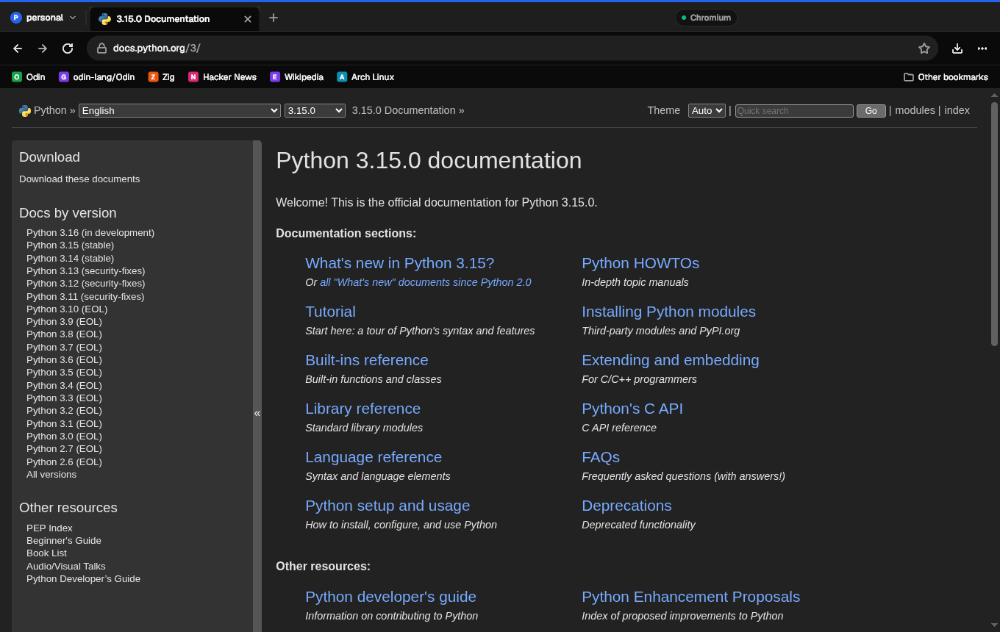
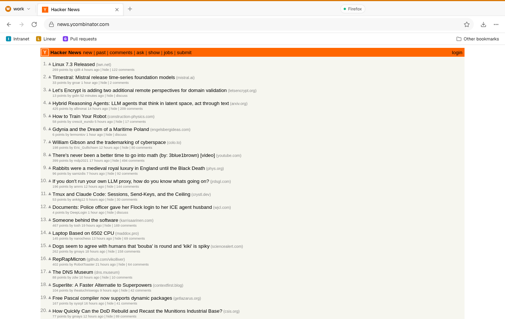
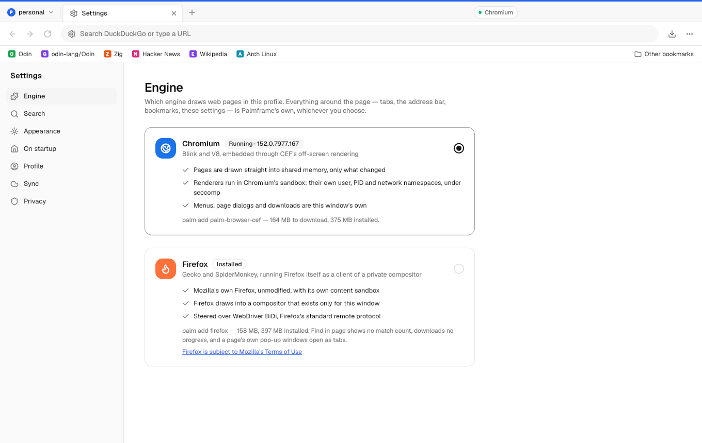

# The browser: Palmframe's chrome, Chromium's or Firefox's engine

`apps/browser` is a web browser whose chrome — tabs, the address bar and its
suggestions, the bookmarks bar and manager, history, downloads, the new-tab
page, settings, menus and page dialogs — is palmy + shadcn, and whose pages
are drawn by an engine the person chooses per profile: **Chromium** (Blink,
through CEF) or **Firefox** (Gecko, Firefox itself). Each Palmframe identity
has its own profile, so cookies and storage never cross between identities,
and bookmarks are stored in a shape designed to sync, with a working sync
through the account (`browser_bookmarks`, scoped by `can_access_identity`).

Everything below that says *measured* or *observed* was run on the build host
(Arch, Hyprland, 16 cores) on 2026-10-19 against CEF 152.0.14 (Chromium
152.0.7977.167) and Firefox 158.0. Nothing has run on Palmframe in QEMU yet;
the closest is the engine packages running in a root holding nothing but
glibc (see *Packaging*).



## What works, in one table

| | Chromium (CEF) | Firefox |
| --- | --- | --- |
| Pages render inside the chrome | yes, damage rectangles | yes, Wayland damage |
| Keyboard into pages, any character | yes | yes (generated keymap) |
| Mouse, wheel, double click | yes (not testable on the headless seat) | yes (same) |
| `<select>`, autocomplete popups | yes (composited by the host) | yes (real `xdg_popup` in our compositor) |
| Tabs, back/forward, reload, stop | yes | yes (history tracked by the host; the Navigation API when Firefox reports it) |
| Title, URL, favicon, load progress | yes | yes (preload script + BiDi events; progress is three steps) |
| Hovered-link status bubble | yes | yes (preload script) |
| Context menu | shadcn menu from the engine's params | shadcn menu from a preload `contextmenu` hook |
| `alert` / `confirm` / `prompt` / leave-page | shadcn dialog | Firefox's own tab-modal dialog, inside the page |
| Downloads | yes, with progress and cancel | yes, start and end only (BiDi has no progress) |
| Find in page | yes, with counts | `window.find`, no counts |
| Zoom | yes | `setViewport` device-pixel ratio |
| Copy / paste with the system clipboard | through the chrome (selection events, insert-text) | same |
| `target=_blank` / `window.open` | becomes a chrome tab | becomes a chrome tab (no `opener`) |
| prefers-color-scheme follows the chrome | yes (DevTools emulation) | yes, read at engine start |
| Sandbox | Chromium's: user, PID and net namespaces + seccomp (observed) | Firefox's own content sandbox |
| Runs headless (screenshots, tests) | yes | yes |

## Research

### Chromium: CEF off-screen rendering

The [Chromium Embedded Framework](https://bitbucket.org/chromiumembedded/cef)
is the maintained way to embed Blink. Its **windowless (off-screen)
rendering** mode is exactly the shape a CPU-composited toolkit wants:
`CefRenderHandler::OnPaint` hands over a BGRA buffer of the whole view plus
the dirty rectangles; `CefBrowserHost::SendMouseClickEvent`,
`SendMouseMoveEvent`, `SendMouseWheelEvent` and `SendKeyEvent` take input;
`<select>` dropdowns arrive as a separate `PET_POPUP` paint the embedder
composites. Everything else a browser needs is a handler: display (title,
URL, favicon URLs, status, cursor, progress), load (state, errors), life span
(popups, close), JS dialogs, downloads, context menus, find, renderer crashes.

- **Builds.** Spotify's CDN publishes Linux x64 builds per Chromium release,
  with an SHA-1 per file (`https://cef-builds.spotifycdn.com/index.json`).
  Current stable: 152.0.14+g8a0b5b9 (Chromium 152.0.7977.167); beta 156.
  The "minimal" distribution is 321 MB compressed. Its `libcef.so` is
  1.4 GB with symbols, **268 MB stripped** (82 MB zstd).
- **Licence.** CEF is BSD-3; Chromium is BSD-3 plus a long tail of
  third-party licences (`CREDITS.html` in the distribution). Shippable.
- **C API.** `include/capi/*_capi.h`, versioned since CEF 133:
  `cef_api_hash(CEF_API_VERSION, 0)` must be called first and the headers
  compiled with `CEF_API_VERSION=15200`. Structs of function pointers with
  manual reference counting (a callee releases every object it is handed).
  Usable from Odin by `foreign import`, but the structs are large and their
  layout changes between versions; the host is therefore written in C
  (`apps/browser/engine/cef/host.c`, ~1,800 lines) so the compiler lays the
  structs out, and Odin talks to it over a socket.
- **Process model.** Browser, GPU, network utility, zygotes and renderers.
  The host binary is its own subprocess: `cef_execute_process()` at the top
  of `main` runs the child roles. On Linux the renderers are forked from a
  sandboxed zygote.
- **Sandbox.** User namespaces when the kernel allows unprivileged ones,
  otherwise the setuid `chrome-sandbox`. Palmframe's kernel has
  `CONFIG_USER_NS`, `PID_NS`, `NET_NS` and `SECCOMP_FILTER`
  (`distro/out/kernel.config`), so the package ships no setuid helper.
  Observed on the host: renderers run with `Seccomp: 2` in their own user,
  PID and network namespaces.
- **Without a display.** `--ozone-platform=headless` keeps Chromium off X11
  and Wayland entirely; the view is pure memory. That is also why the chrome
  can take real screenshots with no compositor.
- **Two traps found the hard way.** (1) On a new profile, Chromium's
  first-run code shows an EULA dialog in a nested message loop; with no
  window system it never appears and `cef_initialize` never returns
  (found with gdb against the unstripped library: `ShowEulaDialog` under
  `PreMainMessageLoopRun`). `--no-first-run` fixes it. (2) A parent that
  starts the host with stdin closed gets its socket on fd 0, which Chromium
  re-points at `/dev/null`; the host fills fds 0–2 first.
- **Runtime needs on a glibc-only system** (found by running the package in a
  `bwrap` root with nothing but glibc, fonts and the package): NSS, NSPR,
  GLib, ATK/AT-SPI, cups, D-Bus, the X11/XCB client libraries, libdrm/libgbm,
  expat, cairo, pango, HarfBuzz, FreeType, fontconfig, udev, ALSA, gnutls —
  68 libraries from `ldd` — plus four NSS loads with `dlopen` that `ldd`
  cannot see: `libsoftokn3`, `libfreeblpriv3`, `libnssckbi` and
  **`libsqlite3`** (without it Chromium aborts in `nss_util.cc`). TLS works
  without system CA certificates: Chromium uses its own root store.

### Gecko: no embedding API, so embed Firefox

| Option | Verdict |
| --- | --- |
| **GeckoView** | Android only. No desktop port. |
| **EmbedLite** (Sailfish) | A fork of Gecko maintained by Jolla for Sailfish's Qt browser; years behind Firefox, tied to Qt. Not credible. |
| **XULRunner / `browser.xhtml` replacement** | XULRunner is gone; replacing Firefox's chrome document means shipping a modified Firefox build (or `omni.ja`), rebased every release, and the chrome would be XUL/HTML, not palmy. |
| **userChrome.css + enterprise policies** | Hides Firefox's chrome but the chrome you see is still Firefox's; nothing of ours. |
| **Headless Firefox + BiDi/Marionette screencast** (`captureScreenshot` per frame) | PNG per frame, no damage, tens of ms each: a slideshow. Input through `input.performActions` works but is synthetic. |
| **Firefox as a Wayland client of a private compositor + WebDriver BiDi** | **Chosen.** Firefox draws real `wl_shm` buffers with real damage; input is a real seat with real serials, so its own popups work; BiDi is Mozilla's supported remote protocol for navigation and events. |
| **Servo** | Embeddable, but as a Rust crate with no C API, and it renders through OpenGL/wgpu — llvmpipe on Palmframe. A third backend later, not a Gecko substitute. |
| **WebKit (WPE)**, **Ladybird**, **NetSurf** | Not asked for here; covered in `distro/notes/browser.md`. WPE's view backend is the next most interesting embedding target. |

How the chosen Gecko path works (`apps/browser/engine/gecko/`, ~3,200 lines of
Odin, run as `browser --gecko-host`):

- **A compositor per window.** The host listens on
  `$XDG_RUNTIME_DIR/palm-gecko-<pid>` and starts Firefox with
  `WAYLAND_DISPLAY` pointing there. It implements what Firefox 158 and GTK 3
  need and nothing more: `wl_compositor` 5, `wl_subcompositor`, `wl_shm`,
  `wl_seat` 7, `wl_output` 4, `xdg_wm_base` 3 with toplevels, **popups and a
  real positioner** (anchor, gravity, offset, flip, slide), a stubbed data
  device and `cursor-shape-v1`. Firefox's page content is a desync
  subsurface over its toplevel; the host composites toplevel, subsurfaces and
  popups into the view and ships damage to the chrome the same way the CEF
  host does. Firefox redraws on frame callbacks, so callbacks are paced to
  60 Hz and to the chrome's acknowledgements — without that it spins.
- **The keyboard is generated.** The chrome sends keysyms, Wayland clients
  want key codes through a keymap; the host writes an XKB keymap in which
  every keysym it is asked to type has a key code of its own, extending it
  and sending it again when a new one appears (the `wtype` technique). Any
  character in any script types correctly.
- **Steering** over `ws://127.0.0.1:<port>/session` (WebDriver BiDi):
  `browsingContext.create/navigate/traverseHistory/reload/activate/close`,
  events `navigationStarted/load/domContentLoaded/historyUpdated/
  contextDestroyed/downloadWillBegin/downloadEnd`, and a **preload script**
  (`script.addPreloadScript` with a channel) that reports the title, the
  favicon (as a PNG data URL), hovered links, the selection, and the
  context-menu target, and suppresses Firefox's own context menu.
- **Kiosk mode** removes Firefox's chrome. Two traps: Firefox focuses its
  hidden address bar on blank windows, so typed text went into it — the host
  starts Firefox on a non-blank page and, when `document.hasFocus()` is false,
  sends F6 (Firefox's own toolbar↔page focus key); and the Terms of Use
  modal on a new profile is turned off with Mozilla's
  `termsofuse.bypassNotification` pref, with a link to Mozilla's terms beside
  the engine choice in Settings.
- **Firefox's probe connection.** Firefox connects once, disconnects, then
  connects for real (and opens short-lived extra connections); the host
  serves several clients and treats only the process exiting as a crash.

## Architecture

```
 apps/browser (Odin, palmy + shadcn; ldd: libc, libm)
 ├─ chrome: tabs · omnibox · bookmarks bar · palm:// pages · menus · dialogs
 ├─ store: bookmarks.json (sync-ready) · history.jsonl · settings · session
 ├─ sync: apps/cloudkit → browser_merge_bookmarks / browser_bookmarks
 └─ Engine ── engine protocol over a Unix socket (engine/proto.h, pb/) ──┐
                                                                         │
   palm-browser-cef (C, links libcef)            browser --gecko-host (Odin)
   CEF off-screen views → memfd buffers          private Wayland compositor
                                                 + WebDriver BiDi client
                                                         │
                                                  firefox --kiosk (unmodified)
```

**One process per window per engine**, started with the identity's profile
directory and nothing else. The chrome never links an engine: a crashing
renderer or a hung Firefox cannot take the window with it (it shows a
"This page stopped working" page and offers a reload), and the chrome binary
keeps the README's promise — `ldd` shows libc and libm.

### The engine interface

`apps/browser/engine.odin` is the whole interface the rest of the browser
uses; the protocol in `engine/proto.h` is its wire form, mirrored in
`pb/proto.odin` and round-tripped by the self-test:

```
engine_create(e, view, w, h, scale, url)     engine_close(e, view)
engine_navigate(e, view, url)                engine_back / engine_forward
engine_reload(e, view, bypass_cache)         engine_stop_loading
engine_resize(e, view, w, h, scale)          engine_show / engine_focus
engine_mouse(e, view, kind, button, clicks, mods, x, y)
engine_wheel(e, view, mods, x, y, dx, dy)    engine_key(e, view, kind, mods, keysym, codepoint)
engine_zoom · engine_find · engine_edit (undo/cut/copy/paste/select-all/insert)
engine_dialog_reply · engine_menu_reply · engine_download_cancel · engine_theme
engine_drain(e, &events)  →  Title Url Favicon Load Progress Cursor Status
                             Open_Tab Dialog Menu Download Find_Result
                             Load_Error Crashed Closed Selection Ready
```

**Frames** never touch the UI thread on the way in. The host owns a memfd
per view and sends it once (`BUFFER`, the fd in `SCM_RIGHTS`); each `FRAME`
lists damaged rectangles in device pixels, `0xAARRGGBB` like palmy's own
canvas. The chrome's reader thread copies those rows into the view's own
pixels under a lock, answers `FRAME_ACK` at once and wakes the window; the
host does not touch the buffer until the ack, and accumulates damage
meanwhile. One frame in flight, no tearing, no locks across processes. The
window's `pixels` element blits rows; while a resize is in flight the
uncovered edge is white.

An in-process engine (a Servo or WPE binding) would implement the same
calls with a different transport; nothing else in the browser would change.

### Identity-aware profiles

`$XDG_DATA_HOME/palmframe/browser/<identity>/` holds `settings.json`
(engine, search, theme, bar, session restore, device id), `bookmarks.json`,
`history.jsonl`, `downloads.json`, `session.json`, and each engine's own
profile (`cef/`, `gecko/`). The identity is `--identity`, else
`$PALM_IDENTITY`, else `personal`; names are validated so they cannot walk
out of the directory. One window per identity owns a control socket
(`palm-browser-<identity>.ctl`): a second `browser example.com` hands the URL
to it. The window carries the identity's colour as a band across the top and
a chip before the tabs; the chip's menu opens a window as another identity.
Colours come from `~/.config/palmframe/identities.json` when apps/accounts
writes one, and otherwise from fixed defaults (personal blue, work amber).



### Engine choice

Settings → Engine shows both engines as cards: what each is, whether it is
installed, the version running, its limits, and (Firefox) Mozilla's terms.
The choice is per profile and remembered in `settings.json`; it takes effect
at the next start, and the page offers **Restart now**, which saves the
session and relaunches the window (tabs come back, loading lazily when first
shown). Cookies and site data belong to each engine and are not carried
across a switch. `browser engine firefox` does the same from the command
line, and the tab strip always shows which engine is drawing.



## Security

- **The chrome never parses web content.** It receives pixels and a handful
  of strings (titles, URLs, link targets, selections), all treated as text.
  Internal pages (`palm://…`) are drawn by palmy; no web page can script
  them: no engine knows a `palm://` scheme, so a page linking there gets an
  error, never the page.
- **Chromium**: namespace sandbox + seccomp for renderers (observed), no
  setuid helper shipped; `PALM_BROWSER_NO_SANDBOX=1` turns it off and the host
  says so in its log. Passwords use Chromium's `basic` store (no keyring on
  Palmframe), i.e. obfuscated, not encrypted against a local attacker. No
  session bus is used.
- **Firefox**: its own content sandbox; the compositor it talks to exists
  only for this window, so Firefox sees no other client and no real seat.
  BiDi listens on 127.0.0.1 on a random port for the life of the window.
  Any local process that finds the port could drive that Firefox — the same
  exposure as any `--remote-debugging-port`; a Unix-socket transport for BiDi
  is not available in Firefox. `navigator.webdriver` is true while BiDi is
  active, which some sites use to refuse automation — a real fidelity cost.
- **Profiles are directories**, one per identity, and the engine is started
  with that directory only.
- **Sync** goes through a session scoped to the profile's identity; the
  database refuses other identities' rows (tested, below).

## Bookmarks, designed to sync — and syncing

`apps/browser/bookmarks.odin`:

- **Stable UUIDs** for every bookmark, folder and separator; the two roots
  have fixed UUIDs so every device agrees on the toolbar.
- **Three hybrid logical clocks per record**: `content_clock` (title, url),
  `place_clock` (parent, position), `life_clock` (deleted). A merge keeps,
  per group, the larger clock — so a rename on one device and a move on
  another both survive. A clock is `<ms:13>-<counter:4 hex>-<device>`: it
  sorts as a string, never goes backwards on one device (the counter carries
  it past a wall clock that stepped back), and the device id breaks ties.
- **Tombstones** (`deleted` + `life_clock`), so deletes propagate and a later
  undelete wins over them.
- **Fractional positions** (base-62 keys between neighbours): an insert is
  one record, not a renumbering, so concurrent inserts both stay.
- **Read-time repair**: a record whose folder was deleted elsewhere is shown
  under Other Bookmarks if it was moved there after the delete, and hidden
  with the folder otherwise; a cycle from two concurrent moves is shown under
  Other Bookmarks.

The self-test checks the merge is commutative, associative and idempotent,
that both concurrent edits survive, and the tombstone, undelete, orphan and
cycle rules.

History is an append-only JSON-lines log; visits are a grow-only set keyed
by UUID with "forget" tombstones, so it is mergeable too — but it does not
sync, and the History page says so.

### The table

`cloud/supabase/migrations/20261019400000_browser_bookmarks.sql`:
`browser_bookmarks (identity_id, id, kind, parent_id, position, title, url,
created_at, deleted, content_clock, place_clock, life_clock, seq,
updated_at)`, primary key `(identity_id, id)`, RLS through
`can_access_identity(identity_id)` for select, insert and update; no delete
(tombstones are kept; `delete`/`truncate` are revoked so they are refused
rather than filtered to nothing), nothing for `anon`. A server `seq`
(sequence, bumped on every write) is what devices pull past, so no one's
wall clock is trusted. `browser_merge_bookmarks(target, items jsonb)` does
the per-group merge in one `insert … on conflict do update` with
`greatest()` per clock, skips rows that bring nothing newer (no new seq), and
runs as the caller so RLS applies.

`cloud/supabase/tests/browser_bookmarks.sql` (27 assertions, passing on
`cloud/dev` with the accounts and mail suites, 145/145): a session scoped to
Alice's personal identity sees only its rows, nothing of her work identity
or of Bob's; merging, inserting, updating or moving rows into either is
refused; unscoped Alice sees both of hers and none of Bob's; anon reads
nothing; and the merge rule holds in the database (rename + concurrent move
both kept, old records are no-ops, tombstone then undelete, malformed clocks
rejected).

### The client

apps/cloudkit landed while this was being built, so sync is implemented
(`apps/browser/sync.odin`): push everything changed since the last push
through `browser_merge_bookmarks`, then pull every row past the last `seq`
and merge locally. Both halves are idempotent. The session is cloudkit's
scoped session for the profile's identity (`PALM_IDENTITY=<handle>`); the
browser profile name is the identity's handle. `browser sync`,
`browser sync-status`, and Settings → Sync (a switch and "Sync now").

`apps/browser/sync-e2e.sh` runs two "devices" (two browser homes) against
`cloud/dev` with a real account and two identities — 30/30: push and pull,
a rename on one device and a move on the other both kept, a tombstone
reaching the other device, and the work profile seeing none of the personal
bookmarks. It does not sync on a timer yet: the window syncs when asked and
when the switch is turned on.

## Packaging, honestly

| Package | Built by | Download | Installed | Notes |
| --- | --- | --- | --- | --- |
| `browser` | `make -C distro` (generated recipe) | — | 1.9 MB | the chrome and the Firefox host; libc + libm |
| `palm-browser-cef` | `distro/recipes/palm-browser-cef/build.sh` | 164 MB `.palm` (from a 321 MB CEF download) | 375 MB | libcef 256 MB stripped, resources + locales 83 MB, 71 bundled host libraries ~30 MB |
| `firefox` | `distro/recipes/firefox/build.sh` | 158 MB `.palm` (from a 91 MB tarball) | 397 MB | Mozilla's tarball 326 MB + 73 bundled system libraries 72 MB in `syslib/` |

The two engine recipes live one directory down (`…/package/PALMBUILD`) so the
image build's `recipes/*/PALMBUILD` glob does not try to pack them without
their downloads; their build scripts pin the upstream file (SHA-1 for CEF as
the CDN publishes, SHA-256 for Firefox from Mozilla's `SHA256SUMS`), build or
unpack, copy the library closure from the build host into a directory of the
package's own (the same "from the build host" rule as glibc), and run
`palm build`. Both were run, both `.palm` files were written, and both
engines rendered `https://example.com` in a `bwrap` root holding only glibc,
`libxkbcommon`, xkeyboard-config, the fonts package's files and the package —
which is how the dlopen'ed NSS/SQLite libraries and a fontconfig file with
an XML comment error were found.

What the distribution still has to provide or decide:

- **Fonts.** Base fonts are Geist, JetBrains Mono and DejaVu Sans; CJK pages
  show boxes until `fonts-cjk` is installed. There is no `/etc/fonts`, so each
  engine package carries a `fonts.conf` (aliases from the web's usual family
  names onto the installed ones) used only when the system has none.
- **CA certificates**: not needed by either engine (Chromium's root store,
  Firefox's NSS roots).
- **Sound**: none (ALSA library bundled, no server).
- **GPU**: none needed; `--disable-gpu` for CEF, software WebRender for
  Firefox. WebGL falls back to SwiftShader (CEF) or is off.
- **A session bus** is not needed; `/etc/machine-id` is absent and Firefox
  only warns.
- **Locales**: CEF ships 220 locale packs (50 MB); trimming to the
  installer's five languages would save ~45 MB.
- **The window manager**: the chrome is an ordinary palmy window and needs
  nothing new from `apps/wm`. Running Firefox or Chromium *directly* on the wm
  still waits on `xdg_popup` (the wm work in progress); the browser does not,
  because its compositor for Firefox is its own.
- **Launcher entry**: `distro/apps/desktop/browser.desktop` does not exist yet
  (not this work's directory).

## Measurements

| | Chromium | Firefox |
| --- | --- | --- |
| Start → loaded example.com screenshot, new profile | 1.5 s | 3.0 s |
| … existing profile | 1.2 s | 2.4 s |
| PSS, chrome + engine, one Wikipedia article (offscreen) | 513 MB, 11 processes | 836 MB, 15 processes |
| Frames to settle example.com | 2–3 | 120–300 (Firefox repaints while loading) |

## Testing

- `browser --selftest` — 660 checks: protocol round-trips (and a truncated
  frame refused), fractional keys, the merge laws, tree repair rules, history
  tombstones, omnibox input resolution, Netscape import/export, every
  internal page rendered offscreen, tab bookkeeping, and **both engines
  rendering a real page whose background colour is then found in the
  window's pixels** (skipped per engine when not installed).
- `apps/browser/sync-e2e.sh` — sync against `cloud/dev`, 30/30.
- `cloud/dev/test.sh` — `browser_bookmarks.sql` 27/27.
- `browser shot OUT.png URL [--engine] [--theme dark] [--omnibox TEXT]
  [--overlay menu|identity|bookmark|downloads|shortcuts]` — the window
  offscreen, with a real engine. `apps/browser/shots/` was made with it.
- `apps/browser/demo.mp4` (Chromium) and `demo-firefox.mp4` (Firefox),
  recorded keyboard-only with `apps/tools/headless-record.sh` from
  `apps/browser/demo.txt`: navigation, the omnibox, Ctrl+D, a `<select>`
  popup opened and chosen from the keyboard, an `alert()`, the bookmarks
  manager, history, settings and the shortcuts sheet.

Not tested: pointer input on a real seat (the headless seat has no pointer —
clicks into pages are wired but unverified), QEMU, real hardware, video and
audio, file uploads (no file chooser is wired for either engine), printing,
WebAuthn, extensions.

## Gaps, per engine

**Both.** No file chooser (`<input type=file>`): CEF's `run_file_dialog`
and Firefox's GTK portal are not connected to palmy's picker yet. No
drag-and-drop. No IME/CJK input method (palmy has none). Key repeat and held
keys are sent as press+release pairs (palmy reports presses). History does
not sync. Sync has no background timer. No per-site permissions UI
(camera, location, notifications are whatever the engine defaults to — CEF
denies, Firefox asks inside the page).

**Chromium.** The scrollbar keeps Chromium's native colours in dark mode.
Passwords are not saved to an encrypted store.

**Firefox.** No find counts; download progress unknown until the end;
`window.open` loses its `opener`; page dialogs are Firefox's own (drawn
inside the page) rather than shadcn's; `navigator.webdriver` is true; the
theme is fixed when Firefox starts; zoom is a device-pixel-ratio override
(it scales the page, not the layout viewport alone); every frame callback is
answered at most at 60 Hz, so Firefox animations are capped there; a cursor
image set with `wl_pointer.set_cursor` (rather than cursor-shape) is ignored.

## Decisions for the person reading this

1. **Is Chromium the default engine?** It is today (faster to start, lighter,
   better fidelity in the chrome). Firefox is one setting away.
2. **Ship the engines as optional packages** (as built), or put one in the
   live image? Either is ~160 MB compressed.
3. **Firefox's Terms of Use.** The first-run modal is suppressed with
   Mozilla's own pref and the terms are linked beside the engine choice; if
   legal prefers the modal, remove the pref and the first page shows it.
4. **`navigator.webdriver`.** Accept it for the Firefox engine, or patch it
   (would mean a modified Firefox, which this design avoids on purpose).
5. **History sync** — designed (grow-only set + tombstones), not built, and
   arguably should stay local.
6. **Password storage** — leave to the vault work, or let each engine keep
   its own (today: Chromium's basic store, Firefox's off).

## Files

```
apps/browser/                 the app (Odin): chrome, store, sync, CLI, self-test
  engine.odin                 the engine interface and the host-process transport
  pb/                         the protocol (Odin), shared with the Gecko host
  engine/proto.h              the protocol (C reference)
  engine/cef/host.c, build.sh the Chromium host
  engine/gecko/               the Firefox host: compositor, seat, BiDi
  engine/fonts.conf           fontconfig for systems without /etc/fonts
  shots/ demo.mp4 demo-firefox.mp4 demo.txt testdata/popups.html sync-e2e.sh
cloud/supabase/migrations/20261019400000_browser_bookmarks.sql
cloud/supabase/tests/browser_bookmarks.sql
distro/recipes/browser/       generated (generate.sh block)
distro/recipes/palm-browser-cef/, distro/recipes/firefox/   optional engine packages
```
