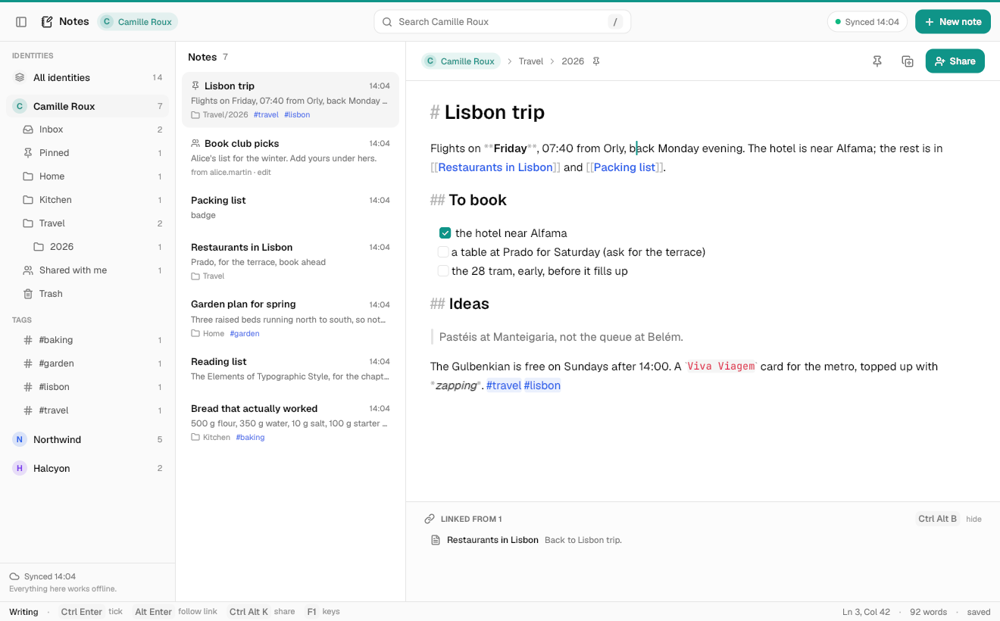
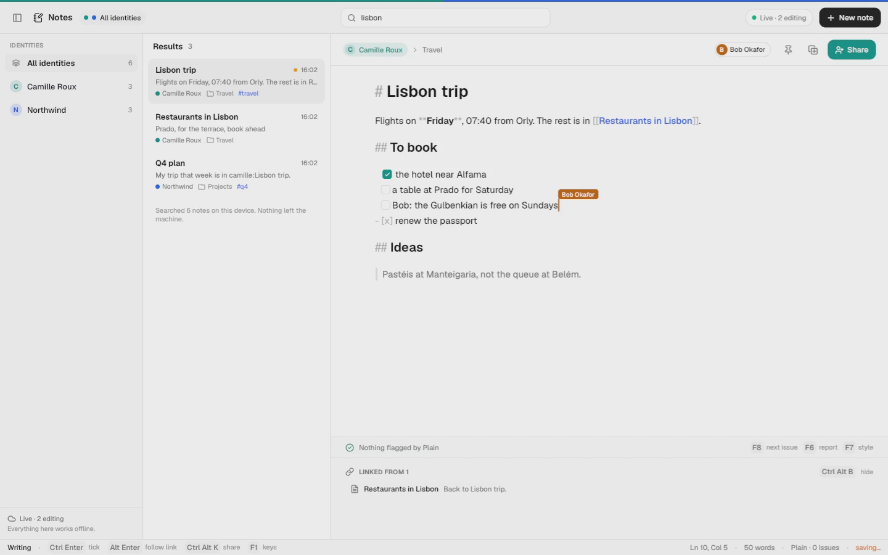
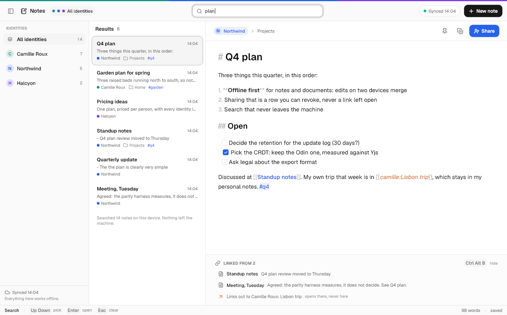
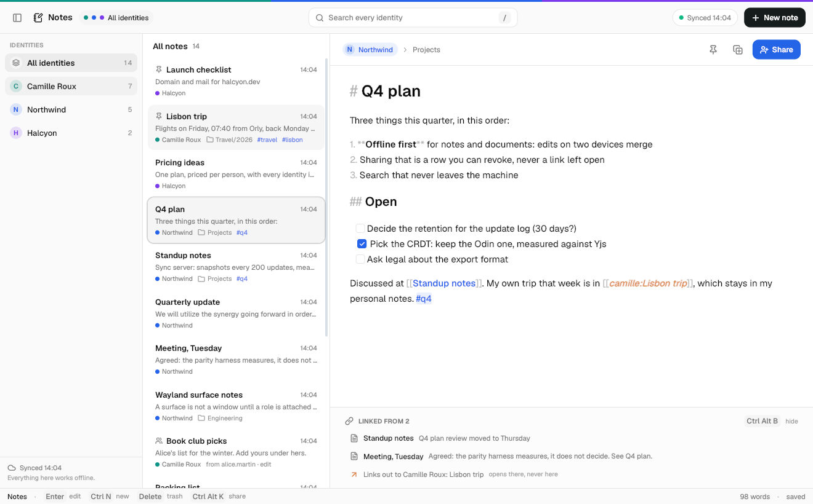
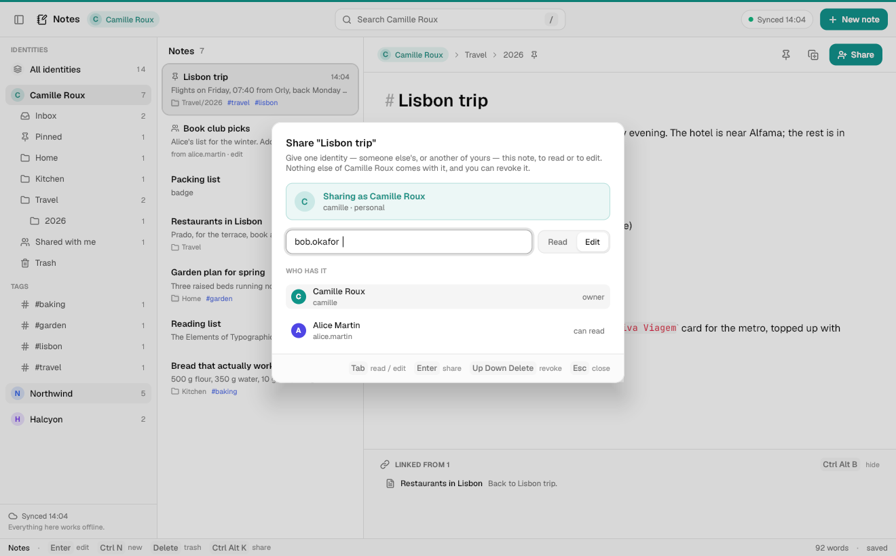
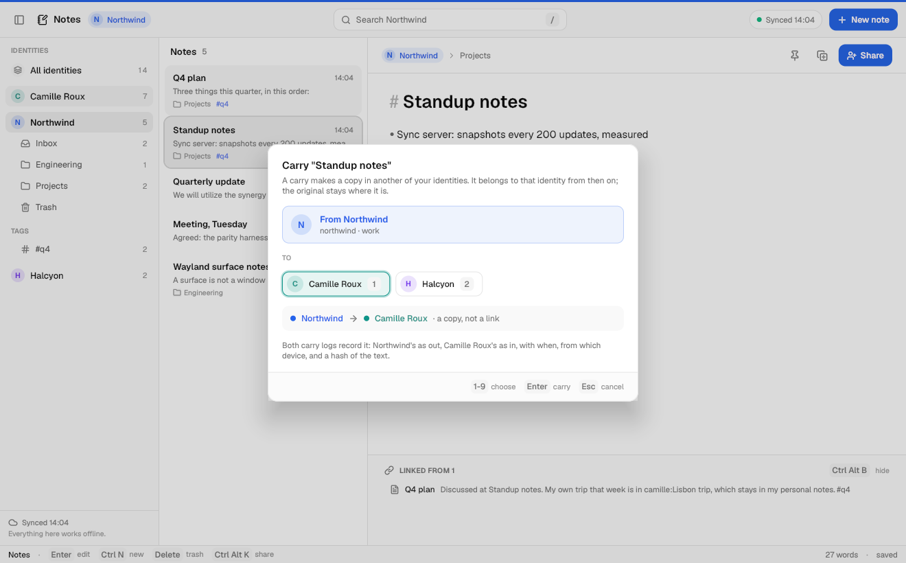
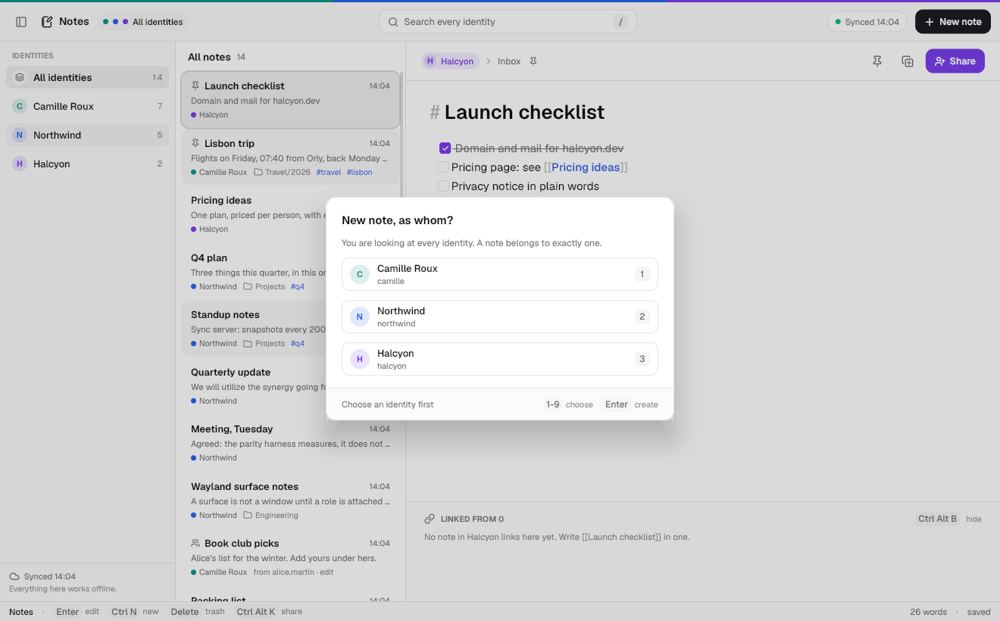
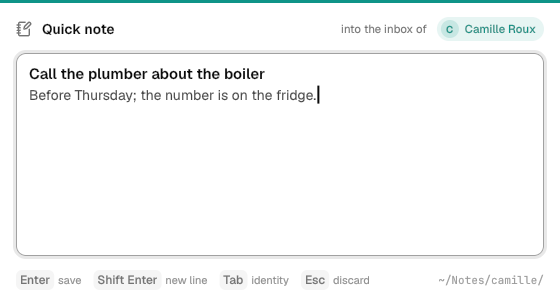

# Notes: Markdown you own, per identity, on every device

*Owned by the notes area. October 2026.*

A note is a Markdown file in a folder of its own identity. You can read it
with `cat` and edit it with vim, and it syncs to your other devices. When two
devices edited it offline, their edits merge character by character, and you
never get a conflicted copy. Someone you share it with can type into it while
you do, and you see their caret. Between your own identities a note moves
only in two ways: a **share**, which is a row you can revoke, or a **carry**,
which is an independent copy recorded in both identities' logs. A
`[[link]]` never quietly reaches into another identity.

This page covers what was built, how it is built, the reasons for the choices,
and what is still only a plan.



---

## 1. What works today, end to end

Every result below comes from a real local stack: Postgres, GoTrue, PostgREST
and Storage from `cloud/dev`, plus the sync server `palm-collab` from
`cloud/collab`. Nothing is mocked.

| | how it was checked | result |
| --- | --- | --- |
| Database isolation, shares, carry | `cloud/supabase/tests/notes_{isolation,shares,carry}.sql` (pgTAP) | 44 + 39 + 33 = 116/116; with every area's files, 16 files and 701/701 |
| Two devices, two identities, offline merge, share, carry, attachments, isolation | `apps/notes/e2e.sh`, which drives the real `notes` binary | 44/44 |
| The engine, CLI, merge and window logic | `notes --selftest` | 527/527 (286 before this work, all still passing) |
| Live co-editing in the real window | `apps/notes/record.sh`: Camille's window on a headless compositor, with Bob typing into the shared note as a second client | `apps/notes/demo.mp4` (50 s) |
| The interface, light and dark | `notes shots <dir>`: 28 PNGs; a curated set is in `img/notes/` | below |

To run it yourself:

```sh
apps/notes/e2e.sh                 # resets the `notes` stack (ports 47521+), sync server on 47590
apps/notes/record.sh out.mp4      # the demo: setup, then a headless take
notes shots /tmp/notes-shots      # every screen, light and dark
cloud/dev/test.sh --name notes --port-base 47521 notes_
```

The task named port base 67521. That number is above 65535, so it cannot be a
port, and this stack uses **47521–47540**.

The e2e covers these cases, in order. Each check's output is in the script's
transcript.

1. A laptop and a phone both enrol Camille's two identities, `camille` and
   `northwind`. A note written on the laptop arrives on the phone in the same
   notebook, with the same id.
2. The sync server goes down. The laptop rewrites the note (a new line at the
   top, a ticked box) and the phone appends a line to the same file. Both
   edits queue. When the server comes back, both devices hold exactly the same
   text with every edit in it. There is no conflicted copy, and there is one
   note, not two.
3. Both devices edit **the same line** offline. Both insertions survive:
   `- [ ] a table at Prado (ask for the terrace) for Saturday`.
4. One device moves the note to another notebook and the other pins it. Both
   changes stand.
5. Camille shares the note with Bob to edit. Bob's device files it under
   `Shared/camille/`, and Bob's edit reaches Camille. When the share is
   lowered to read, Bob's copy is `0444` on disk and `notes append` exits 5.
   When it is revoked, Bob's copy is gone at his next sync.
6. Carry: a work note is carried into personal. The copy has a new id and the
   original stays put. Each identity's log has its own row, `out` on one side
   and `in` on the other, with the same content hash and device. Editing the
   original leaves the copy alone. A process scoped to `northwind` cannot
   carry (exit 5).
7. An attachment added on the laptop arrives byte for byte on the phone.
8. Isolation. A process scoped to `northwind` lists, searches and reads only
   northwind's notes, and asking it for `camille` exits 5. A fresh "work
   laptop" holding only a token scoped to `northwind` (minted by
   `accounts switch`) enrols northwind and nothing else, and none of
   Camille's personal text reaches it. The database is what refuses here: the
   client never asks.



---

## 2. The model

```
~/Notes/                         $PALM_NOTES_ROOT
  camille/                       one folder per identity, named by its handle
    .palm/identity.json          which cloud identity this folder belongs to
    .palm/index.tsv              what the last sync saw of each note
    .palm/sync/<identity>/*.state   each note's CRDT copy and offline outbox
    Inbox note.md                notes at the top level are the inbox
    Travel/2026/lisbon-trip.md   a folder is a notebook; folders nest
    Shared/alice.martin/…        notes other identities shared with this one
    .trash/Travel/…              the trash keeps the notebook it came from
    attachments/<sha12>-map.png  files notes embed
  northwind/
    …
```

**A note is one Markdown file.** Its title is its first line, the way it is
in every notes app worth using, and the file is named after the title, so the
folder reads like a list. A short front matter block carries what is not text:

```markdown
---
id: 7f3c2a1e-…          the note's stable id, which is also its sync id
tags: [travel, q4]
pinned: true
---

# Lisbon trip
```

The editor never shows the front matter. Keys this app does not know, such as
someone's own `aliases:`, are kept verbatim. The id is a UUID chosen on the
device when the note is created, so a note written offline already has its
final id. `notes_create` is idempotent on that id.

| feature | how |
| --- | --- |
| notebooks | folders, nested with `/`; `notes move`, Ctrl+Alt+M |
| tags | front matter `tags:` and inline `#tags` (a letter after `#`, outside code) |
| pins | front matter `pinned: true`; pinned notes list first |
| checklists | `- [ ]` / `- [x]`, drawn as boxes; click or Ctrl+Enter ticks one |
| trash | `.trash/<notebook>/`; synced; restore puts the note back in its notebook |
| attachments | `notes attach`: copied to `attachments/<sha256[:12]>-<name>`, linked, uploaded once per identity |
| links | `[[Title]]`, `[[Title\|alias]]`, `[[Title#heading]]`, resolved inside the identity |
| backlinks | computed from the files, inside the identity; a panel under the note |
| revisions | the note's update log in the cloud; `notes history` groups it into editing sessions |

---

## 3. Where the notes live: their own store, not the drive

The drive (`drive.md`) was the obvious candidate. These are the reasons notes
have their own folder and their own sync instead.

* **The drive's conflict rule is the wrong one for text.** Drive versions
  whole files. When both sides changed a file, it keeps both and names one
  `(conflicted copy, laptop, …)`. That is right for a photo or a `.docx`, and
  it is exactly the outcome a notes app must not have. Notes need a merge per
  character, which is what the collaboration CRDT already does, measured and
  fuzzed (`office.md` §9).
* **Two sync engines must not own one file.** If notes lived in
  `~/Drive/<handle>/`, `palm-drive` would upload every keystroke-save as a new
  version and could produce a conflicted copy, while the notes sync merged the
  same edit. Each would undo the other's work.
* **The files are still plain files.** `~/Notes/<handle>/` is Markdown on
  disk, readable and editable by anything. Only the sync differs.

Attachments are different. They are opaque bytes with no merge, so they are
content-addressed blobs in a Storage bucket (`notes/<identity>/<sha256>`),
deduplicated within the identity, the same shape the drive uses. **Decision
for the user:** whether attachments should be drive items instead. That would
put them in the drive's quota and give them the drive's sharing, at the cost
of a dependency between the two areas (§11).

---

## 4. Sync and merge

### The pieces

A note in a synced identity has three forms:

| | where | role |
| --- | --- | --- |
| the file | `~/Notes/camille/Travel/lisbon-trip.md` | what people and tools edit; the truth for **local** edits |
| the local copy | `.palm/sync/<identity>/<id>.state` | the note's CRDT, the last server sequence seen, and the **outbox** of edits not yet acknowledged |
| the cloud | `collab_updates` (the log), `collab_snapshots` | ordered by `palm-collab`, role-checked on every operation |

Inside the CRDT (`cloud/collab/crdt`), a note is a document of kind `note`:

```
sequence "body"            the Markdown, one element per UTF-8 byte (FugueMax)
register note/notebook     the folder
register note/tags         front matter tags
register note/pinned       "1" or unset
register note/trashed      when it went to the trash, or unset
```

The title is not a register. It is the first line of the body, so renaming a
note is an edit to its text, and it merges like any other edit.

### One pass of `notes sync`

1. Ask the database for the identity's notes and the head of each one's log.
   This is `notes_sync_state`, one round trip that covers owned and shared
   notes.
2. Record any carries made offline (`notes_carry`). This comes first so that
   the copies are created by their carry, not as unrelated new notes.
3. Diff every file that changed since the last pass into its CRDT. That queues
   operations in the outbox. **This step works with the network gone, and it
   is the whole of "offline".**
4. Open a short session with the sync server for every note whose file
   changed, whose outbox is not empty, or whose cloud head is past what this
   device saw. The session catches up, sends the outbox, and merges.
5. Write the merged CRDT back to the file. The file is renamed if the title
   changed, and moved if another device filed it elsewhere or trashed it.
6. Remove from this device the notes deleted for good elsewhere and the shares
   that were revoked. Then upload queued attachments and fetch missing ones.

The window runs exactly this command as a child process every 30 seconds, and
again after a move, a trash or a pin, with `--skip <open note>`. The open note
is handled differently, as described next.

### The diff: why offline edits merge well

What sync receives from vim, `notes write` or a phone is only the new file.
Turning that into CRDT operations is where merge quality is won or lost. A
prefix and suffix diff is exact for one keystroke. For an afternoon of
scattered edits, it collapses everything between the first and last change
into one replace, so the other device's deletions inside that span are lost.
`diff.odin` therefore runs **Myers' O(ND) diff on lines**, then trims each
changed region to the characters that differ (never splitting a UTF-8
sequence). Each hunk touches only the bytes that changed. The selftest checks
this against 400 random edit scripts, and the in-process merge tests run two
real CRDT replicas over the same edits as the e2e.

### The open note: live

When the open note belongs to a synced identity, the window holds a live
`cloud/collab/client` session for it. Every edit becomes CRDT operations as it
is typed. Other people's edits and carets arrive within a frame, and the
buffer is rebuilt around the caret. The caret is carried through the change,
so an edit above it does not move it. **Undo** in a live note is the CRDT's
per-person undo, so it takes back your last change and never somebody else's.
Ctrl+Alt+O takes the window offline and back. While offline, edits queue in
the session's outbox, survive a restart (the outbox is on disk), and merge on
reconnect.

### Conflicts, case by case

| concurrent | result |
| --- | --- |
| two devices edit different paragraphs offline | both edits; one note |
| two devices edit the same line offline | both insertions, not interleaved (FugueMax) |
| one device ticks a box, the other edits the item's text | both |
| one renames (edits the first line), the other edits the body | both; the file is renamed to the merged title on every device |
| one moves the note to a notebook, the other pins it | both registers stand |
| two devices move it to different notebooks | the later move wins on every device (last writer by Lamport clock); the other is in the log |
| one trashes it, the other edits it | it is in the trash with the edit in it; restoring brings both back |
| one **deletes it for good**, the other edits it offline | the deletion wins: the cloud copy, its log and grants are gone, and the other device's file is removed at its next sync. An offline edit to a purged note is lost, which is why the window's Delete moves to the trash and only Shift+Delete purges |
| an edit to a note shared **to read** | not kept: the server refuses it. The file is `0444`, the CLI exits 5, and an external edit is reverted at the next sync with a message |

---

## 5. Schema, roles and RLS

`cloud/supabase/migrations/20261020000000_notes.sql` follows the contract.
Every table has `identity_id`, and every policy goes through
`can_access_identity()`.

| | what | written by |
| --- | --- | --- |
| `collab_documents` (kind `note`) | the note's document, owned by one identity | `notes_create`, `notes_carry` |
| `collab_updates`, `collab_snapshots` | the revisions | only the sync server |
| `collab_grants` | **the share row**: grantee identity, `view` or `edit` | `notes_share` / `notes_unshare` (owner only) |
| `notes` | id, identity, title, notebook, tags, pinned, trashed_at: the server-visible mirror for listing | the owner's devices after a sync |
| `note_carries` | the carry log: one row per side, same `carry_id`, peer identity and note, content hash, device | only `notes_carry`; append-only, no update or delete for anyone |
| `note_attachments` + bucket `notes` | attachment rows and `<identity>/<sha256>` blobs | owner, or an editor-grantee of the note |

To add the kind, my migration changes one collaboration constraint and adds
one index, and nothing else of `collab`'s. The constraint `kind in (…)` gains
`note`. The unique index on `(id, identity_id)` lets `notes` reference its
document with a composite foreign key, so the database itself refuses a note
whose metadata claims a different identity than its document. The collab
pgTAP still passes (59/59). A note's identity can never change (trigger); the
error message says "carry a copy instead".

The three pgTAP files assert that:

* a session scoped to A sees only A's notes, revisions, sync state, attachment
  rows and blobs, and nothing of W (same person) or B. It cannot create,
  rename, trash, purge, attach to or join them, and cannot insert note rows
  directly even for itself;
* a read share gives exactly read: the note row, its revisions and the
  `view` role. It does not allow renaming, attaching, re-sharing (not even to
  the grantee's own other identity), or a revision through the server. The
  share is to B only: Bob's other identity and the owner's other identity see
  nothing;
* an edit share allows revisions and attachments, but not the owner's metadata
  (where the note is filed, pins, trash) and not deletion. Trashing a note
  hides it from grantees; revoking a share removes the row, the revisions,
  the attachment rows and blobs, and refuses a late revision at the database;
* a carry needs a session that can act in both identities. Scoped sessions on
  either side, carrying to someone else's identity, carrying a note shared
  with you, carrying into the same identity and passing a malformed hash are
  all refused. The copy is a new note in the target with only the title
  copied. Grants do not come along, and the copy's log is untouched by the
  original's revisions. Each side sees exactly its own log row, the log
  cannot be rewritten or erased, and it outlives a purge of the original.

---

## 6. Crossing identities: share, carry, link

| | what moves | who can do it | recorded |
| --- | --- | --- | --- |
| **share** | access to *this note*, to read or to edit; it stays the owner's | the owning identity | `collab_grants` row; revocable; the grantee's devices drop their copy at their next sync |
| **carry** | a *copy*, owned by the target identity from then on | an unscoped session (the person), never a scoped one | `note_carries`: an `out` row in the source and an `in` row in the target, with when, from which device, and the sha256 of the text |
| **link** `[[other:Title]]` | nothing | anyone can write one | nothing; it is text |

**What a cross-identity link does.** An unqualified `[[Title]]` resolves only
among this identity's notes, including notes shared *with* it, which it can
already read. It never falls through to another identity's note of the same
name. With no match it offers to create the note here. A link qualified with
another of your identities' handles, `[[camille:Lisbon trip]]`, is written on
purpose, and the app treats it as a link *out*:

* it is drawn in amber italics, never with the target's title or preview
  pulled in, and the backlinks panel lists it as "Links out to Camille Roux:
  Lisbon trip · opens there, never here";
* following it (Alt+Enter) opens the note in that identity's own view, with
  one line saying so (product P1). Nothing is copied;
* it **never creates a backlink** in the target. The target identity does not
  learn that another identity points at it;
* a scoped process (an assistant) cannot follow it at all. `notes links`
  reports it as `elsewhere`, and `notes read` from inside the scope cannot see
  the target.

**Search** is local and reads the files, the same engine in the window and in
`notes search --json`. In All identities every result is labelled. Inside one
identity only that identity is searched, plus one line, "N more in your other
identities", which never names them (product §6). Every result list ends with
"Searched N notes on this device. Nothing left the machine."



---

## 7. Encryption

**Built: encryption at rest is the host's (disk encryption on the database
and Storage volumes). The application does not encrypt.** The reason is that
the sync server has to *read* each operation to enforce roles. It is the
server that refuses a read-only grantee's edit (`office.md` §5) and that
compacts the log into snapshots. Server-side application encryption with a
key the server holds would add work and protect against nothing it does not
already guard against.

**Designed: end-to-end encryption as a per-identity switch.**

* **Keys.** Each identity has a key pair, held by its enrolled devices and
  wrapped for each device through the README's device-key plan. Each note
  has a random content key, wrapped to the owning identity's key.
* **What is encrypted.** Every CRDT update and snapshot is sealed with the
  note's key before it leaves the device, as Secsync and Proton Docs do with
  Yjs. So are attachments, and the mirror columns of `notes` (title,
  notebook, tags), which an E2EE identity leaves empty.
* **What the server still sees.** Note ids, sizes, the timing of updates, who
  holds a grant, and the carry log's rows. A carry would record a hash of
  the *ciphertext* plus a client-side hash only both identities can check.
* **Sharing.** The note key is wrapped to the grantee identity's public key.
  Revocation rotates the note key and re-wraps it for the people who keep
  access. Old revisions stay readable to anyone who already had them, and the
  interface has to say so.
* **What is lost.** Role enforcement becomes signatures: each update is signed
  by its author's device key, and every client rejects a read-only grantee's
  writes; the server can no longer tell. Snapshots are made by clients.
  Server-side history and diff views become client-side. Search is already
  local, and the assistant runs on the device (product P5, P9), so neither
  loses anything.
* **The hard part** is group membership under a shared key: adding and
  removing people safely. The published answer is DCGKA (Weidner et al., CCS
  2021). It is not built.

---

## 8. The app

Three panes: identities and notebooks, the list, the note. Below 1100 px the
sidebar becomes a drawer (Ctrl+\\). Below 760 px there is one pane at a time,
the list or the note, with a back button. The window's identity is always
visible: a 3 px band in its colour (every colour side by side in All
identities), the identity chip in the header and on the note, and the primary
action (New, Share) in its colour. In mixed lists every row carries a label.



**The editor formats Markdown as you type.** Headings are large, **bold** is
bold, *emphasis* is italic, `code` is mono on a tint, links and tags are
coloured, quotes have a bar and tasks are boxes. The marks stay on screen,
faint (Bear's choice, not Obsidian's hide-and-reflow), so the caret always has
a character to sit beside and nothing jumps. The few marks replaced by a
drawing keep their exact width, and on the caret's line they show as the
characters they are. Return continues a list, and an empty item ends it.

**Keyboard first.** F1 lists every key. The main ones:

| key | does |
| --- | --- |
| Ctrl+N / F4 | new note in the identity in view; in All identities it asks *as whom* and refuses Enter until one is chosen (P3) |
| / or Ctrl+F | search |
| Ctrl+1…9, Ctrl+0 | one identity, all identities |
| Tab, Shift+Tab, ← → | list, note, sidebar |
| Ctrl+Enter, Alt+Enter | tick the task, follow the link |
| Ctrl+B, Ctrl+I | bold, italic |
| Ctrl+Alt+K | share (as in the office apps) |
| Ctrl+Shift+C | carry (as in Home) |
| Ctrl+Alt+M, Ctrl+Alt+P, Ctrl+Alt+B | file in a notebook, pin, backlinks panel |
| Delete, Shift+Delete | to the trash (and back from it), delete for good |
| Ctrl+Alt+O | work offline, then reconnect |
| F5 | sync now |

| share | carry | new, as whom |
| --- | --- | --- |
|  |  |  |

**Quick capture: `notes capture`.** This is the command for the shell agent
to bind as the global "new note". Super+N is suggested, launched with
`PALM_IDENTITY=<the focused identity>`. A small window opens and takes a
thought; Enter writes it into that identity's inbox and closes, Shift+Enter
starts a new line, and Esc discards. The identity is shown before the first
character. Unscoped, it starts in the identity the switcher last chose
(cloudkit's `current`), and with neither it does not guess: Tab chooses, and
Enter waits. `notes capture "text"` does the same without a window.



**The command line** (`docs/PALM-CLI.md`) is the same engine, with `--json`
on everything and the documented exit codes. `--identity` narrows the scope
and never widens it.

| | |
| --- | --- |
| read | `list` `read` `search` `path` `notebooks` `tags` `links` `identities` `status` `people` `log` `history` |
| mutate | `new` `capture` `write` `append` `rename` `move` `trash` `restore` `share` `unshare` `carry` `attach` |
| idempotent | `sync` `pin` `tag` |
| destructive | `delete` (refuses without `--yes`) |

```sh
$ notes search "lisbon" --json | jq '.matches[] | {title, identity}'
{ "title": "Lisbon trip", "identity": "camille" }
$ PALM_IDENTITY=northwind notes search lisbon --json | jq .count
0
$ notes carry "Packing list" --to camille --json | jq '{from, to, recorded}'
{ "from": "northwind", "to": "camille", "recorded": true }
$ notes log --identity camille --json | jq '.entries[0] | {direction, peer, device}'
{ "direction": "in", "peer": "northwind", "device": "laptop" }
$ notes history "Lisbon trip" --json | jq '.revisions, .sessions[0].authors'
9
[ "Bob Okafor", "Camille Roux" ]
```

---

## 9. Built, and not yet

**Built:** identity folders and enrolment, and front matter with stable ids.
Notebooks, tags, pins, checklists, trash, attachments, links and backlinks.
Local search across identities with labels. Sync through the collab CRDT with
an offline outbox, a line-then-character diff, live sessions with presence and
per-person undo, and revisions. Share (read/edit) and revoke, and carry with a
log on both sides. The schema with RLS and pgTAP. The window, with
live-formatted editing, three responsive layouts, share/carry/choose dialogs,
light and dark themes and quick capture. The CLI; the e2e; the recorded demo.

**Planned:**

* **Web clipper, through the browser.** `apps/browser` (another area) would
  add "Clip to Notes": the readable text of the page as Markdown, the URL and
  the time in front matter, written into the inbox of **the identity the
  browser tab belongs to**. The clipper never chooses an identity of its own.
  The seam is `notes capture --text` (or `notes new --identity`), so the
  browser needs no notes code.
* **An assistant over notes, scoped per identity.** It holds a session scoped
  to one identity (`palm_identity`), so the database hands it that identity's
  notes and the ones shared with it, and nothing else; `notes search --json`
  under `PALM_IDENTITY` is its reading tool. Edits it proposes go in as its own
  CRDT agent, attributable in `notes history` and undoable as a unit. A
  cross-identity link is opaque to it by design.
* **Publishing a note publicly.** `collab_links` already exists for documents
  (view-only, expiring, hashed token). A published note would be a link of
  role `view` plus a static HTML render. It would be labelled public in the
  window, listed per identity, expire by default (product §11), and be
  revocable. The `public` identity kind is its natural home.

**Gaps, plainly:**

1. **One connection per changed note** during a sync pass. That is fine for
   hundreds of changed notes; for tens of thousands, the collab protocol
   needs a multi-document session.
2. **A shared or updated note that is not open** arrives within the 30 s sync
   interval, not instantly. There is no push channel for closed notes.
3. A wrapped list item's continuation rows start at the margin, not at the
   item's text. Images are linked, not drawn inline. Tables render as text.
4. A live session's token is taken when the note is opened. A note held open
   past the token's lifetime reconnects with an expired token until it is
   reopened. Office's `keep_token` refresh should be wired in the same way.
5. The share dialog needs the exact handle. There is no directory search, by
   design for now, since handles are addresses.
6. Purge beats edit (§4). That is deliberate, but an offline edit to a note
   deleted for good elsewhere is lost.
7. The carry log records the hostname as the device unless `--device` names
   it.
8. The recording is keyboard-only: the headless compositor has no pointer, so
   the boxes' click and the drawer were checked in shots, not on film.
9. E2EE (§7) is designed, not built.

---

## 10. For the other areas

* **SHELL:** bind the global "new note" to `notes capture` with `PALM_IDENTITY`
  set to the focused identity, and put Notes in the launcher if it is not
  already there.
* **collab:** this area adds the `note` kind and the `(id, identity_id)`
  index in its own migration, and nothing in `cloud/collab` changed. If many
  notes become common, a multi-document session (one socket, N documents) is
  the change to make.
* **CONTRACT.md** should list the notes range: `20261020000000`–`20261020099999`,
  prefix `notes_`.
* **kit:** when `apps/kit/identity.odin` lands (shell.md §3), notes should use
  it instead of its own chip, label and band.

---

## 11. Decisions for the user

1. **Own store or the drive** for notes (recommended: own store, §3). For
   attachments: keep the `notes` bucket, or make them drive items.
2. **Purge versus edit.** Should a note deleted for good on one device be
   resurrectable by an offline edit on another? Today it is not.
3. **Show or hide Markdown marks** on lines without the caret. Today they are
   faint and visible; hiding them reflows the text as the caret moves.
4. **E2EE per identity** (§7). Should it be offered, and if so as an
   identity-level switch with its trade-offs stated in the interface?
5. **Carry what?** Today a carry copies the text and title. Should tags and
   the notebook come along, or should the copy land in the target's inbox, as
   it does now, so that nothing of the source's organisation crosses?
6. **Revision retention:** the same question as office's. Keep every update for
   30 days, then snapshots only.

---

## Where the code is

| path | |
| --- | --- |
| `apps/notes/ident.odin` | identity folders, enrolment, colours |
| `apps/notes/front.odin`, `store.odin` | front matter, the files, notebooks, trash |
| `apps/notes/diff.odin`, `notedoc.odin`, `sync.odin` | the diff, the CRDT binding, one sync pass, carry and attachments |
| `apps/notes/live.odin` | background sync from the window; the open note's live session |
| `apps/notes/links.odin`, `search.odin` | links, backlinks, search |
| `apps/notes/wrap.odin`, `ui.odin`, `keys.odin`, `main.odin`, `capture.odin` | the window and quick capture |
| `apps/notes/cli.odin` | the command line |
| `apps/notes/selftest*.odin`, `e2e.sh`, `record.sh`, `demo/` | tests, the e2e, the demo |
| `cloud/supabase/migrations/20261020000000_notes.sql`, `cloud/supabase/tests/notes_*.sql` | schema and its pgTAP |
