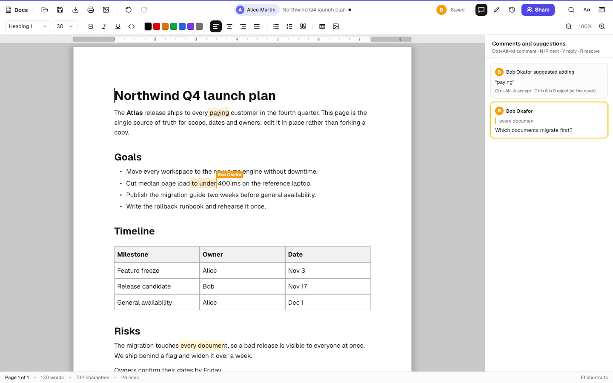
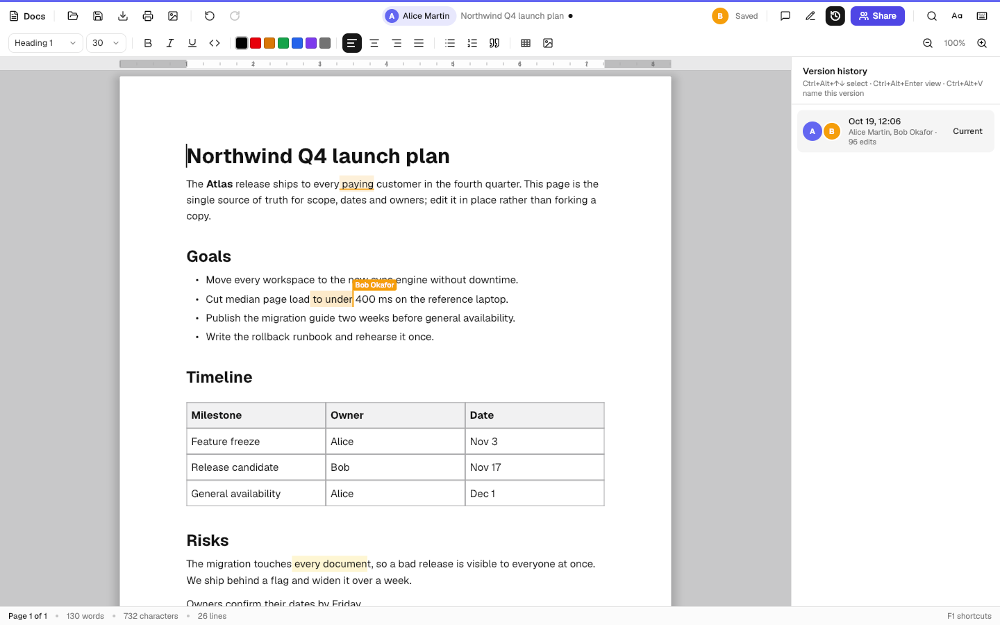
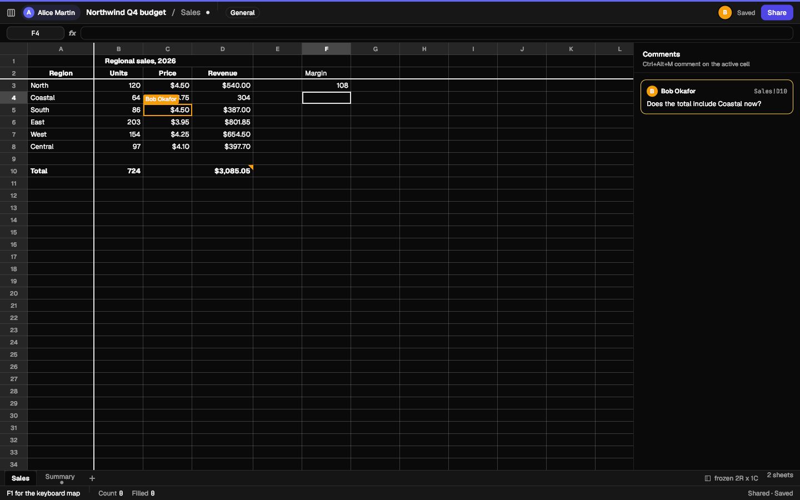
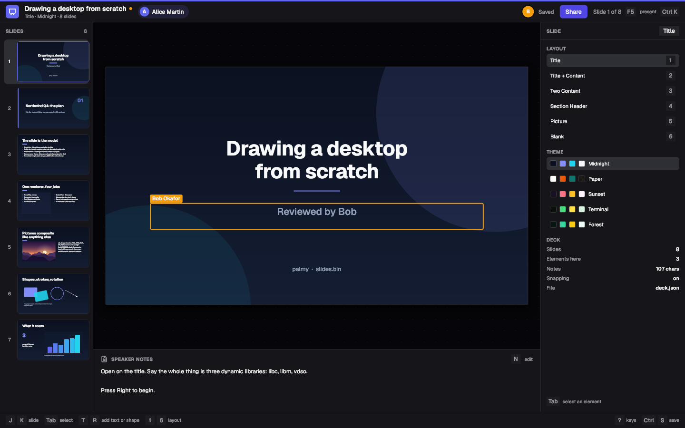
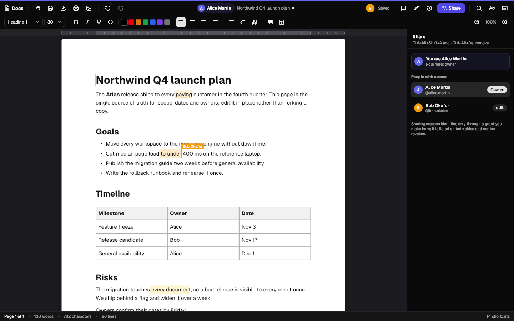

# The office suite, together: collaborative Docs, Sheets and Slides

*Owned by the office area. October 2026.*

Two people edit one document at once, in the native apps, with each other's
cursors on screen; one of them goes offline for a while and their edits merge
when they come back, with no merge dialog. Comments, suggestions, version
history and sharing work the way people expect from Google Docs and Microsoft
365 — and the document belongs to one identity, the sharing is an explicit,
revocable grant that the database enforces, and nothing about the design
stops it from being end-to-end encrypted later.

This page is what was built, why it is built that way, the evidence for the
choices, and what is still a plan.



---

## 1. What works today, end to end

Everything below was run against a real local stack (Postgres, GoTrue,
PostgREST from `cloud/dev`, the sync server `palm-collab`) with two separate
accounts, *Alice Martin* and *Bob Okafor*.

| | how it was checked | result |
| --- | --- | --- |
| CRDT convergence | `cloud/collab/fuzz`: random concurrent edits on 2–8 replicas, hostile network (late, reordered, duplicated, partitioned), snapshots, per-replica undo/redo | see §9 — every round converged |
| CRDT performance | `cloud/collab/bench` on the 259,778-edit automerge-paper trace | 363 ms local, 210 ms as 259,778 remote updates (Yjs on the same machine: 4,876 ms / 1,497 ms) |
| Database isolation | `cloud/supabase/tests/collab_rls.sql` (pgTAP) | 59/59; with the other areas' files 177/177 |
| Sync service | `palm-collab-cli e2e` — refusal without a grant, each role's limits, concurrent edits, presence, offline edit merged on reconnect, reopen from the local copy, history, revocation reaching an open window | 27/27 |
| Docs binding | `docs --selftest`, new "collaboration" section incl. a 3-editor random-editing test through the real commands | 2339/2339 (was 2295) |
| Sheets binding | `sheets --selftest`, new section incl. a 3-replica random test with row/column insertion and deletion | 1012/1012 (was 997) |
| Slides binding | `slides --selftest`, new section incl. a 3-replica random test | 190/190 (was 171/179: the 8 picture failures are fixed) |
| Real windows | three takes recorded with `apps/tools/headless-record.sh`, Alice in the window, Bob a second instance of the same binary | `cloud/collab/demo/*-coedit.mp4` |

To run it yourself:

```sh
TMPDIR=/tmp cloud/collab/dev/up.sh --reset        # stack, server, two accounts; prints env to export
export PALM_CLOUD_URL=http://127.0.0.1:62521 PALM_COLLAB_URL=ws://127.0.0.1:62590 \
       PALM_COLLAB_DIR=/tmp/palm-collab-dev/local
S=/tmp/palm-collab-dev
$S/bin/palm-collab-cli e2e $S/acct-alice alice.martin $S/acct-bob bob.okafor

# A shared document from a file, opened by two people:
PALM_CLOUD_DIR=$S/acct-alice docs --collab new --title "Q4 plan" --as alice.martin cloud/collab/demo/plan.md
$S/bin/palm-collab-cli --dir $S/acct-alice share <doc-id> bob.okafor edit
PALM_CLOUD_DIR=$S/acct-bob   docs --collab <doc-id> --as bob.okafor

# The recorded demos and the screenshots on this page:
cloud/collab/demo/record.sh docs   <docs-bin>   out.mp4 cloud/collab/demo/alice-docs.txt   cloud/collab/demo/bob-docs.txt cloud/collab/demo/plan.md
cloud/collab/demo/record.sh sheets <sheets-bin> out.mp4 cloud/collab/demo/alice-sheets.txt cloud/collab/demo/bob-sheets.txt
cloud/collab/demo/record.sh slides <slides-bin> out.mp4 cloud/collab/demo/alice-slides.txt cloud/collab/demo/bob-slides.txt
cloud/collab/demo/shots.sh <bin-dir> cloud/docs/img/office
```

---

## 2. Architecture

```
 Docs / Sheets / Slides window                       another window, another person
 ┌────────────────────────────────────┐              ┌──────────────────────────┐
 │ the app's own model (unchanged)    │              │                          │
 │   ↕  binding: diff out, rebuild in │              │        same stack        │
 │ CRDT replica (cloud/collab/crdt)   │              │                          │
 │ session: outbox, local copy,       │              └────────────┬─────────────┘
 │   presence (cloud/collab/client)   │                           │
 └──────────────┬─────────────────────┘                           │
                │ WebSocket: hello(token, identity) · updates · acks · presence
                ▼                                                 ▼
          palm-collab (cloud/collab/server) ── orders updates per document,
                │      checks every operation against the sender's role,
                │      keeps one replica per open document, snapshots it
                ▼  PostgREST: the person's token for collab_join,
                   the service key for collab_append / snapshots
          Postgres: collab_documents · collab_updates (the log) · collab_snapshots
                    collab_grants · collab_links · collab_versions · collab_agents
                    — RLS through can_access_identity() (cloud/CONTRACT.md)
```

**The apps keep their models.** Docs still edits paragraphs of styled runs and
tables of cells, Sheets still edits a book of sparse cells with a formula
engine, Slides still edits a list of slides of elements. Every existing
command, exporter and self-test works unchanged. A *binding* per app maps
that model onto the CRDT both ways:

* **out** — after a frame's edits, the model is compared with what the CRDT
  holds and the difference becomes CRDT operations (inserts, deletes, marks,
  register writes);
* **in** — after remote updates, the model is rebuilt from the CRDT, with the
  caret, selection and active cell carried across as *identities* (the
  element a caret sits after, the row and column a cell is on), so a
  collaborator's edit above you does not move you.

This is the same shape as y-prosemirror and the Automerge bindings, and it is
what let three mature editors become collaborative without rewriting their
command sets.

---

## 3. The CRDT: written in Odin, and why

The roadmap (M6) said "integrate a CRDT library instead of writing one: yffi or
automerge-c, decide with a spike". The spike was done; the decision is to
**keep the CRDT in Odin**. The evidence:

**Dependencies and portability.** Linking either library means a Rust
toolchain in the build: yffi v0.28.0 builds `cargo` crates (thiserror,
fastrand, smallvec, async-lock, serde, serde_json, dashmap …), and its
prebuilt Linux `libyrs.so` (1.18 MB unstripped) *also needs `libgcc_s.so.1`*
— a fourth line under `ldd` on a project whose README opens on that list
being three lines ([y-crdt releases](https://github.com/y-crdt/y-crdt/releases)).
No static archive is published. automerge-c needs Cargo ≥ Rust 1.90, CMake ≥
3.25, CMocka, Doxygen, Ninja and cbindgen, and its generated header "is
generated in terms of the processor architecture" it was built on
([automerge-c README](https://github.com/automerge/automerge/blob/main/rust/automerge-c/README.md)).
Palmy's plan is Windows, macOS, Android, iOS and a WebAssembly build of
the same binaries. Each target would need a Rust cross-build, and linking a
Rust wasm32 static library into an Odin wasm module is not something either
project documents. The Odin CRDT is ~1,700 lines, compiles with the app on
every target Odin does, and adds nothing to `ldd`.

**Performance, measured on this machine** with the automerge-paper editing
trace (259,778 single-character edits; `cloud/collab/bench`, Yjs 13.6.27 on
Node 26 via `yjs-b4.mjs` for the reference):

| | Odin CRDT | Yjs 13.6.27 |
| --- | --- | --- |
| every edit applied locally | **363 ms** | 4,876 ms |
| every edit as its own update, applied on a second replica (B4) | **210 ms** | 1,497 ms |
| memory held after the trace | 14.2 MB | — |
| bytes on the wire, per single-keystroke update | 32.4 | 24.3 |
| snapshot size | 1.88 MB | 311 KB |
| snapshot load | 40 ms | 39 ms |

For scale, the published numbers for the same trace: Yjs 5,714 ms and
Automerge 2.1.10 14,326 ms in dmonad/crdt-benchmarks B4
([README](https://github.com/dmonad/crdt-benchmarks)); in Loro's native
benchmark, applying the trace takes Yrs 4,239 ms, Automerge 451 ms, Loro 88
ms, diamond-types 16 ms
([loro-docs](https://github.com/loro-dev/loro-docs/blob/main/pages/docs/performance/native.mdx)).
The Odin implementation is in the same class as the fastest libraries on
apply. It is **worse on snapshot size** (it keeps every deleted character for
undo and history, and stores items without the columnar encoding Yjs uses);
that is the first optimisation to make (§12).

**Correctness** is the real risk of writing one, so it was attacked directly:
the algorithm is a published one, not an invention, and a fuzzer was built
before anything used it (§9). It found two real divergence bugs while being
written (a merged run inheriting a delete stamp; the search-marker cache) and
nothing since.

**Interop** is not a reason for Yjs here: Palmy's other clients are the
same Odin code compiled elsewhere, and interchange with the rest of the world
happens through `.docx`/`.xlsx`/`.pptx`/ODF, not through CRDT wire formats.

**What would change the decision:** needing real-time co-editing with
third-party web editors (TipTap, BlockNote, Lexical) through their Yjs
bindings. The binding layer here is CRDT-agnostic enough that the CRDT could
be swapped for Yrs behind the same five procedures (`insert`, `remove`,
`mark`, `set`, `read_spans`) if that day comes.

### What it is

`cloud/collab/crdt` holds three kinds of shared state, all addressed by plain
byte keys (so no "create object" operation is ever needed, and two people
typing into the same table cell are typing into the same sequence):

* **Sequences** — ordered elements: one per UTF-8 byte of text, one per embed
  (a table, a picture, a comment reply), or *virtual* runs with no content
  (the million rows of a spreadsheet axis are one item). Ordering is
  **FugueMax**, implemented as Gentle's YjsMod integration, which Weidner and
  Kleppmann show behaves as FugueMax — maximal non-interleaving: two people
  typing at the same spot never get their words interleaved
  ([Fugue, arXiv:2305.00583](https://arxiv.org/abs/2305.00583)).
* **Marks** — formatting spans anchored to elements, Peritext-style
  ([Ink & Switch](https://www.inkandswitch.com/peritext/)): a mark's ends sit
  *before* or *after* an element, so bold grows when someone types at its end
  and covers text another person typed inside it concurrently; links and
  comments do not grow. Per attribute the newest mark (Lamport, then agent)
  wins; an empty value means "off here".
* **Registers** — last-writer-wins values keyed by (owner, field): paragraph
  properties, cell inputs, shape geometry, comment threads.

Deletion is a last-writer-wins flag per element (and per mark), not a
one-way tombstone. That is what makes **undo per person** exact: undoing a
deletion restores *the same* elements, so comments, cursors and formatting
anchored to them come back with them. Undo only reverses this replica's own
operations, and leaves a value alone if someone else has changed it since.

Updates are compact varint-encoded operations with an agent table at the
front (32 bytes per single-keystroke update on the trace, headers included).
Operations whose dependencies have not arrived wait in a pending queue, so
delivery order does not matter.

---

## 4. The sync service

`cloud/collab/server` (`palm-collab`) is an Odin program. One WebSocket per
open window; the protocol is in `cloud/collab/wire/protocol.odin`.

**Why WebSocket, not the chat server's transport.** `apps/chat` speaks
length-prefixed JSON over raw TCP bound to 127.0.0.1. A document is edited
from wherever its owner is — through proxies and TLS terminators, and per the
README's plan from the WebAssembly build inside a browser, which can open a
WebSocket and cannot open a raw socket. RFC 6455 framing is small, so it is
implemented in Odin (`cloud/collab/wire/ws.odin`, both ends, SHA-1 handshake
from `core:crypto`). Supabase Realtime (the roadmap's suggestion) was not
used: the server must *read* each operation to enforce roles (§5), which a
broadcast channel cannot do, and Realtime is not part of `cloud/dev`.

**Ordering.** The server is a total-order broadcast per document, the
architecture Microsoft's Fluid Framework uses
([TOB](https://fluidframework.com/docs/concepts/tob/)): each update gets the
next sequence number from `collab_append` (a row lock keeps them dense),
is broadcast to everyone else in that order, and acknowledged to its sender.
CRDT merges make the order irrelevant to the result; it matters for
*catch-up*: a client that reconnects says `since = <last seq applied>` and gets
exactly what follows, or a snapshot when that is shorter, then resends
whatever it sent that was never acknowledged. Applying an update twice is
harmless, so no further bookkeeping is needed.

**Offline first.** Each window keeps a local copy per identity
(`$PALM_COLLAB_DIR/<identity>/<doc>.state`: the CRDT state, the last sequence
seen, the unacknowledged outbox). A window opens from it instantly and keeps
working with the network gone; Ctrl+Alt+O drops and restores the connection
on purpose.

**Snapshots and compaction.** The server keeps one replica per open document.
Every 200 updates, and when the last window closes, it stores the replica's
state as a snapshot at that sequence number. A joining window gets the
current state in one message; history is rebuilt from the nearest snapshot
before a point plus the updates after it.

**Presence** is ephemeral JSON relayed by the server and never stored. The
server stamps each message with the sender's *verified* identity (name,
handle, colour from the database), so nobody can appear as someone else.

---

## 5. Who may do what: schema, roles and RLS

`cloud/supabase/migrations/20261019800000_collab.sql`, held to the contract:
every table carries `identity_id` (the owning identity) and every policy goes
through `can_access_identity()`.

| table | what | written by |
| --- | --- | --- |
| `collab_documents` | one per document: kind, title, owner identity, head/snapshot seq, `drive_item_id` (seam) | the owner (create, rename, delete); editors may rename |
| `collab_updates` | the log | **only the server**, via `collab_append()` |
| `collab_snapshots` | full states at a seq | only the server |
| `collab_agents` | which identity each CRDT agent writes as | only the server |
| `collab_grants` | identity → role (view, comment, suggest, edit) | the owner; revoke by owner or grantee |
| `collab_links` | link shares: hash of the token, role ≤ suggest, expiry | the owner |
| `collab_versions` | named versions | editors |

**A role is checked three times.** `collab_join()`, called by the server *with
the person's own token*, proves who they are and which identity they act as
(a scoped session can act only as its identity) and returns the role. The
server then checks **every operation** of every update against that role:
viewers send nothing; commenters only comment threads (`cmt/…`, `cr/…`) and
comment ranges (`cm:` marks); suggesters additionally insert text flagged as
suggested and set suggestion marks carrying their own handle; every operation
must carry the connection's own CRDT agent, so nobody writes as anyone else.
Finally `collab_append()` re-checks the role in the database before it
assigns a sequence number — a revoked grant stops writes at the next update
even if the server has not noticed. A janitor re-checks open connections
every five seconds, so revocation also cuts off a viewer who never writes
(the e2e test sees it arrive in under 15 s).

**Crossing identities** is the contract's explicit row: a grant names the
grantee identity; Bob's work identity and Bob's personal identity are
different grantees; Alice sharing her personal document with her own work
identity is a grant like any other. Nothing ambient crosses. Product's
**carry** (copy into another identity, recorded on both sides) is the other
way across and is not this — a shared document stays owned by one identity.

The pgTAP file asserts, among 59 checks: a session scoped to A sees exactly
its own document and none of W's (same person) or B's, nor their updates,
snapshots or agents; it cannot create documents in B or W, cannot write the log
even for its own document, cannot rename B's deck, cannot grant itself access,
cannot read B's history; each grant level gives exactly its level (view
cannot comment, comment cannot suggest, suggest cannot edit, edit cannot
delete); an agent cannot switch identities; revocation removes reads and
writes at once; links grant at most suggest, wrong and revoked tokens give
nothing, and nobody but the owner can see a link's hash.

---

## 6. Conflict semantics, app by app

### Docs

| concurrent | result |
| --- | --- |
| two people type at the same spot | both words, not interleaved (FugueMax) |
| A bolds a phrase, B types inside it | B's words are bold (Peritext) |
| A types at the end of a bold word | bold, as in every word processor; links and comments do not grow |
| A splits a paragraph, B types at its end | B's text lands in the second half; the new paragraph's style travels with its newline |
| A inserts a table row, B types in the row below | B's text stays in its row (rows and columns are identities) |
| A changes a paragraph to H2, B to a list | both properties apply (one register each); the same property twice: last writer wins |
| A deletes a paragraph B is editing | the deletion wins; B's typing inside is deleted with it, and B's undo can restore it |
| comments | anchored to elements: they follow their words through any edit, survive a replace-all elsewhere, and are kept (detached) if their words are deleted |

**Suggestion mode** (Ctrl+Alt+S, or forced for the *suggest* role): typing
inserts text flagged as suggested and marked `si=<handle>`; deleting marks the
text `sd=<handle>` instead of removing it (your own pending suggestions are
really removed). Others see insertions underlined in the suggester's colour
and deletions struck through, with a card per suggestion in the panel.
Accept (Ctrl+Alt+A) clears an insertion's mark or performs the deletion;
reject (Ctrl+Alt+D) does the opposite. This is how Google Docs models it
(`suggestedInsertionIds`,
[Docs API](https://developers.google.com/workspace/docs/api/how-tos/suggestions)).
Formatting changes are not yet suggestable.

### Sheets

Cells are registers keyed by **(sheet, row identity, column identity)**;
rows and columns are elements of per-sheet axes. **Formulas are stored with
their references anchored to those identities** and rendered back to A1 text
against the current axes — the approach Apple's patent US9684646 describes for
persistent row/column IDs. So:

| concurrent | result |
| --- | --- |
| A inserts a row above 5, B types in B5 | B's value is in B6 |
| B writes `=B5*2` while A inserts that row | the formula reads `=B6*2` everywhere |
| A deletes row 2, B writes `=A2+1` | `=#REF!+1` everywhere, as a local delete would give |
| A renames sheet Data to Inputs, B writes `=Data!A1*3` | `=Inputs!A1*3` (sheets are identities too) |
| `SUM(B3:B7)` and a row inserted inside the range | the range grows to B3:B8 — the endpoints are identities |
| two people write one cell | one value wins on every replica (Lamport order); the other stays in history |
| formula vs value in one cell | the same: inputs are what is shared, never computed values |

Every replica recalculates from the shared inputs, so values agree whenever
inputs do (volatile functions excepted). Google Sheets reaches similar results
with operational transformation over row/column mutations
([US9489367](https://patents.google.com/patent/US9489367)); Excel's
co-authoring internals are not public.

### Slides

The deck order and each slide's z-order are **movable lists** (Kleppmann,
["Moving elements in list CRDTs"](https://www.cl.cam.ac.uk/research/dtg/www/files/publications/public/mk428/list-move-papoc20.pdf)):
a move is a new placement plus a last-writer-wins pointer to it, so two people
moving one slide leave it in exactly one place, and a moved slide keeps edits
made to it meanwhile. Every element property is its own register (Alice
drags while Bob recolours: both stick), text boxes and speaker notes merge per
character, and an element deleted while someone edits it stays deleted.

### Undo, for all three

Ctrl+Z undoes this window's last step and nothing of anyone else's; steps
group the way each app already grouped them (a typed word is one step). The
apps' snapshot-swapping undo is still used when a document is not shared.

---

## 7. Version history

The log is the history. `collab_history()` groups it into editing sessions —
a gap of five minutes starts a new one — each listing everyone who edited in
it, and lists named versions (Ctrl+Alt+V) alongside. Selecting one
(Ctrl+Alt+↑↓, Ctrl+Alt+Enter) rebuilds that state from the nearest snapshot
and the updates after it and shows it **read-only**; Enter restores it *as a
new edit on top* — the diff from now back to then — so nothing is lost and
the restore itself can be undone; Escape returns to now. The status line says
what is being viewed in words ("Viewing “Draft before review” · read-only").



---

## 8. The identity, always visible

Each collaborative window carries the product's identity treatment
(`cloud/docs/product.md` P2): a 3 px band in the identity's colour across the
top, the identity chip (monogram and name) beside the title, and the Share
button — the primary action — in the identity colour. The share panel opens
with *who you are* in that colour before anything else. Collaborators appear
as monograms in their own identity colours, with their name on a flag at
their caret, cell or shape; colour is never the only signal.





---

## 9. Convergence evidence

`cloud/collab/fuzz` builds N replicas with random 64-bit agents and lets them
edit concurrently: text inserts (ASCII, accented, CJK, emoji), deletions,
marks with every expand rule, registers set and unset, embeds, virtual runs,
grouped transactions, and per-replica undo and redo. Updates travel through a
hostile network — delivered late, out of order, twice, with replicas
partitioned for stretches. At the end everything is delivered and every
replica's canonical dump (element order and liveness, resolved formatting,
registers) must be identical, and a snapshot of each must load to the same
state. Two side properties: a single replica's text always equals a plain
string edited with the same operations (an oracle), and undo is exact when
nobody else is editing.

Final campaign (`./fuzz <rounds> <replicas> <seed>`, binaries from the
committed sources):

| replicas | rounds | random edits | result |
| --- | --- | --- | --- |
| 2 | 3,000 | 1,446,124 | all converged, oracle and undo exact (18 s) |
| 4 | 2,000 | 963,867 | all converged, oracle and undo exact (67 s) |
| 6 | 600 | 288,138 | all converged, oracle and undo exact (45 s) |
| 8 | 300 | 144,271 | all converged, oracle and undo exact (37 s) |

2,842,400 random edits in 5,900 rounds; every round converged.

On top of that, each app's self-test drives the *bindings* the same way:
three Docs editors running 70 random editor commands each over 6 rounds (and
150 rounds when stressed: 10,500 commands, no divergence), three Sheets
replicas with row and column insertion and deletion, three Slides replicas
with moves, z-order changes and slide additions and deletions. Each must
converge, and each app's model must equal its own CRDT's materialisation.

---

## 10. End-to-end encryption

The design keeps the door open: the server stores and relays updates as
opaque bytes, and every operation is already self-contained. An E2EE mode
would encrypt each update and snapshot with a per-document key shared through
the identity's device keys (the README's device plan), as Secsync does
([nikgraf/secsync](https://github.com/nikgraf/secsync)) and as Proton Docs
does with Yjs.

What is lost, plainly:

* **Server-side role enforcement.** The server could no longer read an
  operation to tell a comment from an edit. Roles become a client courtesy
  plus signatures: each update signed by its author's device key, verified by
  every reader, and a *commenter's* edits rejected by every client. Secsync
  states the same limit: the server "can not detect corrupt data".
* **Server-side compaction.** Snapshots would be made by a client (Proton
  squashes client-side after 500 updates per document,
  [SquashingConstants.ts](https://github.com/ProtonMail/WebClients/blob/main/packages/docs-core/lib/Types/SquashingConstants.ts)).
* **Server-side search and the server-side assistant** over document text —
  consistent with product P5/P9: search and the assistant run on the device.
* **Metadata** (who edited when, document sizes) stays visible.

The membership problem (adding and removing people under a group key) is the
hard part, and the published answer is DCGKA (Weidner et al., CCS 2021). Not
built.

---

## 11. Formats

Collaboration does not change the file formats: Docs still imports and
exports .docx, .odt, .rtf, .md, .html and PDF; Sheets .xlsx and CSV; Slides
.pptx and PDF — from the same model the binding fills. A shared document is
exported by exporting the window's model. Two things to state honestly:

* **Suggestions and comments do not export yet.** A .docx written from a
  document with pending suggestions contains them as plain text; Word's
  tracked changes (`w:ins`/`w:del`) and comments (`comments.xml`) are the
  natural mapping and are planned.
* Fidelity work belongs to the format code, not to collaboration. Microsoft
  documents its own deviations ([MS-OI29500](https://learn.microsoft.com/en-us/openspecs/office_standards/ms-oi29500),
  [MS-OODF3](https://learn.microsoft.com/en-us/openspecs/office_standards/ms-oodf3));
  LibreOffice round-trips are already used as an oracle by `docs --selftest`.

---

## 12. Built, and not yet

**Built:** the CRDT and its fuzzer and benchmark; the sync server; the client
session with offline outbox and local copy; schema, RLS and pgTAP; bindings,
presence, comments, history, sharing and per-person undo in all three apps;
suggestions in Docs; scripted headless collaborators (`--script`) used by the
demos and screenshots; the command-line client.

**Gaps, plainly:**

1. **Snapshots are large** (1.88 MB vs Yjs's 311 KB on the trace): no columnar
   encoding, deleted text kept forever. Plan: run-length/columnar item
   encoding, and dropping deleted content older than the oldest snapshot
   anyone can still restore to.
2. **Rematerialisation is whole-document.** Every remote update rebuilds the
   app model (milliseconds for ordinary documents; Sheets via its JSON
   loader). Incremental application by touched container is the next step for
   large documents.
3. **Suggestions** exist in Docs only, and only for text (not formatting).
4. **Sheets**: merged-cell ranges, charts and named ranges are shared as one
   register per sheet (last writer wins, not anchored to identities); comments
   are per cell, without replies.
5. **Slides**: comments are not built; element text is plain (the app has no
   styled runs yet — a TODO.md gap).
6. **Link shares** join through `--link`; there is no in-app "open a link"
   flow yet, and links are not yet listed in the share panel.
7. **Drive integration** is a seam: `collab_documents.drive_item_id` exists
   and nothing fills it. When DRIVE lands, a shared document should be a drive
   item whose content is the CRDT, and drive shares should be able to imply
   collab grants (or the other way round). That needs an agreement between the
   two areas, not a unilateral migration.
8. **Account UX**: the apps use cloudkit's token store and `--as <handle>`;
   there is no in-app identity picker for opening shared documents yet, and no
   "documents shared with me" list in the apps (`palm-collab-cli ls` and
   `collab_documents_mine()` exist).
9. **TLS**: `palm-collab` speaks plain `ws://`; production needs `wss://`
   through a terminating proxy or cloudkit's TLS seam.
10. **One server process per document.** The sequencing is in the database, so
    two processes cannot corrupt a log, but presence and replicas are
    per-process. Horizontal scaling means routing a document to one process.
11. **Recordings:** the recorder only captures frames the window presents, so
    idle stretches are compressed and a presence-only change can land between
    captured frames; the stills in this page are rendered offscreen from the
    live sessions (`--script … shot`) and a `grim` capture of the real window
    confirmed the same pixels. palmy drops a frame when no buffer is free and
    does not retry it; the apps now ask for one follow-up frame after any
    remote change (reported as a toolkit gap).

**Planned beyond this:** real-time editing with Office and Google users
(impossible through their formats; would need their APIs or a Yjs bridge —
see §3); mobile (the CRDT and client are plain Odin and port with the apps);
an assistant scoped per identity that proposes edits as *suggestions* under
its own agent, so they are reviewable and attributable — the suggestion
machinery and per-agent attribution in `collab_agents` are already the right
shape for it.

---

## 13. Decisions for the user

1. **Keep the Odin CRDT** (recommended, §3) or move to Yrs for ecosystem
   interop — the binding layer makes the latter a contained change.
2. **Does a shared document live in the drive?** Proposed: yes, as a drive
   item of a "palm document" kind whose bytes are the latest snapshot, with
   collab grants as the document-level sharing and drive shares at folder
   level. Needs DRIVE's agreement.
3. **May an *editor* re-share?** Today only the owning identity grants. Google
   lets editors share by default; Palmy's principle of deliberate
   crossings argues for keeping it owner-only.
4. **History retention.** Today the log is kept forever. Proposed: keep every
   update for 30 days, then only snapshots (hourly, then daily) and named
   versions.
5. **E2EE per identity** — offer it as an identity-level switch with the
   trade-offs in §10 stated in the interface, or not at all.

---

## Where the code is

| path | |
| --- | --- |
| `cloud/collab/crdt/` | the CRDT: sequences, marks, registers, undo, snapshots |
| `cloud/collab/fuzz/`, `cloud/collab/bench/` | convergence fuzzer; trace benchmark (`convert.py` prepares the trace) |
| `cloud/collab/wire/` | WebSocket, both ends; the protocol |
| `cloud/collab/server/` | `palm-collab` |
| `cloud/collab/client/` | the session (offline outbox, local copy, presence) and account helpers over cloudkit |
| `cloud/collab/ui/` | shared chrome: identity band and chip, presence, share and history panels |
| `cloud/collab/cli/` | `palm-collab-cli`, including the `e2e` test |
| `cloud/collab/dev/up.sh` | the whole local stack and two accounts |
| `cloud/collab/demo/` | demo scripts, recorder, screenshot driver, recorded takes |
| `apps/docs/collab*.odin`, `apps/sheets/collab*.odin`, `apps/slides/collab*.odin` | the bindings, window integration, scripted mode, tests |
| `cloud/supabase/migrations/20261019800000_collab.sql`, `cloud/supabase/tests/collab_rls.sql` | schema and its isolation test |
