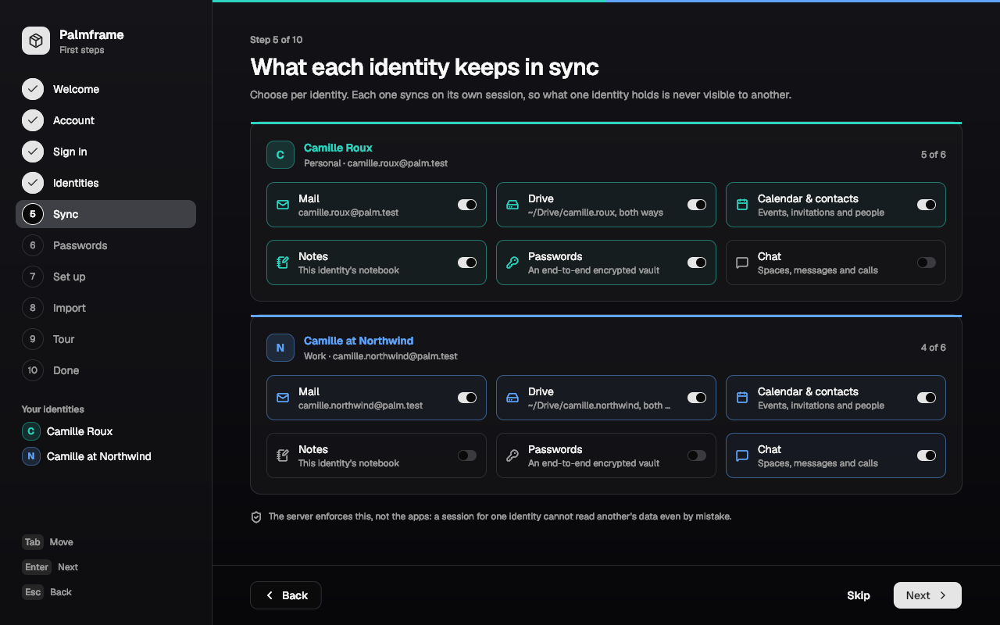

# The first run: from the installer's last page to a working account

Before this, a fresh Palmframe install had no way to create or sign in to
the Palmframe account, set up identities or choose what syncs: the cloud was
reachable only through CLI demos. `apps/welcome` is that way. It opens once
per person at their first login, and anyone can run it again later.

`product.md` is the model (one account, several identities, nothing crosses
silently). `accounts.md` is the account side. `research.md` §1 and §2 are
why the order below is what it is.



## The flow, and why

| # | step | what happens | why it is there |
| --- | --- | --- | --- |
| 1 | Welcome | language (the five catalogues) and appearance (light, dark), preselected from what the installer and the environment say | the installer chose for the machine; this is the person's own choice. Changing either writes a file, looking at the page writes nothing |
| 2 | Account | **Use an account** or **Only on this computer** | local-only is first-class (P5): every app works without the cloud. Skip here means local |
| 3 | Sign in | tabs: Create account (name, email, password, confirm) / Sign in; the server is a line with **Change** | the email is the recovery address and should be *outside* Palmframe (accounts.md, Recovery); the page says so when it is not |
| 4 | Identities | one suggested Personal identity named after the person; **Add an identity** (Ctrl N) adds Work, then Project, Public; name, handle, kind, colour; the mail address each handle gives is shown under it | handles are permanent (they are mail addresses), so this is where they are chosen with care. Colours come from shell.md's palette, never shared, never red |
| 5 | Sync | per identity: Mail, Drive, Calendar & contacts, Notes, Passwords, Chat, defaults by kind | choices are per identity (P3); each card carries its identity's band and name (P2) |
| 6 | Passwords | master password + confirm; then the **Emergency Kit**: Secret Key, Save (PNG and text, 0600), "I have saved it" before Next | the vault's two-secret design (vault.md) is only safe if the person has the kit; Palmframe cannot recover it |
| 7 | Set up | the whole list of what will happen first; **Set up** runs it; each line says Done, Waiting for the server, Not installed, Coming, Failed (with the tool's reason) | nothing ambient: nothing runs before this button, and every outcome is visible |
| 8 | Import | Google and Microsoft, marked **Coming** | a placeholder another agent can fill; it already says imports go into *one* identity |
| 9 | Tour | start menu (Super Space), identity switcher (Super I), five keys | three things, not a manual |
| 10 | Done | the identities and what each syncs; **Start using Palmframe** writes the marker | |

Every step but the first and the last can be skipped; skipping never does
anything, it only moves on. The steps that need an account (3 to 7) drop out
of the rail in local-only mode, and Passwords drops out once the Sync page
is left without any identity choosing it. Everything works from the
keyboard: Tab, Space, Enter (Next), Esc (Back), the arrows on the language
list and the account choice, Ctrl N on Identities.

**Identity colour appears as soon as identities exist**: the band across the
top of the window (every identity's colour side by side, Home's "All
identities" mark), the rail's "Your identities", each identity's own card on
Sync and Setup (band, monogram, name in its colour). The colour is never
alone: a name and a letter are always next to it, and when two names start
with the same letter the later one takes the letter of its handle's last
part (Camille Roux **C**, Camille at Northwind **N**).

**Nothing crosses identities.** Every service is set up by its own program
with `PALM_IDENTITY=<handle>`, on a session minted for that identity alone
(`mint_scoped_session`, as `accounts switch` does). A service could not read
another identity's data if it tried: the database refuses it. The e2e checks
it: a file put in one identity's drive is not in the other's.

## What each service gets

| choice | done by | on this computer |
| --- | --- | --- |
| (always) | `ck.scope_to` | `scoped/<handle>.json`, device "<host> · desktop" |
| Mail | `mail_bootstrap` RPC on the identity's scoped session, then once for the account `mailcore palm login` + `mailcore palm sync` | the identity's mailboxes on the server; `~/.local/share/palmy-mail/<address>/`, `palmframe.conf` for apps/mail |
| Drive | `PALM_IDENTITY=h palm-drive sync`, then `palm-drive watch` | `~/Drive/<handle>`; `session.d/60-palm-drive` starts the watchers at every login |
| Calendar & contacts | `PALM_IDENTITY=h calendar sync`, `contacts sync` | their local copies |
| Notes | `PALM_IDENTITY=h notes sync` | `~/Notes/<handle>` (with notes from main and palm-collab running) |
| Passwords | `vault setup` (master password in `PALM_VAULT_PASSWORD`, never argv), or `vault enroll --secret-key-file` when the account already has a vault | the vault; the kit in `~/Documents` |
| Chat | `PALM_IDENTITY=h chat whoami` | nothing to store; reports whether palm-rtc answers |

An exit 6 from a service becomes "Waiting for the server", an unknown verb
"Coming; your choice is saved", a missing program "Not installed". The
choice is written to `sync.conf` whatever happens, so a later login (and a
later `welcome run`) picks up from it.

## Files

| file | what |
| --- | --- |
| `$XDG_STATE_HOME/palm/welcome/done` | the marker, `{"completed_at":…,"mode":"account"\|"local"}` |
| `$XDG_CONFIG_HOME/palm/sync.conf` | `mode`, `url`, then one `[identity]` block per identity with `mail = on` … |
| `$XDG_CONFIG_HOME/palm/appearance` | `theme = dark` |
| `$XDG_CONFIG_HOME/locale.conf` | `LANG=fr_FR.UTF-8`, only if the language was changed |
| cloudkit's `config.json` | the server, only if **Change** was used and the server answered `/auth/v1/health` |
| `~/Documents/Palmframe Emergency Kit.{png,txt}` | 0600 |
| `/etc/palm/session.d/90-welcome` | waits for the compositor's socket, then `welcome run --first-login` |
| `/etc/palm/session.d/60-palm-drive` | one `palm-drive watch` per identity with `drive = on` |

## Command line (docs/PALM-CLI.md)

```sh
welcome status --json          # done, mode, signed in, theme, identities and what they sync
welcome run [--first-login]    # the window; --first-login does nothing once done
welcome reset --yes            # forget the marker (exit 4 without --yes); account and choices stay
welcome setup …                # the whole flow without a window:
welcome setup --local --finish --json
welcome setup --create --email E --name N --password-file F \
  --identities "camille:personal:teal:Camille Roux;camille.nw:work:blue:Camille at Northwind" \
  --sync "camille=mail,drive,passwords;camille.nw=drive,calendar" \
  --vault-password-file V [--kit-dir D] [--url U] [--start-daemons] --finish --json
welcome shots DIR [--lang ar]  # every step offscreen, light and dark
welcome --selftest
accounts server [URL] --json   # which server, from where; set it only if it answers
```

`welcome drive` (hidden) runs the window offscreen and types into it, Enter,
Tab, Space, letters and Ctrl N, from the first page to the last.

## Verified

Against a cloud/dev stack built from main's migrations (`--port-base 51521`),
palm-maild on base+70..72 and palm-collab on base+75:

- `bash apps/welcome/e2e.sh --port-base 51521` with
  `WELCOME_E2E_NOTES_TREE=<a checkout of main>`: **33 passed, 0 failed**.
  Three fresh users in throwaway homes: (1) the window, typed into: account,
  two identities, sessions scoped to each, `~/Drive/<h>` with a file that
  reaches the server and is absent from the other identity's drive, the
  vault enrolled, the kit saved 0600, mail configured with a Maildir per
  address, `~/Notes/<h>` synced and none for the identity that did not
  choose notes; (2) `welcome setup` and the `60-palm-drive` hook starting
  exactly one watcher per drive identity, `reset` refusing without `--yes`,
  `90-welcome` giving up quietly with no compositor; (3) local only: no
  token store, marker `local`, `run --first-login` does nothing after.
  Without notes sync in the tree, the notes task is checked to say Coming.
- `welcome --selftest`: **1151 passed, 0 failed** (210 msgids in all five
  catalogues with matching conversions; handles, letters, sync.conf, marker;
  the flow; every page in six languages, light and dark, balanced, Arabic
  laid out right to left; no password in clear on screen, busy or not).
- `accounts --selftest` 24/0 and `apps/accounts/e2e.sh` 28/0 after the
  `server` verb; `odin test apps/kit/i18n_test` (lints every catalogue) 5/5.
- Screenshots: `apps/welcome/shots/` (English light and dark, Arabic dark,
  the first pages in French, German, Spanish and Japanese); `welcome shots`
  renders all 84. Demo: `apps/welcome/demo.mp4`, from
  `bash apps/welcome/record.sh --port-base 51521` (the e2e's window run,
  filmed at 10 fps, letter by letter, against the real server).

## Signing in to the machine with the account (greeter): not built

accounts.md's plan assumes PAM (`pam_palm` after `pam_unix`). Palmframe has
no PAM: palm-login (`distro/login`) checks `/etc/shadow` itself. So the
plan moves, and none of it is small or safe to do from the greeter:

1. **Binding** (Accounts or the welcome, run as root through doas):
   `/var/lib/palm/accounts/<user>` root 0600 with the account id, the cloud
   URL and an argon2id verifier of the account password; the local password
   set to the same one through `passwd`'s code.
2. **palm-login** (`distro/login`, not the greeter) gains a verifier check:
   online, a GoTrue password grant; on success a single-use handoff file
   under `/run/palm-login/<uid>` that a session hook moves into the person's
   token store; offline, the cached verifier. A password changed elsewhere
   fails the online grant and the greeter's banner says so.
3. **The greeter** changes only its words: a bound user shows the account
   email under the name, and "Start in" shows the identities' monograms read
   from a root-written, non-secret list. It never holds a token.

What is safe today and done: the greeter is untouched; the first login
opens the welcome, which signs the *session* in to the account. Decisions
are listed at the end.

## Gaps, said plainly

- **Vault**: `vault setup` makes vaults for every identity the account has,
  so Passwords is per identity on the Sync page but the vault itself is
  per account (the page says so). An identity created after the vault gets
  no keyset: vault needs an "add identity" step (AUTOFILL's area).
- **Mail on this computer** is one mailcore login for the account and syncs
  every identity whose mailboxes exist: the per-identity choice decides the
  server mailboxes (`mail_bootstrap` scoped), not which Maildirs mailcore
  writes. mailcore needs `--identity` or scoped sessions for that. mailcore
  also signs in on GoTrue's own port (gateway port + 10 on cloud/dev, or
  `PALM_MAIL_AUTH_PORT`), not through the gateway.
- **Language and appearance** are written to `~/.config/locale.conf` and
  `~/.config/palm/appearance`, but palm-login reads only `/etc/locale.conf`,
  and apps read `PALM_THEME` from the environment: palm-login (or wm) has to
  read both files for the choice to reach every app at the next login.
- **An account with no identity** can exist if the window is closed between
  Create account and Create identities; the next run resumes at Identities.
- **Handle availability** is known only when the server refuses (no RPC to
  ask first); the row then says so.
- **palmy wraps only at spaces**, so the Japanese catalogue carries a space
  after each 、 and 。 in long sentences; palmy should learn CJK breaks.
- **The headless window take** (`record.sh --window`) works, but wtype can
  deliver a Tab in the same frame as the letters before it and palmy applies
  text after focus moves; demo.txt waits around every field for that. The
  film is the demo.
- **Recovery, 2FA, passkeys** are not offered at sign-up (accounts.md designs
  them; none is built).
- Not run on the QEMU image: the image does not package `welcome` yet (see
  the packaging lines in the report); the hooks are checked by e2e.sh as the
  user with the session environment, which is how palm-login runs them.

## Decisions for the person

1. The default server in a release build: today it is cloudkit's
   (`127.0.0.1:54321`, the dev stack). A hosted URL needs to exist.
2. Should Passwords be an account-level choice instead of per identity,
   matching the vault as built?
3. Should the welcome reappear at every login until finished (today), or
   only once even if the window is closed midway?
4. Machine sign-in with the account: build it in palm-login as above, or
   keep local Unix passwords separate from the account for good?
