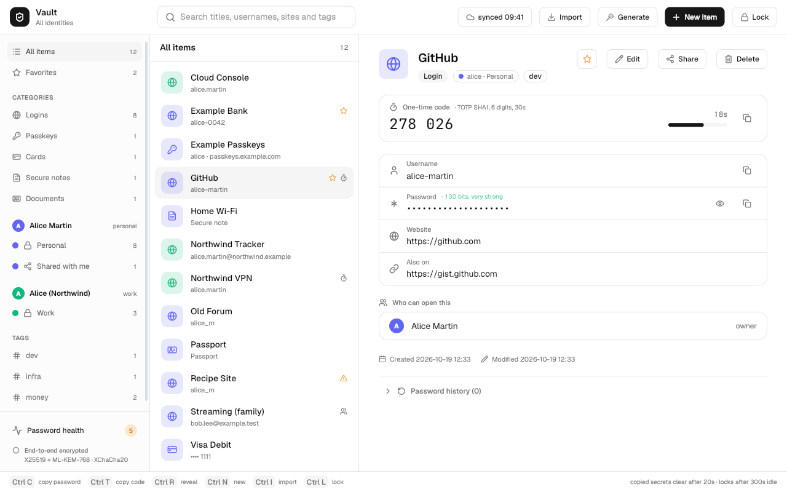

# The vault: end-to-end encrypted passwords, per identity

`apps/vault` is Palmframe's password manager. On a machine that is not
enrolled in an account it is what it always was: one encrypted file, no
network code reachable from the window. On an enrolled machine it is the
**account vault**: every identity's vaults, encrypted on the device, synced
item by item through the Palmframe cloud, shared deliberately between
identities, and offered to the browser over a local socket.

This note is the design, what was built, what was measured, and what is
left. `apps/vault/SECURITY.md` is the threat model; this note refers to it
rather than repeating it.

| piece | where |
| --- | --- |
| schema, RLS, functions | `cloud/supabase/migrations/20261019900000_vault.sql` |
| pgTAP (92 assertions) | `cloud/supabase/tests/vault_isolation.sql`, `vault_shares.sql` |
| key hierarchy, sealing, signatures | `apps/vault/keys.odin` |
| records (one item = one blob) | `apps/vault/model.odin` |
| local cache, unlock, decrypt | `apps/vault/cloud.odin` |
| sync, conflicts, sharing, rotation, devices | `apps/vault/sync.odin`, `merge.odin` |
| one engine for window and CLI | `apps/vault/book.odin` |
| CLI (`vault <verb> --json`) | `apps/vault/cli.odin` |
| importers, export | `apps/vault/import.odin`, `kdbx.odin`, `argon2/` |
| health, breach check | `apps/vault/health.odin` |
| autofill socket and reference client | `apps/vault/autofill.odin` |
| end-to-end demo against a live stack | `apps/vault/e2e.sh` (87 checks) |
| self-test | `vault --selftest` (4865 checks) |



## What others do, and what we took

Read from their published papers and source (links in the research notes of
the commit history; the short list):

- **1Password** (security design paper): two-secret key derivation. The
  account unlock key comes from the password (PBKDF2-HMAC-SHA256, 650,000
  iterations) *and* a 128-bit Secret Key generated on the first device and
  never sent to the server, so a stolen database cannot be attacked by
  guessing passwords alone. Vault keys are wrapped to each member's public
  key (RSA-OAEP). Items are encrypted as two parts (overview and details),
  both encrypted. **Taken:** the Secret Key, per-vault keys wrapped per member.
- **Bitwarden** (`bitwarden/server`, `clients`): master key from PBKDF2 (600k)
  or Argon2id (32 MiB, 6 passes, 4 lanes by default), stretched by HKDF, wrapping
  a 512-bit user key; RSA-2048 for organisations. Item contents are
  encrypted, but **type, favourite, folder and organisation membership,
  timestamps, collection membership and attachment sizes are plaintext** on
  the server. **Not taken:** any plaintext metadata.
- **Proton Pass** (`ProtonMail/WebClients`): a key per item, wrapped by the
  vault ("share") key; AES-GCM with a context tag as associated data
  (`itemcontent`, `itemkey`, `vaultcontent`, ...); sharing one item hands over
  that item's key, signed by the inviter. Plaintext on the server includes
  revision, flags, timestamps, and the **alias e-mail address**. **Taken:**
  per-item keys, context-bound AEAD, signed shares.
- **KeePassXC-Browser**: native messaging to a proxy, a local socket to the
  app, NaCl boxes, an "association" the person approves once, and a
  per-entry "allow this site" prompt. **Taken:** pairing approved by a person,
  confirmation per fill with a "remember for this site".
- **LastPass, 2022**: stolen vault backups held **website URLs in the clear**,
  and old accounts still used 5,000 (some 1 or 500) PBKDF2 iterations, never
  forcibly upgraded. **Lessons applied:** no plaintext URL, title, tag or
  vault name anywhere on the server; KDF parameters live with the keyset and
  are re-chosen at every master-password change; the Secret Key means even a
  weak password is not the only thing between a database thief and the vault.

## The key hierarchy

```
master password ──Argon2id (256 MiB, t=3, p=4, salt per account)──┐
                                                                   ├─HKDF-SHA256─► account unlock key (AUK)
Secret Key (128 bits, on each device) ──HKDF(salt = account id)───┘        │ wraps (XChaCha20-Poly1305)
                                                                           ▼
                                                                  account key (random 256 bits)
                                                                           │ wraps, once per identity
                                                                           ▼
          identity keyset: X25519 + ML-KEM-768 (encryption), Ed25519 (signing)
                                                                           │ seals (hybrid KEM)
                                                                           ▼
                                                              vault key (random, one per vault)
                                                                           │ wraps
                                                                           ▼
                                                              item key (random, one per item)
                                                                           │ encrypts
                                                                           ▼
                                                      the item: every field, padded to 512 bytes
```

- **Every symmetric layer** is XChaCha20-Poly1305 with a random 192-bit nonce
  (no counter to keep in step between devices) and carries an 8-byte key id
  (a hash of the key, so a device holding several generations knows which one
  a blob needs) and a **context string as associated data**: what the blob is
  and which row it belongs to (`palm-vault/item/v1|<vault>|<item>|<revision>`,
  `.../item-key/v1|<vault>|<item>|<key version>`, ...). A key copied to
  another row, an item blob moved to another id, or a revision number
  rewritten all fail to authenticate instead of decrypting into the wrong
  place. The self-test does each of those to a real cache.
- **Sealing to an identity is hybrid**: X25519 *and* ML-KEM-768, combined
  through HKDF with the X25519 ciphertext and public key in the transcript,
  the shape of X-Wing. A vault key sealed today sits on a server for years;
  X25519 alone would fall to whoever records it now and owns a large quantum
  computer later. It costs 1.2 KB per sealed key. The self-test checks the
  KEM half is bound (a box carrying another box's ML-KEM ciphertext fails).
- **The Secret Key** (`PV1-XXXXXX-XXXXXX-XXXXXX-XXXXXX-XX`, 26 base32
  characters) is generated at `vault setup`, kept in
  `account/device.json` (0600) on each enrolled device, and printed once for
  the person's emergency kit. Changing the master password re-wraps the
  account key on every identity's keyset under a new salt; the items are not
  touched and the Secret Key does not change.
- **Why one account key for all identities:** the person unlocks once, at the
  cost of one Argon2id. The separation *between* a person's identities is the
  database's (a device scoped to `work` never receives `personal`'s rows), not
  the cryptography's: a device that knows the master password and the Secret
  Key could derive every identity's keys if it had their rows. The
  separation between *people*, and from the server, is cryptographic.

Published vectors asserted by `vault --selftest`, transcribed from the
documents: X25519 (RFC 7748 §6.1), HKDF (RFC 5869 A.1), Ed25519 (RFC 8032
§7.1 test 1), XChaCha20-Poly1305 (draft-irtf-cfrg-xchacha-03 A.3.1), Argon2d
(RFC 9106 §5.1) and Argon2id (§5.3) through the vendored Argon2, plus the
local vault's existing ChaCha20-Poly1305, AES-GCM, HMAC, HOTP and TOTP
vectors. ML-KEM-768 is Odin's `core:crypto/mlkem`, tested there against the
NIST vectors; here it is round-tripped and tampered with, not re-vectored.

## What the server sees

Everything a person typed is inside an AEAD the server cannot open: titles,
usernames, passwords, **URLs**, notes, tags, custom fields, card numbers,
passkeys, TOTP seeds, password history, item types, favourites, vault names
and colours. What is in the clear, and why each one is needed:

| visible | why | what it tells the server |
| --- | --- | --- |
| row ids (random UUIDs) | addressing | nothing |
| `identity_id` on every row | RLS: the contract's one access rule | which identity owns how many items |
| item `revision`, `key_version`, `deleted`, timestamps | sync's compare-and-swap; tombstones so deletions reach every device | when items change |
| blob length, in 512-byte steps | unavoidable for ciphertext | roughly "a login" vs "a login with a long note" |
| keyset public keys | others must be able to seal to them | nothing secret |
| KDF salt and parameters | a client must know them before it can derive | the cost an attacker pays |
| share rows: who shares which item or vault with whom, role, revoked | the grantee's RLS path; revocation | the sharing graph |
| device names and enrolment public keys | approving a new device | how many devices, and what they are called |

The end-to-end demo checks the first column the hard way: `pg_dump` of the
five vault tables after a run, searched for 20 known strings (both passwords,
every title, username and URL the demo used, the vault names, the Secret
Key's prefix and the master password). None appear.

Not hidden, and stated as such: the number of items per identity, when they
change, and who shares with whom. Hiding the share graph would need a
mixnet-shaped design no password manager ships; hiding counts would need
padding with dummy rows, which is a reasonable later step.

## Schema and access rules

`20261019900000_vault.sql`, all tables with `identity_id` and RLS through
`can_access_identity()` as `cloud/CONTRACT.md` requires:

- `vault_keysets` — one per identity: public keys, KDF salt and parameters,
  the account key wrapped under the AUK, the identity's private keys wrapped
  under the account key.
- `vault_vaults` — the vault key sealed to its owner, its encrypted name, a
  `key_version` that goes up on rotation.
- `vault_items` — one row per item: the item key wrapped under the vault
  key, the item under the item key, a revision.
- `vault_shares` — the cross-identity rule made concrete: an explicit row by
  the source identity, carrying the key sealed to the grantee and an Ed25519
  signature. Item shares are read-only; a whole-vault share may be `write`.
- `vault_devices` — enrolment keys and the Secret Key sealed to a new device.

The access rule, written once as `vault_can_access(identity)`, is the
contract's `can_access_identity()` **and one narrowing addition: the session
is not an assistant's** (`public.devices.kind = 'assistant'` for the session
in the token). Nothing is widened. Grantees read an item through
`vault_shared_role()` (a live share to an identity they may act for);
writers through a whole-vault `write` share may add and edit items, never
delete them, rename the vault, or see the owner's keyset.

`vault_put_item()` is the only write path sync uses: a compare-and-swap on
the item's revision (40001 with the current revision on conflict), a refusal
when the item key is wrapped under a vault key that has since been rotated
(so an offline device cannot republish a key a revoked member holds), and
"not found" — not "forbidden" — for an item the session cannot see, so it does
not confirm that the item exists. Triggers keep ids, identities and vaults
permanent, revisions going up by exactly one, shares immutable except for
being revoked, and revoked shares revoked.

pgTAP, 92 assertions over two files: a session scoped to identity A gets
nothing of B's and every write fails, across one person's identities and
across people; a share grants exactly the item (or vault) and role it says
and nothing next to it, not to the grantee's other identities, not onward;
revocation stops the rows at the next request; rotation; tombstones; anon
gets nothing; an archived identity's vault disappears; and an **assistant's
session for an identity gets zero rows from every vault table and every
vault function** while a device session for the same identity sees
everything — the assertion the README asks for.

## Sync

Offline first. A device keeps `account/cache.json`: exactly the rows the
server has (ciphertext, ids, revisions) plus a queue of its own edits, which
are encrypted the moment they are made. Nothing in the cache opens without
the master password and the Secret Key, so an edit made offline is as safe
on disk as it will be on the server.

A sync (`vault sync`, the cloud button in the window, after every edit, and
every 60 s while unlocked):

1. **Pull**: identities, keysets, vaults, shares and devices in full (small);
   items as a listing of id, revision and key version, then only the rows
   whose revision moved, 40 per request. Rows that disappeared from the
   listing (a share revoked, a vault purged) are dropped from the cache.
   Foreign identities that appear in shares have their public keys pinned
   on first sight.
2. **Push** the queue one item at a time through `vault_put_item`.
3. **Conflicts** (40001): fetch the server's row and merge three versions —
   the base (kept *with* the queued edit, because the pull in step 1 has
   already replaced the cached row: the first version of this code merged
   against the wrong base and the end-to-end demo caught it losing the other
   device's notes), ours and theirs — field by field. A field one side changed
   takes that side; both changed differently, the later `modified` wins **and
   the losing password goes into the history**, because a site may already
   have accepted it. Tags, URLs and custom fields merge as sets. The result
   is pushed as the next revision.
4. **Compaction**: the cache is written and read back into a fresh arena.

Measured in the demo: two devices, one offline edit to a username while the
other changed the notes and the password; after sync both edits are on both
devices and the overwritten password is in the history.

## Sharing, revocation and rotation

**Sharing** one item: the owner seals the item key to the grantee's public
keys (theirs if they are this account's identity; looked up by handle and
pinned otherwise), signs a transcript of every field of the share row plus a
hash of the sealed key with the owning identity's Ed25519 key, and inserts
the row. **Sharing a vault** is the same with the vault key. Cross-account
shares show a 20-digit safety number to read aloud.

**Signed shares** close the hole a server could otherwise use: anyone can
seal a key to a public key, so without the signature a malicious server
could hand the grantee a key of its own and feed it items it wrote (phishing
URLs in a trusted vault). The grantee verifies the signature against the
source identity's key (its own account's keyset, or the pinned key of
another account) before opening anything. The self-test substitutes a key
the grantee *can* open and checks it is refused.

**Revoking** sets `revoked_at`: the next request returns none of the rows.
That stops sync; it cannot take back what the grantee already decrypted, and
the grantee may have kept the key. So the owner's client rotates at once:

- an item share: a new item key; the item re-encrypted; any other live share
  of it re-issued with the new key;
- a vault share: a new vault key (`key_version` + 1, enforced by
  `vault_put_item` for every later write), every item re-encrypted under a
  new item key, remaining shares re-issued.

Every item the revoked identity could read is flagged **exposed**, and
password health says "change this password at the site". Rotation protects
what is written next; only a new password protects what was read.

## Devices

A new device either types the Secret Key from the emergency kit
(`vault enroll --secret-key-file`) or asks an enrolled device
(`vault enroll --request`): it publishes an X25519 key in `vault_devices`,
both screens show a six-digit code derived from that key, and the person
approves on the old device with the code (`vault approve <id> --code ...`),
which seals the Secret Key to the new device. A server that substituted its
own key would show a different code. This one box is X25519 only (the device
key is single-use and protects the Secret Key, which is useless without the
master password); the demo enrols a phone this way.

Revoking a device ends its session through accounts (`revoke_device`); it
cannot take back the Secret Key or the items the device already holds. Recovery
from a lost device is: change the master password (the device's cached
wrap no longer opens) and, if the device may have been compromised while
unlocked, rotate the Secret Key — designed below, not built.

## Recovery: the options and what each costs

There is no server-side recovery, by construction. The options, for the
person to choose (decision 1 below):

| option | recovers from | costs | status |
| --- | --- | --- | --- |
| Emergency kit (Secret Key printed, password remembered) | a lost device | nothing; the default | built (`vault setup` prints it) |
| Another enrolled device | a lost device | none | built (`enroll --request` / `approve`) |
| Recovery code: a second random secret that also wraps the account key, shown once | a forgotten password *and* lost devices | one more secret that opens everything; stored by the person | designed |
| Recovery contact (1Password's recovery group, Bitwarden's emergency access): the account key sealed to a trusted identity, released after a waiting period the owner can cancel | everything | that identity, plus whoever controls its mail and devices, can open the vault after the wait | designed; needs a server-side timer |
| Server-side escrow | everything | the server can read the vault: the whole design is gone | **rejected** |

## Passkeys

Passkeys are stored today as an item kind with the fields Bitwarden's
`Fido2Credential` carries (credential id, relying party, user handle and
name, the private key, counter, discoverable), encrypted with the rest of the
item, imported from Bitwarden exports and exported back. Nothing performs a
WebAuthn ceremony yet: Linux has no shipped platform authenticator API
(credentialsd proposes an XDG portal; Firefox's support is experimental), and
every password manager that offers passkeys on desktop does it by replacing
`navigator.credentials` in the browser. The plan is the same here, through
the autofill socket: `webauthn.create` / `webauthn.get` requests from the
browser, answered by the vault after the person confirms, signing with
`core:crypto/ecdsa` (P-256). Import and export of passkeys between managers
should then follow FIDO's Credential Exchange Format (CXF, a proposed
standard since August 2025).

## Password health and the breach check

Weak (in a short list of the most common passwords, under 10 characters, a
word followed by digits — "Summer2024!" scores 72 bits by shape and falls in
seconds — or under 50 bits), reused, exposed (above), and unchanged for two
years. All local.

The breach check is the one outbound call outside sync, so it is off by
default, runs only when the person turns it on *and* presses "Check now"
(or `vault health --breach --yes`), and sends Have I Been Pwned's range API
the first five hex digits of each distinct password's SHA-1 with
`Add-Padding: true`, comparing the ~800 suffixes locally. What leaks: that
this address asked for those prefixes. The fetcher is a parameter; the
self-test supplies a fixture and asserts only five-character prefixes would
have left, one per distinct password. No live call is made by any test.

## Import and export

| from | format | notes |
| --- | --- | --- |
| Bitwarden | JSON (unencrypted), CSV | logins, notes, cards, identities, SSH keys, passkeys, custom fields, password history, folders as tags; trashed items skipped; encrypted exports refused with how to re-export |
| 1Password | 1PUX | logins, cards, notes, documents, sections, TOTP, password history; archived items skipped |
| KeePass / KeePassXC | KDBX 4 | AES-256 and ChaCha20; AES-KDF, Argon2d (KeePassXC's default) and Argon2id; protected fields; history; groups as tags; the recycle bin skipped. KDBX 3, key files and Twofish are refused with a sentence |
| Chrome, Firefox | CSV | Firefox's internal `chrome://` logins skipped |
| palmy | `.pvz` | another vault file, with its own password |

The KeePass fixtures are written by pykeepass (an independent implementation,
whose Argon2d is libargon2's), in three cipher/KDF combinations, and the
Argon2d the importer needed is Odin's Argon2id with the type switch added
(`apps/vault/argon2/`, three lines differ; asserted against RFC 9106 §5.1).
Export is an encrypted `.pvz`, or Bitwarden's JSON for leaving (`--yes`
required, since it is every password in the clear).

## Autofill: the protocol

The browser asks the vault for logins over a Unix socket. The vault side and
a reference client (`vault autofill-client`, which is what the browser does,
from a terminal) are built and tested; the browser side is the browser
agent's, and the exact integration is below.

**Transport.** `$XDG_RUNTIME_DIR/palm-vault/autofill.sock`, directory 0700,
socket 0600. One JSON object per line each way; 64 KiB per line at most. The
window serves it while it runs (and a headless `vault autofill` exists for
tests and scripted demos). Every connection is checked with `SO_PEERCRED`: a
peer that is not this user is dropped before a byte is read; the peer's pid
and `/proc/<pid>/exe` are shown in every prompt.

**Requests** (all fields strings; responses always carry `ok`):

| op | request | response | needs |
| --- | --- | --- | --- |
| `hello` | `{"op":"hello","client":"Palmframe Browser"}` | `{"ok":true,"version":1,"state":"locked"\|"unlocked","challenge":"<b64 32 bytes>"}` | — |
| `pair` | `{"op":"pair","name":"…","key":"<b64 32 random bytes>"}` | `{"ok":true,"pair_id":"<uuid>"}` or `{"ok":false,"error":"denied"}` | the person, after comparing the 6-digit code both sides show (SHA-256 of the key) |
| `auth` | `{"op":"auth","pair_id":"…","proof":"<b64 HMAC-SHA256(key, challenge)>"}` | `{"ok":true}` / `unpaired` | a pairing; the challenge is single-use |
| `query` | `{"op":"query","origin":"https://github.com","identity":"alice"}` | `{"ok":true,"state":…,"candidates":[{"id","title","username","match":"exact"\|"subdomain","totp":bool}]}` | auth; **never a password** |
| `fill` | `{"op":"fill","id":"…","origin":"…","identity":"…"}` | `{"ok":true,"username","password","totp"?}` | auth, the origin matching the item, the identity owning it, and the person's "Allow once" (or an earlier "Always on this site" for that pair, item and origin) |
| `save` | `{"op":"save","origin","identity","username","password","title"?}` | `{"ok":true,"saved":true}` | auth, the person |
| `state` | `{"op":"state"}` | `{"ok":true,"state":…}` | auth |

**Origin binding.** The browser names the *top-level* origin of the tab, as
its engine reports it (never a URL taken from the page). The vault offers an
item only if one of its URLs has the same scheme, the same port and either
the same host (`exact`) or a host the origin is a subdomain of (`subdomain`,
not across a short list of shared suffixes such as `co.uk` or `github.io`).
An https login is never offered to http; nothing is offered to a URL with
credentials in it, to `file:`, or to `javascript:`. Asked to fill an item on
an origin it does not match, the vault refuses even with the person's
approval. 18 cases in the self-test; lookalikes (`github.com.evil.example`,
`evilgithub.com`) in the live demo.

**Identity binding.** The tab's identity (the browser profile's identity
handle) must be the identity whose vault holds the item, or that sees it
through a share. A work tab gets nothing from the personal vault.

**What it cannot stop**, said in SECURITY.md: a program running as the same
user can read the browser's profile (and its pairing key), ptrace either
process, or replace the browser binary. Pairing and confirmation make that
visible; they are not a sandbox.

### Wiring it into apps/browser

The browser already has everything the protocol needs: it knows the top-level
URL of every view (`PB_URL`), the identity of the window (its profile), and a
host process per engine that can run script in the page. The change is
small and specified here so the browser agent can make it:

1. **Client** (`apps/browser/autofill.odin`, Odin, ~200 lines): connect to
   the socket, `hello`, and on first use `pair` with a 32-byte key generated
   with `crypto.rand_bytes`, shown to the person as the 6-digit code
   (`SHA-256("palm-vault/autofill-pair/v1" ‖ key)`, first 4 bytes big-endian
   mod 10⁶, as `### ###`) next to the vault's prompt. Keep
   `{pair_id, key}` in `$XDG_DATA_HOME/palmframe/browser/<identity>/vault-pair.json`,
   0600. Every connection then `auth`s with `HMAC-SHA256(key, challenge)`.
   `apps/vault/autofill.odin`'s `af_dial`, `af_call`, `af_req` and `af_proof`
   are the reference to copy; `vault autofill-client` exercises all of it.
2. **When to ask**: on `PB_URL` for a view (and when a password field gets
   focus, below), send `query` with the view's current origin and the
   profile's **identity handle** (the account handle, from
   `~/.config/palmframe/identities.json`, not the profile directory name).
   Show the candidates in the chrome (a key icon in the address bar, and a
   palmy dropdown anchored under the focused field). Never cache passwords.
3. **Filling**: when the person picks a candidate, send `fill`. The vault
   asks the person; on `ok`, send the engine a new request
   `PB_FILL = 23 /* str origin, str username, str password */`. The host
   **re-checks that the view's top-level origin still equals `origin`**
   (CEF: `browser->GetMainFrame()->GetURL()`; Gecko: the BiDi
   `browsingContext.getTree` URL of the top context) and drops the request if
   the page navigated meanwhile, then fills:
   - CEF: `frame->ExecuteJavaScript` of a fixed function, with the two values
     passed as JSON string literals produced by a JSON encoder (never
     concatenated text), that finds the focused `input[type=password]` (or the
     one in the focused element's form), the closest preceding text/email
     input as the username, sets `.value`, and dispatches `input` and
     `change` events.
   - Gecko: `script.callFunction` in the top-level realm with the same
     function and the values as BiDi `arguments`, which are serialized by the
     protocol rather than spliced into source.
   Wipe both strings in the chrome and the host after use.
4. **Focus events** (host → chrome, new): `PB_FIELD_FOCUS = 121 /* u8 kind:
   0 none, 1 username, 2 password, 3 one-time code */`, from a preload
   script's `focusin` listener (CEF: inject at `OnLoadEnd`; Gecko: the
   existing preload script and channel). It lets the chrome offer the
   dropdown at the right moment, and fill a TOTP code into an OTP field.
5. **Saving**: `PB_FORM_SUBMIT = 122 /* str origin, str username, str password */`
   from the same preload script on a form submit that carried a password; the
   chrome sends `save` and the vault asks the person.
6. **Turn off the engines' own password managers**: CEF with
   `credentials_enable_service=false` and `profile.password_manager_enabled=false`
   in the profile prefs (it uses Chromium's unencrypted `basic` store on
   Palmframe today); Firefox already has `signon.rememberSignons=false`.

The tests that should come with it: the chrome against `vault autofill`
(headless, `--allow once`), asserting that a fill for a view whose URL
changed between `fill` and `PB_FILL` is dropped by the host.

## The assistant never reads the vault

An assistant is handed an identity through a delegated session
(`accounts delegate --kind assistant`, `PALM_CLOUD_SESSION`). Enforced three
times, so no single one is load-bearing:

1. **Database**: `vault_session_ok()` is false for a session whose devices row
   is `kind = 'assistant'`, and every vault policy and function requires it.
   pgTAP asserts zero rows from all five tables, refused writes and refused
   functions for an assistant, and full access for a device session of the
   same identity.
2. **Live**: the demo takes the delegated session's own access token and
   queries PostgREST directly: `[]` from every vault table, while the same
   token reads the identity.
3. **CLI**: every `vault` verb refuses a process holding `PALM_CLOUD_SESSION`
   (exit 5).

And the cryptography is the floor under all three: an assistant holding
ciphertext would still need the master password and a device's Secret Key.
What this cannot stop: an assistant process running as the same Unix user
with the vault window unlocked can read that process's memory. That is the
same-user boundary SECURITY.md names; the scoped assistant should run as a
different user or in a sandbox, which is the distro's to decide.

## The QEMU "/root" failure

`apps.tsv` recorded the vault GUI exiting with "could not create
/root/.local/share/palmy-vault" while the shell said `HOME=/home/palm`, and
`distro/notes/runtime.md` says the same happened to `mailcore` and `ocr`.
Odin's `os.get_env` reads the process's real environment (libc `getenv`), so
the process really had `HOME=/root`: whatever launched it in the harness
passed root's environment to a process running as palm (palm-login runs as
root with `HOME=/root`; a launch path that drops privileges without resetting
the environment produces exactly this). That launch path is the integration
agent's (`distro/`). The vault no longer trusts a `HOME` it does not own: the
data directory is `$XDG_DATA_HOME`, else `$HOME` if this uid owns it, else
the home `/etc/passwd` gives this uid; `vault where` prints which and why,
and the error names the source.

## Decisions for the person

1. **Recovery.** Ship with emergency kit + device approval only (today), add
   a recovery code, or add a recovery contact with a waiting period? Each is
   one more way in.
2. **Master password vs account password.** They are separate today: the
   account password goes to GoTrue in the clear (over TLS) at sign-in; the
   master password never leaves the device. Using one password for both is
   what people will want, and is safe only because of the Secret Key; it
   would need GoTrue to receive a derived value instead (Bitwarden's
   one-iteration hash, or SRP as 1Password does).
3. **The breach check's default.** Off (today) or on with a first-run
   question. It is the vault's only third-party request.
4. **Hiding item counts** with padding rows: cheap to add, changes storage by
   a constant factor.
5. **Hosted Supabase**: the vault adds no new dependency on the gateway rule,
   but the assistant restriction depends on `public.devices.kind`, which only
   accounts' `mint_scoped_session` sets — keep it that way.

## Gaps, honestly

- **The window's network calls are on the frame thread.** Sync against the
  local stack takes tens of milliseconds; against a slow server the window
  would stall for the length of a request. A sync thread is the fix.
- **The idle-lock and clipboard timers** still depend on the frame loop
  running (TODO.md K4); the window keeps it running while unlocked.
- **No passkey ceremony** (above), **no Secret Key rotation**, no recovery code
  or contact (designed), no device revocation UI in the window (the CLI's
  `vault devices` lists them; ending a device is `accounts revoke`).
- **Export from the window**: the CLI exports; the window imports only.
- **KDBX 3, key files, Twofish** are refused rather than read.
- **Search** covers titles, usernames, URLs and tags in memory; there is no
  index, which is fine for thousands of items and not for millions.
- **The autofill client in the browser** is specified above, not built here.
- **Memory**: the account vault holds every decrypted item while unlocked,
  like the local one; `mlock` is still not used (SECURITY.md).
