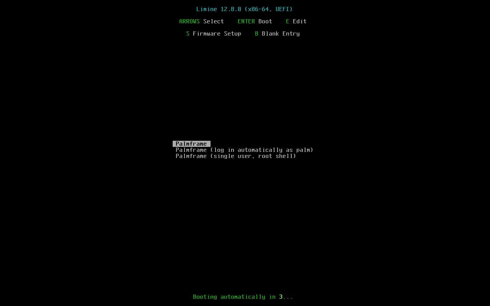
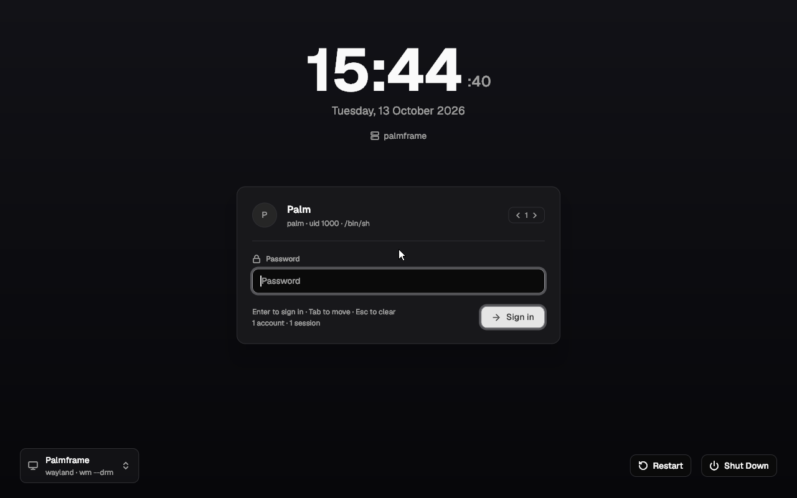
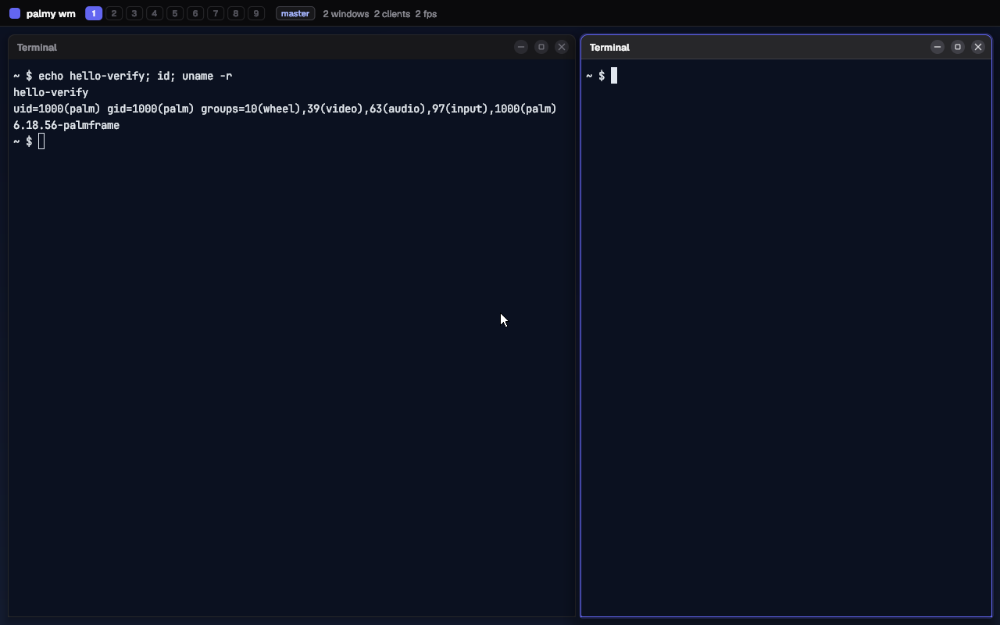
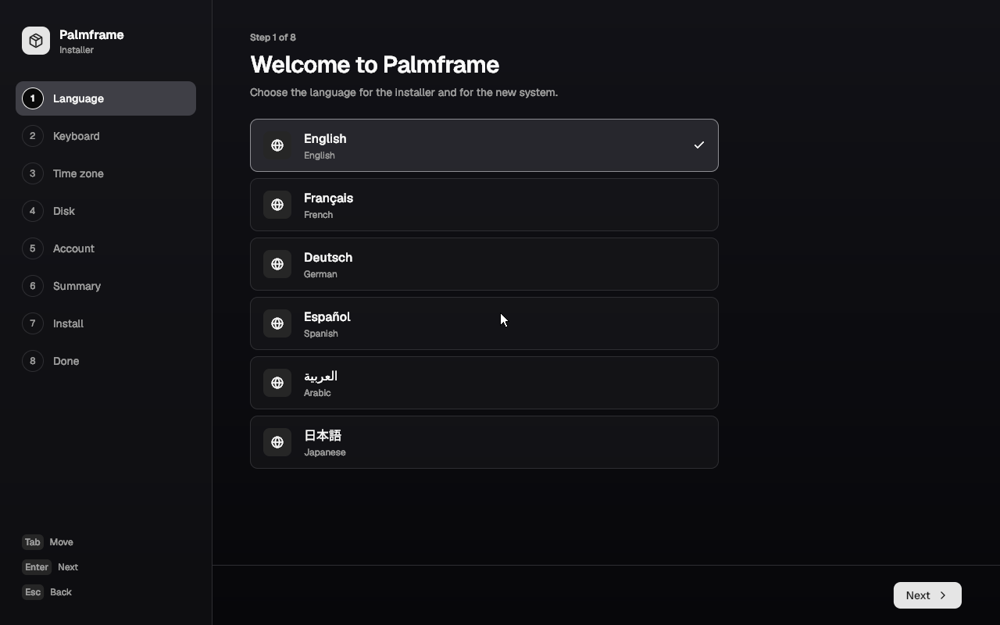
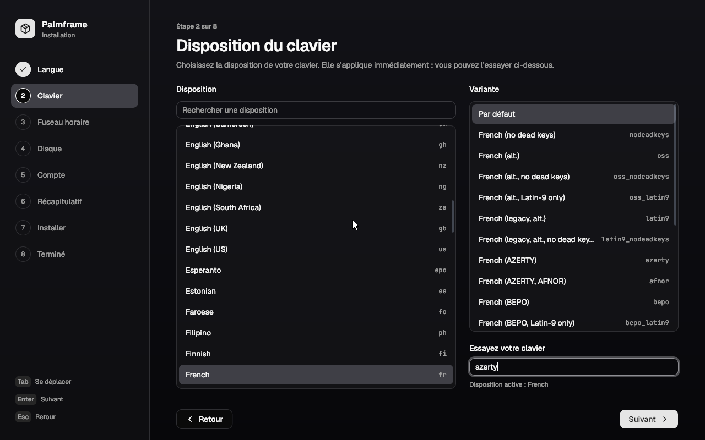
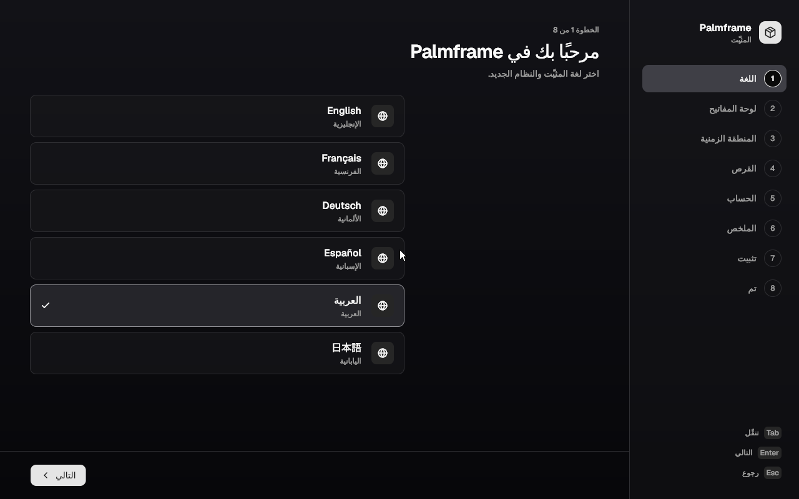
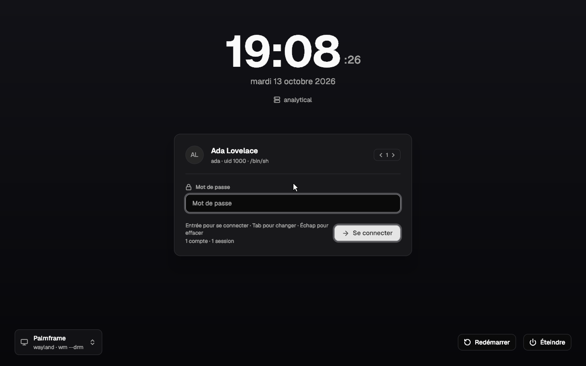

# Palmframe, the distribution

A small Linux distribution built from this checkout: a kernel, a static
busybox userland, an init, a login daemon and a package manager written in
Odin, and the palmy window manager and applications on top. It builds into one
GPT disk image and boots in QEMU from UEFI firmware to a graphical login and a
working desktop. It also builds into a live ISO whose graphical installer puts
the system on a disk of its own; see *Installing*.

It is modelled on Alpine. Like Alpine it is small, uses busybox for the
userland, and has a package manager with a world file and signed indexes.
Unlike Alpine it uses glibc rather than musl, because every palmy binary links
glibc, and that glibc is copied from the build host rather than built.







These are QMP screendumps from the verification run described under
*What has been verified*, not mock-ups.

`CONTRACT.md` is the set of interfaces every piece was built against, and
`INSTALLER.md` the installer's. This file describes what was built; where it
and the contracts disagree, the notes in `notes/` say why.

## Building and running

```sh
make distro                  # from the repository root; same as make -C distro
distro/run-qemu.sh           # boot it in a QEMU window, UEFI firmware
```

`make distro` builds the kernel (Linux 6.18.56) and busybox (1.37) only if
`distro/out/kernel.release` or `distro/out/busybox` is missing (the kernel
also when `distro/kernel/palmframe.config` changes), because those take
minutes. Then it builds the Odin binaries, generates the recipes, builds 48
packages into `distro/out/repo/x86_64/`, signs the index, and assembles
`distro/out/palmframe.img` from 34 of them. Once the kernel exists, the rest
takes a few seconds. The image is 1.2 GB sparse and under 100 MB on disk.

Nothing needs root. palm installs the system into an empty directory under
`fakeroot`, and `mkfs.ext4 -d` runs in the same fakeroot session, so the
owners palm records (root, palm 1000, greeter 900) and the 0600 `/etc/shadow`
are what land in the ext4 image even though every file on the host belongs to
the builder. The disk is partitioned with `sfdisk` on a plain file, with mtools
for the FAT partition. No loop device is used.

Other targets:

| command | |
| --- | --- |
| `make -C distro repo` | stop after the signed repository |
| `make -C distro image` | rebuild the image from the repository |
| `make -C distro iso` | the live installer, `distro/out/palmframe-live.iso` (see *Installing*) |
| `make -C distro run-iso` | `distro/run-qemu.sh --iso` |
| `make -C distro run` | `distro/run-qemu.sh` |
| `make -C distro test` | the headless boot test (`image/test-boot.py`); screenshots in `distro/out/shots/` |
| `make -C distro test-installer` | `palm-install --selftest` and `installer --selftest`; no disk is touched |
| `make -C distro test-install` | builds the ISO, then `live/test-install.py`: a GUI and a CLI install in QEMU, each booted afterwards |
| `make -C distro serve` | serve the repository on :8080 for the guest's `palm update` (`PORT=8091` for another port) |
| `make -C distro check-libs` | fail if a shipped binary needs anything but libc, libm and the loader |
| `make -C distro clean` | remove the packages, root and image; keeps the kernel, busybox and the signing key |

`distro/run-qemu.sh` options:

| flag | |
| --- | --- |
| (none) | a gtk window, OVMF firmware, serial console logged to `distro/out/serial.log` |
| `--serial` | the serial console on this terminal too (ctrl-a x quits) |
| `--headless` | no window; QMP on `distro/out/qmp.sock` |
| `--serial-socket P`, `--qmp-socket P` | for scripts |
| `--direct` | skip firmware and limine: `-kernel`/`-append` |
| `--bios` | SeaBIOS instead of OVMF |
| `--iso` | boot the live ISO, with `distro/out/target.qcow2` (8 GiB, made if missing) as the virtio disk |
| `--disk P` | the virtio disk is `P` instead of the image; without `--iso` it boots `P` |
| `-- <args>` | passed to QEMU unchanged |
| `IMG=<file>` | boot a different image, e.g. a copy |

The image is used in place: what the guest installs stays installed. Run
`make -C distro image` to start again from a clean image.

### Logging in

| user | password | |
| --- | --- | --- |
| `palm` | `palm` | the graphical login; uid 1000, groups palm, wheel, video, audio, input; only on the disk image, not on an installed system |
| `root` | `palm` | the serial console getty (`--serial`) |
| `greeter` | locked | runs the login screen, uid 900 |

In the session, SUPER+Return opens `term`, SUPER+D the launcher, SUPER+S
Software, and SUPER+SHIFT+E ends the session and returns to the greeter. The rest of the key
bindings are in `apps/wm/config.odin`.

## Installing

The disk image above is a demonstration system with a shared `palm` account.
To put Palmframe on a disk of its own, boot the live ISO and run the
installer.

```sh
make -C distro iso                                  # distro/out/palmframe-live.iso
distro/run-qemu.sh --iso                            # boot it, OVMF, blank 8 GiB distro/out/target.qcow2
distro/run-qemu.sh --disk distro/out/target.qcow2   # afterwards: boot what was installed, alone
```

With `--iso` or `--disk`, OVMF's variable store is kept beside the disk as
`<disk>.OVMF_VARS.fd`. The installer writes its boot entry into that store,
so the entry is still there when the disk boots without the ISO. Add `--bios`
for SeaBIOS.

The ISO is 74 MB. limine offers two entries, *Install Palmframe* and
*Install Palmframe (serial console only)*. The whole system runs from RAM: a
57 MB zstd initramfs, about 81 MiB unpacked, holding 19 packages (the base
system, the kiosk wm, term, the installer and its tools, and a 100 KB
Japanese subset of Noto Sans CJK) and, in `/usr/share/palm/repo`, a signed
repository of the 36 packages an installation needs: `palmframe`, its
dependencies and `fonts-cjk`. Installing therefore needs no network.
palm-init starts the `installer` service, which
runs `wm --drm --kiosk --exec installer` as root, and a root shell on the
serial console. `palm-login` and `getty-ttyS0` are masked by files in
`/etc/palm/services.off/`. Two kernel options change the session:
`palm.live.serial` starts no graphical session, and `palm.live.exec=term`
runs another program in place of the installer. The ISO is hybrid. Attached
to QEMU as a raw disk instead of a CD, it boots under OVMF and SeaBIOS alike,
which is how a USB stick would present it. It has never run on real hardware.

`live/build.sh` builds the ISO and `notes/live.md` describes it.
`INSTALLER.md` is the installer's reference: the steps, the `install_core`
API and the files an install writes.

### The graphical installer







`apps/installer` has eight steps, listed in a rail. Tab and Shift+Tab move
focus, Up and Down move through a list, Enter is Next and Esc is Back.

1. **Language.** The interface switches as soon as a language is chosen.
   Choosing one also preselects a keyboard layout and a time zone (French
   gives `fr` and Europe/Paris) until you pick those yourself.
2. **Keyboard.** Layouts and variants come from xkeyboard-config's
   `base.lst`, and the list is searchable. The choice is written to the live
   system's `/etc/palm/keyboard` and wm reloads it, so the test field already
   types with the new layout.
3. **Time zone.** The list comes from tzdata's `zone1970.tab` and is
   searchable. The selected zone shows its local time, abbreviation and UTC
   offset.
4. **Disk.** The only mode is erasing a whole disk. Disks come from
   `/sys/block`, with model and size. The disk the live system runs from,
   read-only disks and disks under 4 GiB are greyed out with the reason, and
   the arrow keys skip them. If exactly one disk is usable it is preselected.
   Next opens a dialog that names the device, model and size. Cancel has the
   focus, so Enter alone never erases.
5. **Account.** Full name, a user name suggested from it, the computer name
   (default `palmframe`), and the password twice with a strength meter. Root
   gets the same password unless that option is turned off. Problems appear
   under each field as you type. Next refuses to continue while any remain
   and says which fields to correct.
6. **Summary.** Every choice, each with a Change button, under a red warning
   naming the disk that will be erased.
7. **Install.** A progress bar, the seven steps ticked off as they finish,
   and the log behind *Show details*. On failure the page shows the error,
   opens the log, and offers a way back to the summary.
8. **Done.** *Restart now*.

Going back keeps every choice already made. Once the install starts there is
no going back.

Outside a Palmframe system, or when not run as root, `installer` starts in
demo mode, with a red *Demo* badge: the disks are invented and the "install"
only waits. `installer --shots DIR` renders every page offscreen and
`installer --selftest` runs its 141 checks. `notes/installer-gui.md` has the
rest.

### palm-install, the command line

`palm-install` (`installer/cli`) drives the same `install_core` library as
the GUI. On the live system it runs from the serial root shell. Run with no
options on a terminal (or with `--interactive`), it asks each question in
turn, with a default Enter accepts, checks each answer as it is given, shows
the summary and installs once the disk's name is typed back. For a script,
the options below; busybox sh has no `<(...)`, so the password goes on
stdin:

```sh
echo gracehopper | palm-install --disk /dev/vdb --language de_DE --keyboard de \
    --timezone America/New_York --hostname cli-test --user grace \
    --full-name 'Grace Hopper' --password-file - --yes
```

| option | |
| --- | --- |
| `--disk <dev>` | the disk to erase |
| `--language <ll_CC>` | default `en_US` |
| `--keyboard <layout[:variant]>` | default `us` |
| `--timezone <Region/City>` | default `UTC` |
| `--hostname <name>` | default `palmframe` |
| `--user <name>`, `--full-name <text>` | the account; `--user` is required |
| `--password-file <file\|->`, `--root-password-file <file\|->` | first line of the file, `-` for stdin; root defaults to the user's password |
| `--package <name>` | repeatable; default `palmframe` |
| `--repo <path\|url>` | default `file:///usr/share/palm/repo` |
| `--swap <size>` | a swap file on the root, `2G` or `512M`; default none |
| `--no-efi-entry` | do not write a UEFI `Boot####` variable |
| `--no-bios-boot` | do not run `limine bios-install` |
| `--answers <file>` | `key = value` lines with the option names; options win |
| `--yes`, `--dry-run`, `--json`, `--verbose` | `--json` gives each problem's code and each progress line's |
| `--list-disks`, `--list-layouts`, `--list-zones`, `--list-languages` | |

A password is never accepted as a command-line argument, because any user
can read `/proc/<pid>/cmdline`. `password =` is allowed inside an
`--answers` file. Without `--yes`, palm-install prints what it would do and
refuses to continue. `--dry-run` changes nothing. Exit codes follow palm's: 0
ok, 2 usage, 3 not found, 4 refused (invalid plan, no `--yes`, not root), 7
failed. palm-install refuses the disk the running system is on (`/dev/vdc
holds the running system; choose another disk.`) and devices that are not
disks (`There is no disk /dev/sr0`).

On a build host, `--disk-image <file> --target <dir> [--efivars <dir>]`
partitions and formats a plain file, builds the system in a directory, and
writes the boot entry into a stand-in directory. That path refuses anything
under `/dev`, never mounts anything and never touches the host's efivars.
`palm-install --selftest` (1567 checks, `limine bios-install` on an image
among them) runs on that path.

### Languages

| language | code | |
| --- | --- | --- |
| English | `en_US` | the msgids themselves |
| Français | `fr_FR` | |
| Deutsch | `de_DE` | |
| Español | `es_ES` | |
| العربية | `ar` | right to left |
| 日本語 | `ja_JP` | needs a CJK font; the live system has a subset of one, and choosing Japanese adds `fonts-cjk` to the installed packages |

The installer and the greeter are translated. The language chosen goes into
`/etc/locale.conf`. palm-login passes it to the greeter and to every
session, and palm-init passes it to services. French, Japanese and Arabic
went through full GUI installs in QEMU, German through a full CLI install.
The core's progress details and its refusals are translated too, and so are
country names and keyboard layout descriptions, from iso-codes and
xkeyboard-config (`distro/locale/import-data.py` makes `countries.msg` and
`keyboards.msg`); what they leave untranslated stays English. A layout with
no Latin letters, Arabic's among them, comes with US English first and
Alt+Shift to switch, so that a user name can be typed. The wm bar's date
stays English.

To add a language:

1. Write `distro/locale/<lang>/installer.msg` and `greeter.msg` in the format
   `locale/README.md` describes. Copying `fr/` and translating each `msgstr`
   is the quickest start. Each file's header needs `language`, `name`,
   `english`, `plural` and, for a right-to-left script, `direction = rtl`.
2. `odin test apps/kit/i18n_test -collection:palmy=palmy
   -collection:kit=apps/kit -collection:shadcn=shadcn` lints every catalogue:
   it must parse, its plural rule must evaluate, and each translation must
   keep its msgid's `%` verbs. `installer --selftest` also checks that every
   msgid is translated and that `{placeholders}` survive, but only for the
   languages listed in `apps/installer/selftest.odin`.
3. `make -C distro` puts every `.msg` file into the `palm-locale` package,
   with no list to update.
4. Without further changes, `install_core.list_languages` offers the new
   catalogue under its directory name. To show the language's own name, add
   it to `LANGUAGES` in `installer/core/catalog.odin`. To give it a default
   layout and time zone, add it to `LANGUAGE_DEFAULTS` in
   `apps/installer/flow.odin`.
5. The base fonts cover Latin, Greek, Cyrillic and Arabic. Any other script
   needs a font package, which the installer has to add to the plan, as it
   does `fonts-cjk` for Japanese.

### What an install writes

`install_core` (`installer/core`) runs seven steps: partition, format, mount,
packages, configure, bootloader, unmount. The core writes the GPT itself,
with a protective MBR, both headers and CRC32s, and reads it back to check it
before formatting:

| partition | size | filesystem |
| --- | --- | --- |
| 1, ESP | 512 MiB, starting at 1 MiB | FAT32, label `PALMEFI` |
| 2, root | the rest of the disk | ext4, label `palmroot` |
| 3, BIOS boot | the gap before 1 MiB (1007 KiB) | none: limine's BIOS stage 2 |

The bootloader step runs `limine bios-install <disk> 3`, which puts limine's
stage 1 in the protective MBR, so an installed disk starts under UEFI and
under a BIOS alike.

The root is mounted at `/mnt/target` and the ESP at `/mnt/target/boot/efi`.
Then `palm --root /mnt/target --initdb add palmframe` installs from the
medium's repository: 33 packages, plus `fonts-cjk` for Japanese. The
`palmframe-demo` package that the disk image adds is not installed, so
neither is `/home/palm`. Then the configure step writes:

- `/etc/passwd`, `group` and `shadow`. The demo user `palm` is removed. The
  new user gets uid 1000, its own group, and membership in wheel, video,
  input and audio. Its home is copied from `/etc/skel` with mode 0700.
  Passwords are stored as SHA-512 crypt (`$6$`), and root's password is the
  user's unless one was given for root.
- `/etc/hostname` and `/etc/hosts`.
- `/etc/locale.conf`, for example `LANG=fr_FR.UTF-8`.
- `/etc/palm/keyboard`, for example `layout = fr`. wm reads it at start.
- `/etc/localtime`, a symlink to `../usr/share/zoneinfo/<zone>`, and
  `/etc/timezone`.
- `/etc/fstab`, naming the root and the ESP by PARTUUID, and `/swapfile`
  when one was asked for (the GUI offers one on the disk page, half the
  memory, 1 to 4 GiB).
- `/etc/palm/repositories`, rewritten only when the install came from an
  `http(s)://` repository. An install from the medium keeps the network
  repository that palmframe-base names.

On the ESP the bootloader step writes `EFI/BOOT/BOOTX64.EFI` (the
removable-media path any UEFI firmware boots) and `EFI/palmframe/BOOTX64.EFI`
(the copy the boot entry points at), both limine. It also writes
`boot/limine/limine.conf`, with a normal entry and a single-user entry
booting `root=PARTUUID=<root>`, `boot/limine/limine-bios.sys` for the BIOS
stages, and a copy of the kernel as `vmlinuz`. The
log is `/var/log/palm-install.log` on the live system. On the installed
system `palm verify` exits 0, listing the configured `/etc` files as
"modified (config)".

### The UEFI boot entry

When `/sys/firmware/efi` exists, the core writes a `Boot####` variable named
"Palmframe (<host name>)" ("Palmframe" for the default host name) through
efivarfs, mounting it if needed and clearing the immutable flag first. The
variable is an EFI_LOAD_OPTION whose device path is
`HD(1,GPT,<ESP guid>,start,size)/\EFI\palmframe\BOOTX64.EFI`, the short form
efibootmgr writes. The core reuses a Palmframe entry only when it points at
this disk, at the new ESP or at a partition of the table the installation
erased; otherwise it takes the lowest free number. Each disk in a machine
therefore keeps its own entry. The entry goes first in `BootOrder`.
`palm-install --no-efi-entry` skips this step. If the write fails, the
install still succeeds, and the disk boots through `EFI/BOOT/BOOTX64.EFI`.

In QEMU the installed disk, booted alone with the same variable store,
showed `BdsDxe: loading Boot0009 "Palmframe (analytical)"`. efivarfs then
read `BootCurrent` 0009, first in `BootOrder`.

### What has been verified

All of it in QEMU, headless, driven over QMP and the serial console, from a
fresh build: `make -C distro` and `make -C distro iso` both exited 0. A
separate verification agent drove every machine with its own controller,
not with `live/test-install.py`. Its 31 screenshots are
`distro/out/shots/verify-install-r1-*.png`, and the four above are copies of
them.

- **GUI install, French.** It ran under OVMF onto a blank 8 GiB disk.
  Arabic rendered right to left. Français turned the whole UI French. The
  keyboard step wrote `layout = fr`, after which the physical keys q w e r
  t y typed `azerty`. The time zone was Paris, CEST, UTC+02:00. The erase
  dialog named `/dev/vda` with Annuler focused. Invalid user names and
  mismatched passwords were refused, each with its message. Esc back to
  Language and Enter forward again kept every choice. The install ended on
  *Palmframe est installé*, and Restart ended the machine.
- **The installed disk, alone.** OVMF booted it through the Palmframe
  entry. The serial prompt was `analytical login:`. The system had
  `LANG=fr_FR.UTF-8`, layout `fr`, local time in CEST and
  `/etc/localtime -> ../usr/share/zoneinfo/Europe/Paris`. `ada` was uid
  1000 in wheel, audio, video and input, and was the only home in `/home`.
  `palm verify` exited 0 over 33 packages, and the root filesystem filled
  the disk. The greeter was French with the Paris time, as in the
  screenshot below. Typing the password in AZERTY key positions logged ada
  in to `wm --drm`. In term, `date` printed CEST and `hostname` printed
  analytical.
- **CLI install, German.** The command above ran to `Palmframe is
  installed`, writing `Boot000B "Palmframe"`. Booted alone, that disk gave
  `cli-test login:`, `LANG=de_DE.UTF-8`, layout `de` and EDT, and
  `palm verify` was clean. The greeter was German, grace logged in, and
  term typed `qwertz` for physical q w e r t y.
- **Refusals.** With the ISO also attached as `/dev/vdc`, the GUI showed
  vdc as the disk the live system runs from and skipped it, and
  `palm-install --disk /dev/vdc` was refused with exit 4. So were
  `--disk /dev/sr0` and `--user 'Ada!'`.
- **Tests on the host.** `make -C distro test-installer` passed:
  `palm-install --selftest` 1515/0 and `installer --selftest` 132/0
  (1567/0 and 141/0 on 2026-10-19).
  `make -C distro test-install` runs `live/test-install.py`, whose last full
  run ended with `test-install: all passed`.

Later, on 2026-10-19, `live/test-install.py` passed again on the new
layout, and `live/test-install-more.py` added (screenshots
`distro/out/shots/more-*.png`):

- **Japanese, on NVMe, with the pointer.** Live ISO under OVMF, the target
  an emulated NVMe disk. 日本語 was chosen and Next clicked with the pointer
  (QMP absolute events through virtio-tablet) on two pages; the progress
  detail and the Done page were Japanese; "Restart now" was clicked. The
  install wrote `nvme0n1p1`..`p3`, ran `limine bios-install /dev/nvme0n1 3`
  and `Boot000A "Palmframe (kyoto)"`, and added `fonts-cjk`. The NVMe disk
  then booted alone under OVMF through that entry, to a Japanese greeter
  with `LANG=ja_JP.UTF-8`, layout `jp`, JST and `/swapfile` in use; and
  under SeaBIOS, through limine's BIOS stages, once the disk had a boot
  index (QEMU's SeaBIOS does not try an NVMe disk without one).
- **Arabic, under SeaBIOS.** The live ISO booted through the BIOS, the
  installer ran right to left, the keyboard became `us,ara`, the account
  (Layla Hassan, layla, cairo) was typed in Latin letters, and the install
  wrote no UEFI entry but limine's BIOS stages. The disk booted under
  SeaBIOS to `LANG=ar`, Cairo time and an Arabic greeter, and under OVMF
  with a fresh variable store through `EFI/BOOT/BOOTX64.EFI`.
- **Two disks in one machine.** `palm-install --disk /dev/vdb ... --swap 1G
  --yes`, then palm-install's questions answered over the serial console
  onto `/dev/vda` (French, a `?Paris` search, a 512 MiB swap file). The
  firmware then held `Boot000A "Palmframe (cli-b)"` and `Boot000B
  "Palmframe (cli-a)"`, and each disk booted alone through its own entry,
  with its swap file.



## The boot chain

```
OVMF (UEFI)                      or SeaBIOS with --bios
└─ limine 12.8                   partition 1, FAT: BOOTX64.EFI, limine.conf, a copy of the kernel
   └─ Linux 6.18.56              storage, ext4, vfat built in, no initramfs; drivers as modules
      └─ /sbin/init = palm-init  root=/dev/vda2 ro (ext4, partition 2), fsck'd, then rw
         ├─ network              udhcpc on eth0, a built-in one-shot service
         ├─ getty-ttyS0          busybox getty + login on the serial port
         ├─ syslog               busybox syslogd -> /var/log/messages
         └─ palm-login           the greetd-protocol login daemon
            ├─ wm --drm --kiosk --exec greeter     as greeter
            └─ wm --drm                             as the user who logged in
```

limine's menu has three entries: the normal boot, one that adds
`palm.autologin=palm`, and one that adds `palm.single` for a root shell with
no services. The disk also carries a 1 MiB BIOS boot partition, physically
first but numbered 3 so the root stays `/dev/vda2`, which is what lets the
same image boot under legacy BIOS.

The image is built small (the installed size plus 1 GiB) and fills whatever
disk it lands on: copy it onto a bigger disk, or `truncate -s 32G` /
`qemu-img resize` the file, and on its first boot palm-init grows the root
partition and filesystem to the disk's end. Its `/etc/fstab` names the root
and the ESP (mounted at `/boot/efi`) by label; e2fsprogs and dosfstools are
installed so both are checked at boot. The time zone is UTC unless the image
is built with `TIMEZONE=Europe/Paris` (or `TIMEZONE=host`). Swap is zram,
sized from RAM at boot, so the image has no swap partition.

## The pieces

| directory | what | language |
| --- | --- | --- |
| `kernel/` | the kernel config and build script; `palm-modules`, the module loader; `test-hardware.py` | config, shell, Odin, Python |
| `busybox/` | the static busybox build | shell |
| `init/` | palm-init, PID 1, statically linked | Odin |
| `login/` | palm-login, the login daemon; `login/auth/`, the crypt, shadow, rate-limit, utmp and syslog code doas and passwd share with it | Odin |
| `doas/` | doas, setuid root: run a command as root after your own password | Odin |
| `passwd/` | passwd, setuid root: change a password | Odin |
| `palm/` | palm, the package manager | Odin |
| `palmd/` | palmd, the root daemon that runs palm for group wheel | Odin |
| `base/` | `/etc`, the users, the service files, and `layout` (what git cannot hold: symlinks, owners, modes) | text |
| `apps/` | builds the applications; `default.list`, `fonts.list`, `.desktop` files, `apps.tsv` | shell, text |
| `recipes/` | one `PALMBUILD` per package, and `generate.sh` | text, shell |
| `image/` | `build.sh` assembles the disk; `test-boot.py` boots and checks it | shell, Python |
| `installer/` | `core/`, the `install_core` library; `cli/`, `palm-install` | Odin |
| `live/` | `build.sh` makes the live ISO; `test-boot.py` boots it; `test-install.py` installs from it | shell, Python |
| `locale/` | the translation catalogues, `<lang>/<program>.msg` | text |
| `notes/` | each area's decisions, requests to other areas, and gaps | |

The window manager's bare-metal backend is in `apps/wm` (`bare.odin`,
`drm.odin`, `evdev.odin`, `xkbmap.odin`, and `keyboard.odin`, which reads
`/etc/palm/keyboard`). The greeter is `apps/greeter`, the graphical installer
`apps/installer`, and the translations library `apps/kit/i18n.odin`.

### palm-init

PID 1. It mounts `/proc`, `/sys`, `/dev`, `/dev/pts`, `/dev/shm`, `/run` and
`/tmp`; checks `/` with `fsck.<type> -p` while the kernel still has it
read-only and remounts it as its `/etc/fstab` line says; mounts every other
fstab line (by path, `UUID=`, `LABEL=`, `PARTUUID=` or `PARTLABEL=`, each
checked first when its pass is not 0) and turns on its swap lines; sets up
swap in compressed memory (zram) from `/etc/palm/zram`; writes
`/etc/machine-id` on the first boot; sets the hostname, brings `lo` up, and
runs `udhcpc` on `eth0` as a built-in one-shot service called `network`.
Device groups and modes (`/dev/dri/*` video, `/dev/input/event*` input,
`/dev/snd/*` audio, ttys tty) are set by walking `/dev` at boot and again from
netlink uevents on hotplug. It reaps orphans.

Before the device walk, the fstab mounts and any service, it runs the
executables in `/usr/lib/palm-init/early.d/` and `/etc/palm/early.d/` in name
order (a name in `/etc` replaces or, when not executable, disables the
packaged one). That is where a kernel with modules loads them. While
`/etc/palm/grow-root` exists, it grows the root's GPT partition to the end of
its disk and the ext4 on it online, then deletes the file: the disk image
ships with it, so a copy of the image on a bigger disk fills it on the first
boot.

Services are files in `/etc/palm/services/`, one `key = value` per line:

```
cmd     = /usr/bin/palm-login          # required; split on spaces, no shell
user    = root                         # default root
restart = always                       # always | never
after   = network                      # optional
tty     = /dev/ttyS0                   # optional: setsid + controlling tty
env     = KEY=value                    # repeatable
```

Each service's output goes to `/var/log/<name>.log`. A service that exits is
restarted after 1 s, doubling up to 30 s; a service whose binary is missing
keeps retrying, so installing its package later makes it start. A file
named `/etc/palm/services.off/<name>` masks a service, which is how the live
system turns off palm-login without touching palmframe-base. Services get
`LANG` and the other locale keys from `/etc/locale.conf`. `kill -HUP 1`
re-reads the directory: new services start, services whose definition changed
are stopped (SIGTERM, SIGKILL after 3 s) and started with the new one, and
removed or masked ones are stopped. A file that no longer parses leaves its
service running as it was.

Signals follow busybox's convention so busybox's `reboot`, `poweroff` and
`halt` work unchanged: SIGTERM and SIGINT (ctrl-alt-del) reboot, SIGUSR2 powers
off, SIGUSR1 halts. Shutdown sends SIGTERM to every service, waits 3 s, sends
SIGKILL, syncs, turns swap off, unmounts the filesystems (remounting busy ones
read-only), remounts `/` read-only and calls `reboot(2)`.

It is statically linked so it does not depend on the loader to start, and
because a static glibc has no NSS it reads `/etc/passwd` and `/etc/group`
itself. `palm-init --selftest` runs its parser checks; `notes/init.md` has the
rest.

### palm-login

Speaks the greetd IPC protocol on `/run/palm-login.sock` (root:greeter 0660),
so `apps/greeter` talks to it the same way it talks to greetd. It checks
passwords against `/etc/shadow` with SHA-512 crypt written in Odin. Wrong
passwords, locked accounts and unknown users get the same error, after a delay.
From the third failure in a row for one name the wait before the next attempt
is even looked at doubles, up to a minute; the seat as a whole starts waiting
after eight. Every failure and grant goes to syslog (authpriv), so to
`/var/log/messages`.

Shadow's aging fields are honoured with shadow-utils' rules: an expired
account is refused, a password about to expire is announced, and an expired
one is changed in the greeter before the session starts (a second and third
question in the greetd conversation, which the greeter already asks). Each
session is written to `/run/utmp`, `/var/log/wtmp` and `/var/log/lastlog` on
the line `seat0`, with a reboot record once per boot, so busybox's `who` and
`last` show it beside the serial console's logins.

It loops: the greeter session (`wm --drm --kiosk --exec greeter` as
`greeter`), then the session the greeter asked for (`wm --drm` by default) as
the user, with `/run/user/<uid>` created 0700 and the session's output in
`/var/log/session-<user>.log`, then the greeter again. `palm.autologin=<user>`
skips the greeter for the first session only.

One addition to greetd's protocol: `{"type":"power","action":"poweroff"|"reboot"}`.
The greeter runs unprivileged and busybox's `poweroff` works by signalling
PID 1, which an ordinary user may not do, so palm-login runs it as root. It
refuses while a user session is running. `notes/login.md` has the detail.

### doas and passwd

How palm becomes root. busybox is not setuid, so its `su` and `passwd` cannot
work for anyone else; these two small Odin programs are, and share
palm-login's crypt, shadow parser and rate limit (`login/auth/`).

`doas` is OpenBSD's: `/etc/doas.conf` in its grammar, which by default reads
`permit :wheel`, so palm types `doas palm add foo` and its own password.
`persist`, `nopass`, `cmd`/`args`, `setenv` and `keepenv` work as on OpenBSD;
`persist` remembers the terminal session for five minutes in `/run/doas`.
It refuses a policy that is not root's or that anyone else may write, or that
has any error in it; looks commands up only in `/usr/local/bin:/usr/bin:/bin`;
keeps only `TERM`, `COLORTERM`, `LANG`, `LANGUAGE`, `LC_*`, `DISPLAY` and
`WAYLAND_DISPLAY` of the caller's environment; and counts failures per user in
`/run/faillock` with palm-login's backoff.

`passwd` changes the caller's own password after the current one, or, for
root, anyone's (`-l`, `-u`, `-e` lock, unlock and expire; `-S` shows the
status). `/etc/shadow` is rewritten to `/etc/shadow+` and renamed over, under
both `/etc/.pwd.lock` and busybox's `shadow+` lock, with the old file kept as
`/etc/shadow-`. `notes/login.md` has the detail and what each was tested
against.

### palm

The package manager, modelled on Alpine's apk. There is a world file
(`/etc/palm/world`), and every `add`, `del` or `upgrade` resolves the world
again from scratch, so `del` also removes dependencies nothing needs any more.
Packages run no install scripts.

```
palm add <pkg|constraint|./file.palm>...   install and record in world
palm del <pkg>...                          remove, and orphans
palm update                                fetch and verify every index
palm upgrade                               upgrade everything
palm search <text>...
palm info <pkg>... [-L] [--who-owns <path>]
palm list [--installed|--upgradable|--available]
palm verify [<pkg>...]                     check installed files against recorded sha256
palm fix [<pkg>...]                        reinstall broken or missing files
palm build <dir> -o <outdir>               build a package from <dir>/PALMBUILD
palm index <dir> --key <secret>            write and sign <dir>/PALMINDEX
palm keygen <name>                         write <name>.sec and <name>.pub
palm --selftest | --version | help

global: --root <dir> --initdb --repo <url|path> --keys-dir <dir>
        --allow-untrusted --no-cache --json --yes --dry-run
exit:   0 ok, 1 verify found problems, 2 usage, 3 not found,
        4 refused, 6 unavailable, 7 failed
```

Any other first word is passed to `/usr/lib/palm/palm-surface`, which is
`apps/palm`, the command surface for the applications, installed under that
name because the two share a name.

**Formats.** A package, `<name>-<ver>-r<rel>.palm`, is a gzip-compressed ustar
archive whose first member is `.PKGINFO` (`key = value`: `pkgname`, `pkgver`,
`pkgdesc`, `arch`, `size`, `license`, `depend`, `provides`, `install_user`),
followed by the files with their modes and owners. `PALMINDEX` is a text file
with one stanza per package, including the sha256 of its `.palm`, and
`PALMINDEX.sig` is its detached ed25519 signature. Packages are trusted
because the index lists their sha256; the index is trusted because of the
signature, and carries the time it was made, so palm refuses an index older
than one it has already seen. Plain `http://` would therefore be safe, as it
is for apk; palm also speaks `https://` with its own TLS 1.3 client
(`palm/tls.odin`, on `core:crypto`, checking servers against the Mozilla
roots the palm package ships), which keeps what a machine downloads private.
palm writes its own tar, gzip encoder, HTTP client (keep-alive, resumable,
four downloads at once, streamed to disk) and TLS client; sha256, ed25519,
X25519 and X.509 come from `core:crypto`. Packages may declare `conflicts` and
`replaces`, and the resolver backtracks across alternatives.

**Recipes.** A `PALMBUILD` is a declaration, not a script: package fields,
then `file`, `tree`, `dir` and `symlink` lines mapping build-machine paths to
installed paths, and `mode` and `owner` overrides. The format is specified in
[`palm/PALMBUILD.md`](palm/PALMBUILD.md). Builds are reproducible. Six recipes
are written by hand (linux, palm-init, palm, palm-login, greeter, palmy-wm);
`recipes/generate.sh` writes the rest from what they package (busybox's applet
list, the host's glibc, libxkbcommon and keyboard data, `base/`, the font list,
the applications). `make` runs it on every build and its output is committed.

**The repository.** The build makes a signing key once per checkout in
`distro/build/keys/` (git-ignored), and its public half is installed in
`/etc/palm/keys/`, so a built machine trusts exactly the repository it was
built from. The palm package adds `palmframe-release.pub`, the key of the
public repository, and `/etc/palm/repositories` names it:
`https://palmframe-packages.vercel.app/x86_64`, with
`https://github.com/alexisbcz/palmframe-packages/releases/download/x86_64` as
its mirror on the same line. `distro/repo-publish/publish.sh` signs and
publishes both from a build; `notes/palm.md` says how a security fix travels
from a recipe to a machine (palmd refreshes the indexes every six hours). To
test against the checkout's own repository instead, run
`make -C distro serve` on the host and give the guest
`--repo http://10.0.2.2:8080/x86_64` (the host as QEMU's user network shows
it). The repository has 48 packages. The `palmframe` meta-package installs 35 of them, and the
disk image adds `palmframe-demo`, the demo user's home. `shop`, `track`,
`pickdemo`, `emoji` and `fonts-emoji` are in the repository but not
installed, so `palm add` has something to fetch. The rest serve the live
system: `palm-install`, `installer`, `e2fsprogs`, `dosfstools`, `limine`,
`fonts-cjk` and `palmframe-live`.

`notes/palm.md` has the decisions the contract left open and the image
builder's command lines.

### Software and palmd

Software (`apps/store`, the `store` command, SUPER+S) is the graphical face of
palm: Discover with a shelf per category, live search, Installed (what you
asked for, or everything with what each dependency is for), Updates with
Update all, and a page per package with its description, sizes, licence,
dependencies, reverse dependencies and file list.

It reads by running `palm ... --json` as the logged-in user, and changes the
system through palmd (`palmd/`), a small root daemon palm-init starts from
`/etc/palm/services/palmd` (shipped by the palmd package). palmd listens on
`/run/palmd.sock` (0666) with greetd's framing, and answers only root and
members of group wheel, decided per connection from `SO_PEERCRED` against
`/etc/passwd` and `/etc/group`. It understands three requests -- plan an add,
del or upgrade; apply a plan; update the indexes -- and builds palm's argv
itself from validated package names (`[a-z0-9][a-z0-9+._-]*`), so nothing a
client sends reaches palm as an option. One operation runs at a time; every
request is logged with the peer's uid to `/var/log/palmd.log`.

Nothing changes on a click. Software asks palmd for the plan, shows it ("will
install track; download 561 kB"), and applies it only when confirmed; palmd
plans again and refuses if the plan has changed since it was shown. palm's
progress streams into the dialog, and a failure is shown in palm's own words.
`palmd --request '<json>'` is a client for the serial console.

palm gained what this needed and nothing else: optional `category`, `icon`
and `details` fields (`palm/PALMBUILD.md`; older indexes still read), sizes
and `explicit`/`required_by` in its `--json` output, and progress as JSON
lines on stderr under `--json`. `notes/store.md` has the rest, including the
verification run.

## What has been verified

Everything below was run inside QEMU and observed. The window manager's DRM
backend was never run on the build host. This run is older than the
installer, from when the repository held 36 packages and the image 31. The
installer's own verification is under *Installing*. This run started from a
clean build (`make -C distro` after deleting the repository, root and image),
then booted a copy of that image through OVMF firmware, headless, driven over
QMP and the serial console. Screenshots are in `distro/out/shots/`
(git-ignored; the three at the top of this page are copies).

- **Build.** `make -C distro` exited 0 in 4.8 s: 36 packages, a signed index,
  31 packages installed, the image written. `make -C distro check-libs`
  reported that every binary links only glibc.
- **Firmware to services.** OVMF started limine 12.8.0, which showed its three
  entries and booted the first after 3 s (`verify-r1-00-ovmf.png`,
  `verify-r1-00-limine.png`). palm-init mounted everything, set permissions on
  73 device nodes, and started network, getty-ttyS0, palm-login and syslog;
  network finished with status 0 and the serial login prompt appeared. The
  root was ext4 on `/dev/vda2`, read-write.
- **Greeter.** `verify-r1-01-greeter.png`: clock, date, hostname, the Palm
  account with a password field, the Palmframe session, Restart and Shut Down.
  `ps` showed `wm --drm --kiosk --exec greeter` and `greeter` running as user
  greeter.
- **Login.** Typing `palm` and Enter through QMP replaced the greeter with
  `wm --drm` as palm (`verify-r1-02-desktop.png`): the bar with workspaces 1 to
  9 and the hint to press SUPER+Return.
- **Terminal.** SUPER+Return opened term. `echo hello-verify; id; uname -r`
  printed `hello-verify`, `uid=1000(palm)` with groups wheel, video, audio,
  input and palm, and `6.18.56-palmframe` (`verify-r1-03-term.png`). A second
  SUPER+Return tiled two terminals with focus on the new one
  (`verify-r1-04-two-terms.png`).
- **Pointer.** An absolute pointer move and click on the left window moved
  focus there, and typed text landed in it (`verify-r1-05-pointer-left.png`);
  clicking the right window moved focus back, and `ls /usr/bin | wc -l`
  printed 424 there (`verify-r1-06-focus-typing.png`).
- **palm, offline.** On the serial root shell, `palm list --installed` listed
  31 packages, `palm verify` printed `OK: 31 packages verified` (its one note:
  `/etc/resolv.conf` modified, which udhcpc writes), and `palm info palmy-wm`
  showed the package.
- **palm, with the repository.** With `make -C distro serve` running,
  `palm update` reported 36 packages signed by `palmframe.pub`.
  `palm add --yes track` installed `/usr/bin/track`; `palm verify` then
  reported 32 packages. `palm del --yes track` removed it and verify was back
  to 31. `/etc/palm/world` still held only `palmframe`.
- **palm refuses tampering.** An index with one changed line under the original
  signature: `palm update` and `palm add` refused, exit 4. A package with one
  byte flipped and the index untouched: `palm add` refused on the sha256
  mismatch, exit 4, and nothing was installed.
- **Persistence.** Files written as root and as palm survived `reboot` (which
  stopped each service and remounted `/` read-only first) and, later, a
  power-off and a fresh QEMU start.
- **Power.** Clicking Shut Down on the greeter powered the machine off cleanly
  and QEMU exited by itself (`verify-r1-07-greeter-hover-shutdown.png` is the
  pointer over the button). `poweroff` on the serial console did the same.

Not checked in that run: the windowed gtk display, `--bios`, `--direct`, the
launcher, logging out, and Restart from the greeter. The integration agent's
own runs covered some of these on an earlier build of the same image:
`make -C distro test` passed on its last three runs, including the launcher
listing the 16 installed applications (`distro/out/shots/04-launcher.png`),
and `--bios` and `--direct` both reached palm-init and the serial login.
Logging out and Restart were tested by the login agent in its own initramfs,
not in this image.

Each component also has its own tests: `palm --selftest`, `palm-init
--selftest`, `palm-login --selftest`, `init/test-boot.sh`,
`login/test-boot.sh`, `login/e2e/run.sh`, `apps/wm/qemu-test.sh` and
`wm --drm-probe` inside the guest. Their results are in each area's notes.

## What is missing

The system boots, logs in and installs packages. It is not something to run
on real hardware yet.

- **Only QEMU.** It has never booted on real hardware. The kernel is now
  configured for it (storage built in, GPUs, Wi-Fi, Ethernet, sound and
  laptop drivers as modules that `palm-modules` loads, firmware packages
  split as Arch splits them; `notes/kernel.md`), and an NVMe root with
  e1000e and HD Audio works in QEMU, but no GPU driver other than QEMU's has
  ever taken over the screen, and nothing installs the firmware yet.
- **The disk image's limine.conf boots a copy.** The linux package installs
  the kernel as `/boot/efi/vmlinuz`, which on the mounted ESP is the
  `/vmlinuz` the installer's limine.conf boots, so `palm upgrade linux`
  reaches the boot loader there. The image still boots `boot():/boot/vmlinuz`,
  a copy made at build time (`notes/kernel-image.patch` is the fix).
- **No su.** palm becomes root with `doas`; busybox's `su` is still there and
  still fails for anyone but root.
- **glibc, libxkbcommon and xkeyboard-config come from the build host** (Arch),
  not from source.
- **The window manager on bare metal** has no VT switching (Ctrl+Alt+Fn does
  nothing, the console is not put into graphics mode), enumerates input
  devices once at startup so hotplugged keyboards and mice are ignored, has
  only ever run one monitor, and repaints the whole screen on the CPU every
  frame. Clients see keys as press and release pairs, so none can see a key
  held down. `notes/wm.md`.
- **The clipboard is partly native.** palmy speaks `wl_data_device` and the
  primary selection itself, so palmy's text fields, `term`, `files` and the
  launcher copy and paste on the bare system; applications that go through
  `kit.clipboard_set` still run `wl-copy`, which Palmframe does not ship.
- **Applications.** 22 of the 47 programs work on the bare system, 9 partly,
  16 not at all: those need ffmpeg, PipeWire, NetworkManager, BlueZ, ollama,
  pacman or OpenSSL (`apps/apps.tsv`). `files` and the launcher still offer
  `foot` as the terminal. The `chat` app is not packaged, and busybox's `chat`
  applet is left out because the names clash.
- **The installer** has the gaps listed in the root `TODO.md` under
  *Distribution*. The main ones: an installed disk boots only through UEFI,
  and part of the interface stays in English.
- **No swap until the kernel has zram.** palm-init sets up zram swap from
  `/etc/palm/zram`, but `kernel/palmframe.config` does not enable
  `CONFIG_ZRAM` yet, so it says so at boot and runs without swap. Disk swap in
  `/etc/fstab` works. Growing the root on first boot handles only a GPT disk
  whose last partition is an ext4 `/`.
- **palm**'s resolver backtracks but is not a SAT solver (a step budget stops
  a pathological search); its TLS client checks no revocation; indexes do not
  expire (only an older one is refused); each package is still decompressed
  whole in memory to install. `notes/palm.md` has the list.
- **busybox's serial `login`** ignores shadow's aging fields and has only its
  own fixed delay; palm-login, doas and passwd honour both.
- **Small visual faults** seen in the verification screenshots: a single left
  click in term leaves a one-cell selection, and the greeter's Shut Down
  button shows no hover state.
